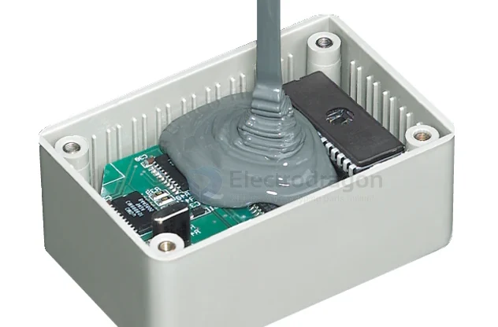

# PCB-potted-dat

- [[PCB-dat]] - [[PCB-potted-dat]]

## ref 

- [[engineering-dat]]

## restore 

Can a potted circuit board (PCB) be restored and taken apart?

**Removing potting compound from a circuit board to restore it is extremely difficult, but not entirely impossible.** It largely depends on the specific type of potting compound used.

Electronic potting compounds generally fall into three main categories, and their ease of removal varies drastically:

1. **Silicone**: **The easiest to remove.** It has an elastic, rubber-like texture. You can peel it off piece by piece using tweezers and a scalpel, or soften it with specific chemical solvents.
2. **Polyurethane (PU)**: **Moderate difficulty.** It has a tough texture, usually semi-hard or soft-rubbery. It can often be softened with heat or dissolved using organic solvents (such as acetone or dichloromethane).
3. **Epoxy Resin**: **Extremely difficult.** It cures hard like stone. Most chemical solvents have no effect on it, and forcefully prying it apart mechanically will almost certainly snap circuit traces, rip up solder pads, or crush surface-mount components.

---

### Common Removal and Disassembly Methods

- [[silicon-grease-dat]] 

If you must repair or salvage a potted circuit board, you can try these methods based on the type of resin:

#### 1. Mechanical Peeling (Best for Silicone / Soft PU)

* **Best for**: Elastic silicone or softer polyurethane compounds.
* **How to do it**: Use fine-tipped tweezers, a precision hobby knife (scalpel), or a heat gun set to a low temperature (around 150°C / 300°F). Carefully pry, slice, and peel the compound away from the edges of the components.
* **Caution**: Go slowly. Never pull forcefully, or you risk ripping surface-mount devices (SMD) or copper pads right off the board.

#### 2. Chemical Dissolution (Solvent Soaking)

* **Best for**: Most potting compounds *except* epoxy.
* **Common solvents**:
* **Acetone** or **Dichloromethane**: Can swell or soften certain polyurethanes and low-grade resins.
* **Specialized Epoxy Strippers**: Commercial chemical strippers formulated for electronic potting compounds (usually contain strong polar organic solvents).

* **How to do it**: Submerge the board (locally or entirely) in the solvent for hours or days until the compound softens or bubbles, then scrub away the residue with a soft brush.
* **Caution**: Strong solvents will dissolve plastic component housings, electrolytic capacitor sleeves, chip silkscreen printing, and some plastics. Always wear protective gear and work in a well-ventilated area.

#### 3. Thermal Softening (Heat)

* **Best for**: Thermoplastic potting compounds or certain polyurethanes.
* **How to do it**: Use a heat gun or a temperature-controlled heating plate to locally heat the area to around **120°C–180°C**. Many thermoset resins soften or become more brittle at elevated temperatures.
* **Caution**: Excessively high heat will melt solder joints, displace components, or cause the PCB substrate to blister and delaminate.

---

### Practical Advice and Recommendations

* **Evaluate the Repair Value**: Unless the electronics are rare, high-value, or irreplaceable, **it is almost always cheaper and faster to replace the board**. The labor time and risk of damaging components during chemical or mechanical stripping usually outweigh the cost of a new board.
* **Safety First**: Solvents like dichloromethane and acetone are toxic and flammable, and heating resins releases irritating fumes. Always operate in a **well-ventilated workspace** while wearing gloves and eye protection.
