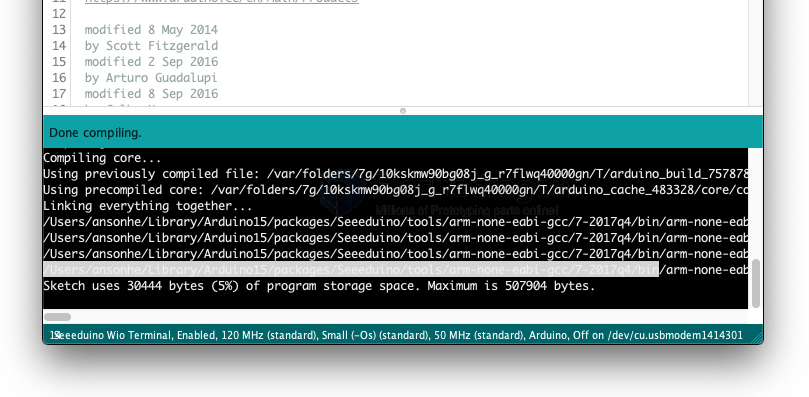

# GCC-dat

- [[arduino-ide-dat]] - [[arduino-elf-dat]] - [[SWD-dat]] - [[GDB-dat]] - [[GCC-dat]] file path - [[jlink-dat]] - [[ARM-dat]]

## obtain GCC path 

Under the same sketch compile log information, you can also find the GCC path used by Arduino of which also can be used for J-Link Debug Programmer later.

For example, in my case:

/Users/ansonhe/Library/Arduino15/packages/Seeeduino/tools/arm-none-eabi-gcc/7-2017q4/bin

## ref 

