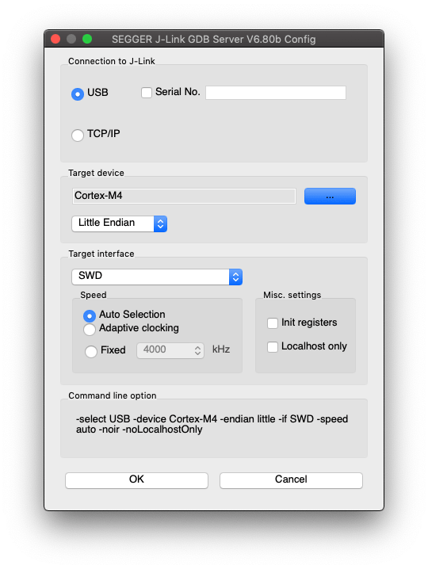
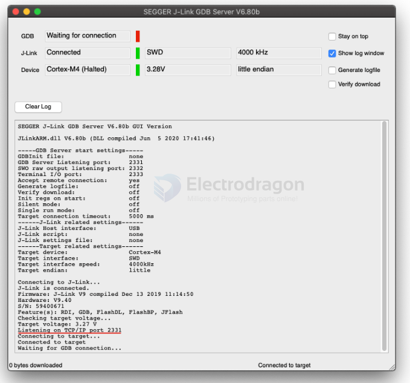
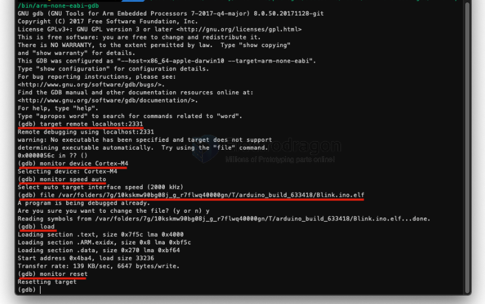

# GDB-dat


- [[arduino-ide-dat]] - [[arduino-elf-dat]] - [[SWD-dat]] - [[GDB-dat]] - [[GCC-dat]] - [[jlink-dat]] - [[ARM-dat]]


## JLINK GDB server

Connect the J-Link Debug Programmer to the PC and also power Wio Terminal from the USB port. Launch the J-Link GDB Server, select the following settings:

- Connection to J-Link: USB
- Target Device: Cortex-M4
- Target Interface: SWD



Select OK and if everything goes well you should see the following screen:




## GDB client 

Launching a GDB Client

Now you can launch the GDB Client by using the path we've saved earlier from the GCC path in Arduino. Open Terminal and paste the copied path + /arm-none-eabi-gdb:

For Example: /Users/ansonhe/Library/Arduino15/packages/Seeeduino/tools/arm-none-eabi-gcc/7-2017q4/bin/arm-none-eabi-gdb


`/Users/ansonhe/Library/Arduino15/packages/Seeeduino/tools/arm-none-eabi-gcc/7-2017q4/bin/` ++ `arm-none-eabi-gdb`

Run the following commands under gdb:

- target remote localhost:2331
- monitor device Cortex-M4
- monitor speed auto
- file + Arduino Sketch ELF File Path, i.e. file /var/folders/7g/10kskmw90bg08j_g_r7flwq40000gn/T/arduino_build_633418/Blink.ino.elf
- load
- monitor reset





### GDB init 

.gdbinit Method

You can also create a .gdbinit file, copy the following and save it in the ~/ location to avoid keep repeating setting process for gbd.

target remote localhost:2331
monitor device Cortex-M4
monitor speed auto
file /var/folders/7g/10kskmw90bg08j_g_r7flwq40000gn/T/arduino_build_633418/Blink.ino.elf
load
monitor reset

### debugging 

Debugging
Some useful commands for GDB:

- continue/cont
- ctrl+c
- next
- break
- info break
- clear
- delete
- list


## info 

A **GDB Server** (GNU Debugger Server) is a small background program that runs on a target device or emulation environment to act as a bridge between the **GDB debugger** (running on your host computer) and the **hardware or software** you are trying to debug.

It allows you to debug software running on a completely different system—such as an embedded microcontroller (like an ARM Cortex-M chip), an Android phone, a virtual machine, or a remote server—over a network connection (TCP/IP) or a hardware interface (like JTAG or SWD).

---

### How It Works: The Host-Target Architecture

Debugging with a GDB server relies on a client-server model split across two machines (or environments):

1. **Host Machine (Your PC)**: Runs the full GDB client (e.g., `arm-none-eabi-gdb`). This is where you type commands (`break main`, `step`, `print variable`), view source code, and analyze state.
2. **Target Device (The Hardware/Remote System)**: Runs your compiled program alongside the **GDB Server**.
3. **The Connection**: The GDB client on your PC connects to the GDB server over a communication link (such as a TCP port via Wi-Fi/Ethernet, a USB serial port, or a hardware debug probe).

```text
+-----------------------+              TCP / Serial / JTAG              +-----------------------+
|      Host Machine     |  <---------------------------------------->  |     Target Device     |
|  (GDB Client + IDE)   |                                              |  (App + GDB Server)   |
+-----------------------+                                              +-----------------------+

```

---

### Why Do You Need a GDB Server?

* **Cross-Debugging (Embedded Systems)**: Microcontrollers (like STM32, ESP32, or AVR) do not have enough RAM, storage, or processing power to run a full interactive debugger like GDB directly on the chip. A lightweight GDB server runs on your debug probe (like an ST-Link, J-Link, or OpenOCD) or directly on a tiny RTOS to translate GDB commands into low-level hardware instructions.
* **Remote or Headless Environments**: If you are debugging a Linux daemon running on a headless embedded Linux board, a remote server (like `gdbserver`) lets you attach to the running process from your desktop workstation.
* **Security & Sandboxing**: It allows developers to debug software running inside containers, virtual machines, or emulators (like QEMU) without exposing the entire host environment.

---

### Common Examples of GDB Servers

* **`gdbserver`**: A native Linux utility included with GDB that attaches to processes running on remote Linux targets.
* **OpenOCD (Open On-Chip Debugger)**: An open-source server widely used with JTAG/SWD adapters for flashing and debugging ARM microcontrollers.
* **SEGGER J-Link GDB Server**: A high-performance, proprietary GDB server optimized for J-Link hardware probes.
* **Hardware-integrated servers**: Many modern microcontrollers and debug probes run a GDB server directly on their onboard firmware, exposing a TCP port over Wi-Fi or USB.


## ref 