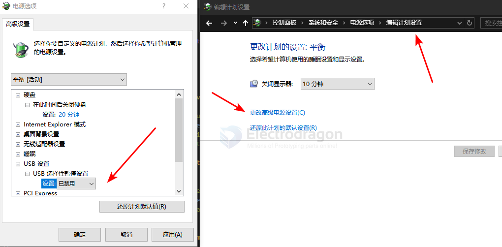

# WIN10-dat

- [[RTL8812AU-dat]] - [[WIN10-dat]] - [[USB-SDK-dat]]

- [[WIN10-net-dat]] - [[WIN10-dat]]

### 2. Windows powers USB down by default, so the USB adapter is cut off and re-enumerated — which looks like repeated plugging

1. Control Panel → Power Options → current power plan → Change advanced power settings
2. Expand: **USB settings → USB selective suspend setting**
3. Set it to: **Disabled** (both *On battery* and *Plugged in*)
4. OK → restart

USB settings 

## ref 