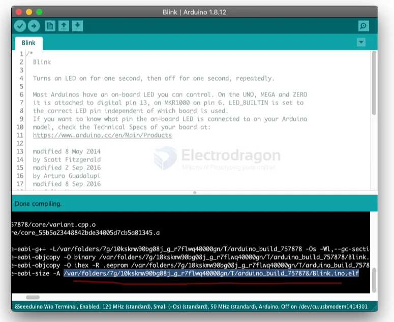

# arduino-elf-dat

- [[arduino-ide-dat]] - [[arduino-elf-dat]] - [[SWD-dat]] - [[GDB-dat]] - [[GCC-dat]]

In the settings of Arduino IDE, make sure that the Show verbose output during compilation and upload are both ticked.

Under the Arduino sketch you want to debug, click Compile (select Wio Termianl as board), and check the log information to get the path of the `.elf` file location. Let's take Blink as example:

Copy this path and it will be used later for `GDB`.

For example, in my case:

/var/folders/7g/10kskmw90bg08j_g_r7flwq40000gn/T/arduino_build_633418/Blink.ino.elf

## ref 