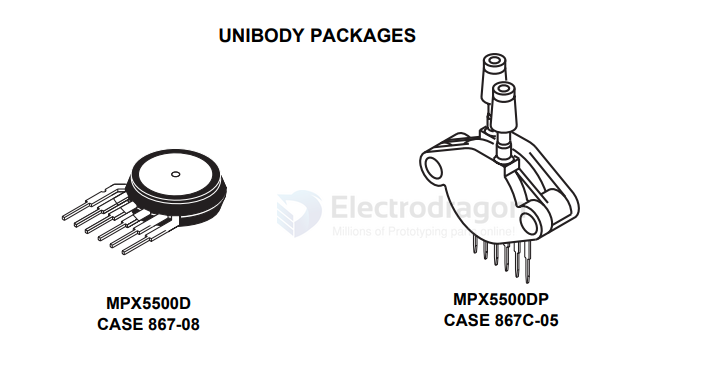

# sensor-pressure-dat

- [[sensor-dat]] - [[sensor-pressure-dat]]

`MPX5500DP` - SENSOR 72.52PSID 0.19" 4.7V == 	Pressure Sensor 72.52PSI (500kPa) Differential Male - 0.19" (4.93mm) Tube, Dual 0.2 V ~ 4.7 V 6-SIP Module

Integrated Silicon Pressure Sensor On-Chip Signal Conditioned, Temperature Compensated and Calibrated

0 to 500 kPa (0 to 72.5 psi)

0.2 to 4.7 V Output 

https://www.nxp.com/docs/en/data-sheet/MPX5500.pdf

## ref 