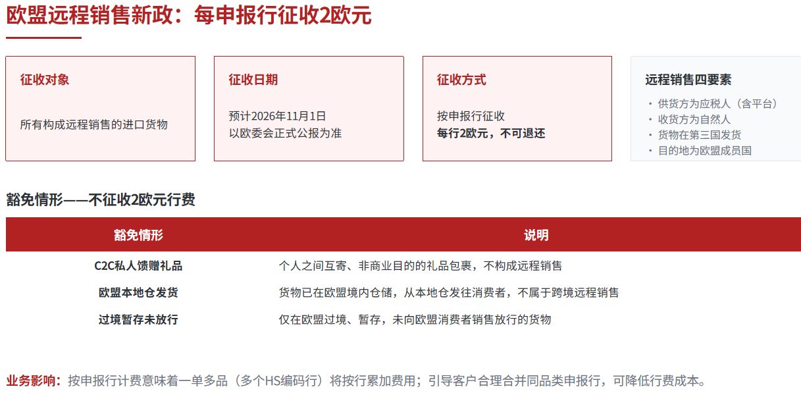
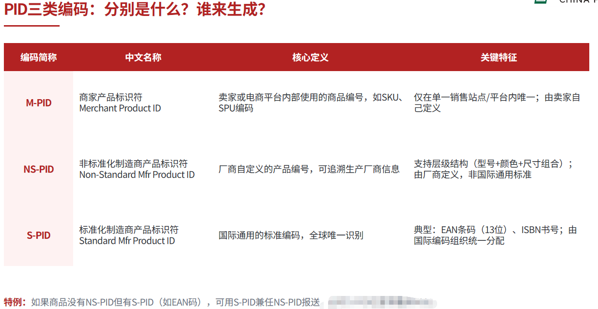
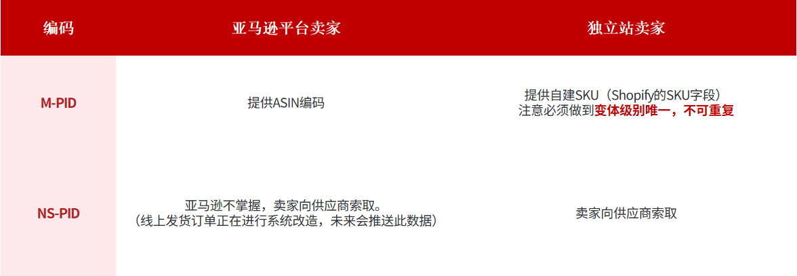

# customs-dat

- [[EUEX-V-dat]] - [[EUEX-V]]

- [[customs]] - [[shipment]]

## EU 

欧盟新政：欧盟产品标识符PID申报规则（2026年11月1日强制生效）

为落实欧盟海关改革法要求，应对跨境电商包裹量激增带来的监管压力，欧盟将进一步加强低货值跨境电商进口监管，以提升商品信息透明度、打击不实申报并防范产品合规风险。

自2026年11月1日起，针对从非欧盟地区发往欧盟国家、通过远程销售方式进口且货值不超过150欧元的商品，欧盟进口清关将新增产品标识符（PID，Product Identifier）申报要求。

产品标识符（PID）是用于识别和追踪商品的关键信息，可帮助欧盟海关识别商品对应的品牌或销售主体、制造商及具体产品，从而加强商品追溯与进口监管。

根据相关申报要求，商品信息涉及以下三类产品标识符：

处理费收取及PID产品标识符填报规则

欧盟国家最终计费：运费+临时关税3欧元  每item+2欧元 每item+如无IOSS税号代缴税费

## US 

## ref 

