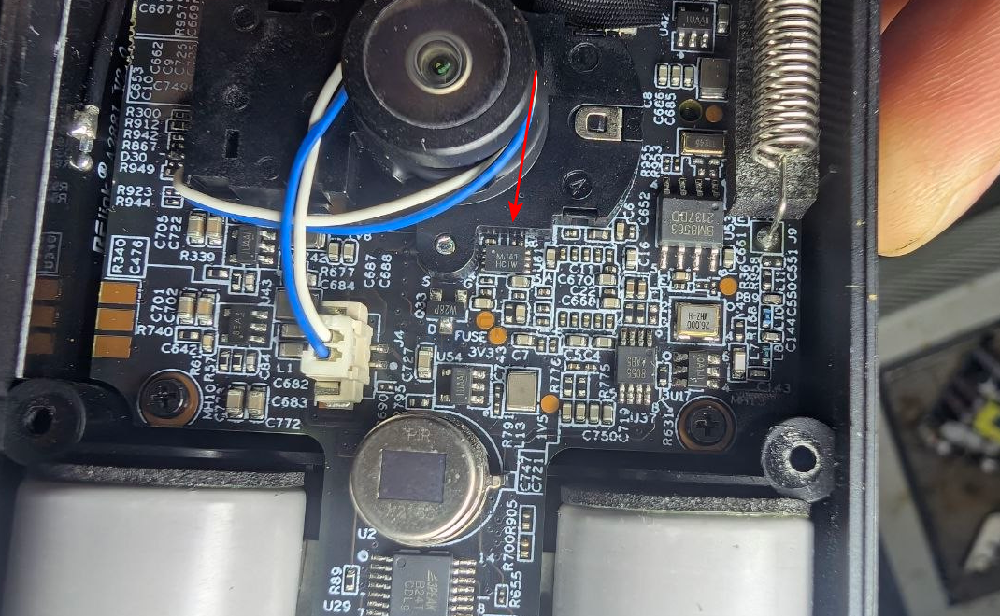

# HSM-dat

- [[HSM-dat]] - [[Wireless-Video-Doorbell-dat]] - [[xiaomi-dat]] - [[IOT-dat]]

The `MJA1-HCIW` is a proprietary second-generation hardware security module (HSM) / secure chip developed by Xiaomi for its smart home and IoT ecosystem.

Key specifications and details

- • Market designation. The MJA1-HCIW variant is designated for IoT hardware products sold in the domestic (Chinese) market. (For international/overseas products, Xiaomi uses the `MJA1-SXIW` variant.)
- • Package. It uses a compact DFN-8 (2×3 mm) surface-mount package.
- • Interface. Communicates with the host processor over an I2C interface (typically at address 0x2A).
- • Security functions. Stores unique cryptographic keys and device certificates to authenticate devices, verify signatures, generate random numbers, and establish encrypted communication sessions for Xiaomi's IoT platform.
- • Generation. It succeeds Xiaomi's discontinued first-generation MJSC security chip.

## ref 