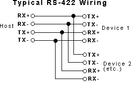

# RS422-dat

## Wiring

The following wiring should be correct for RS422 to RS422 

| RS422 pin | RS422 alias | target alias |target | 
| --------- | ----------- | ------------ |------ | 
| Y         | TXD+        | RXD-         |A      | 
| A         | RXD-        | TXD+         |Y      | 
| Z         | TXD-        | RXD+         |B      | 
| B         | RXD+        | TXD-         |Z      | 

this probably wrong or not P2P type 

- Y = TXD+ --- B = RXD+
- Z = TXD- --- A = RXD-
- B = RXD+ --- Y = TXD+
- A = RXD- --- Z = TXD-

| RS422 pin | RS422 alias | target alias |target | 
| --------- | ----------- | ------------ |------ | 
| Y         | TXD+        | RXD+         |B      | 
| Z         | TXD-        | RXD-         |A      | 
| B         | RXD+        | TXD+         |Y      | 
| A         | RXD-        | TXD-         |Z      | 

## Use with arduino

## Demo video 

- please refer to ESP32-ISO board 

## push pull resistor for fail-safe biasing

**Only needed** if the bus can become *idle* (tri-state) and needs *fail-safe biasing*.

---

# 1. Point-to-Point RS-422
**No pull-ups needed.**

- MAX490 outputs are **push-pull** (active drivers)
- They actively drive both HIGH and LOW
- A/B will not float

---

# 2. RS-485-Style Multi-Drop Bus (Tri-state Idle)
If your system has:

- multiple receivers  
- drivers that may **disable** (tri-state)  
- moments where *no one is driving the line*  

→ Then you **must add bias resistors**.

### Typical fail-safe bias network:
- **A → Pull-up 680–1kΩ**
- **B → Pull-down 680–1kΩ**
- **120Ω termination across A–B**

This ensures the bus stays in a known “mark” state.

---

# 3. Driver Always Enabled
**No bias resistors required.**

MAX490 will drive the line at all times → never floating.

---

# 4. Receiver Inputs Only
**Usually no pull-ups needed.**

- MAX490 receiver includes **internal fail-safe**
- Output goes HIGH if inputs:
  - are open,
  - shorted,
  - or idle.

---

# Summary Table

| Scenario | Need Pull-up/Down? | Reason |
|---------|---------------------|--------|
| Point-to-point RS-422 | ❌ No | Push-pull driver |
| Multi-drop RS-485-like bus | ✔️ Yes | Bus can float when idle |
| Driver always enabled | ❌ No | Never tri-states |
| Receiver-only use | ❌ No | Internal fail-safe exists |

## chips 

dual channels 

- SN65C1167E, SN65C1168E - SN65C116xE Dual Differential Drivers and Receivers With ±15kV ESD Protection

- [[TI-interface-dat]]

## names RS422 TIA-422 ITU-T V.11

**RS422**, **TIA/EIA-422-B**, and **ITU Recommendation V.11** are essentially different names and administrative generations for **the exact same core electrical signaling technology**. They describe balanced (differential) digital interface circuits capable of high-speed, long-distance data transmission.

The specific relation between them comes down to *who* published the standard, *when*, and for *what regional or international context*:

---

### 1. The Core Relationship: They are Interoperable Equivalents

Technically, a device built to comply with RS-422 will seamlessly communicate with a device built to ITU-T V.11. They share the same underlying physical layer principles:

* **Differential signaling:** Uses two complementary lines ($A$ and $B$) per signal, providing high immunity to common-mode electrical noise.
* **Topology:** Designed for single-source (one driver) to multi-target (typically up to 10 receivers) configurations.
* **Performance scope:** Supports data rates up to 10 Mbps (at shorter distances) and cable lengths up to 1,200 meters / 4,000 feet (at lower data rates).

---

### 2. Breakdown of Each Designation

#### A. RS-422 (Recommended Standard 422)

* **Origin:** Published originally in 1975 by the **EIA** (Electronic Industries Alliance) in the United States.
* **What it means:** The "RS" prefix stands for Recommended Standard. Over decades, it became the universally recognized shorthand name used by engineers globally for differential serial communication.

#### B. TIA/EIA-422-B

* **Origin:** The formal modernization and continuation of the standard by the **TIA** (Telecommunications Industry Association).
* **What it means:** As standards organizations evolved, the EIA partnered with the TIA. **Revision B** (published in May 1994 and subsequently reaffirmed) is the updated, official American National Standards Institute (ANSI) designation for the standard. When modern semiconductor manufacturers design line drivers/receivers (like the AM26C31/AM26C32) and state compliance, they typically cite **TIA/EIA-422-B**.

#### C. ITU Recommendation V.11 (also known as X.27)

* **Origin:** Published by the **ITU-T** (International Telecommunication Union - Telecommunication Standardization Sector, formerly CCITT).
* **What it means:** This is the **international global equivalent** to RS-422. While TIA/EIA-422-B is heavily favored in North American commercial and industrial markets, ITU-T V.11 is the formal standard used internationally within telecommunications infrastructure (often referenced alongside physical connector standards like X.21).

---

### Summary of Differences

* **Naming Authority:** RS-422/TIA-422 is managed by the US-based TIA, whereas V.11 is managed by the global, UN-governed ITU.
* **Minor Nuances:** While the electrical characteristics (common-mode voltage range of $-7\text{V}$ to $+7\text{V}$, differential thresholds, etc.) are virtually identical, formal testing documentation and exact short-circuit current parameters (`Ios`) can have minute discrepancies between the US commercial specifications and the international telecom specs. In practical implementation, however, integrated circuits marketed as RS-422 or V.11 are treated as interchangeable.

## ref

https://en.wikipedia.org/wiki/RS-422
https://www.omega.com/en-us/resources/rs422-rs485-rs232

- [[DPR1097-dat]] - [[MAX490-dat]]

- [[RS422]] - [[DPR1097]]

- [[push-pull-driver]] - [[open-drain-open-collector-dat]] - [[circuits-dat]]

