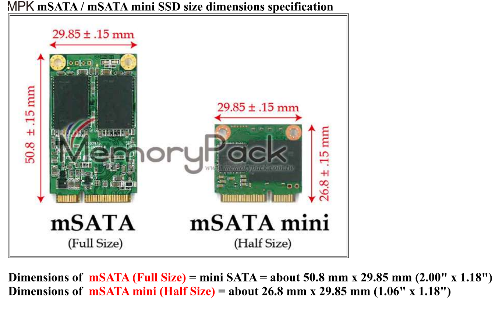
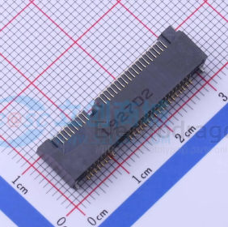
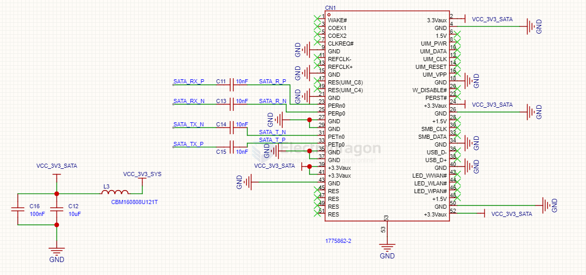
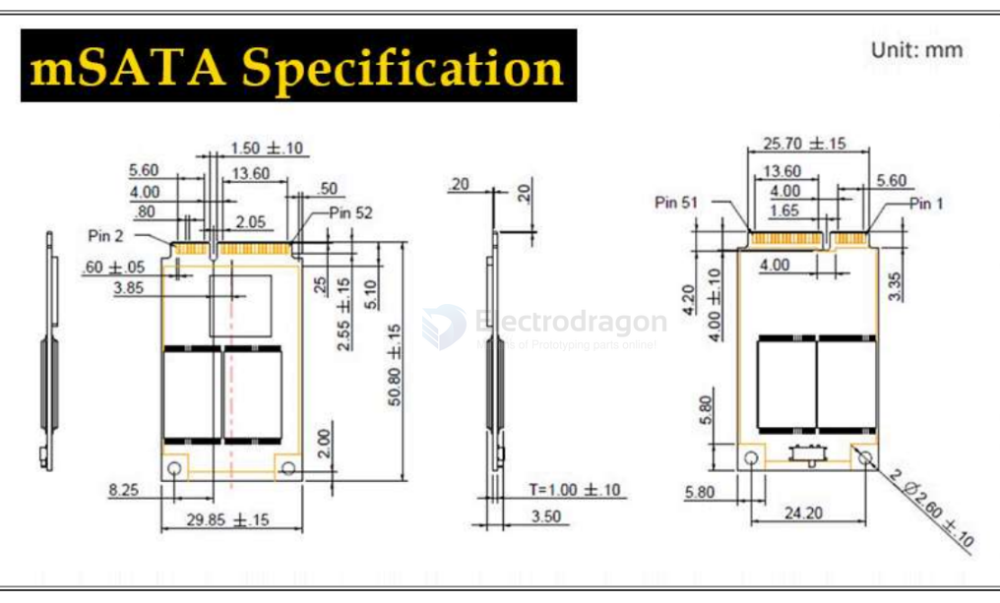
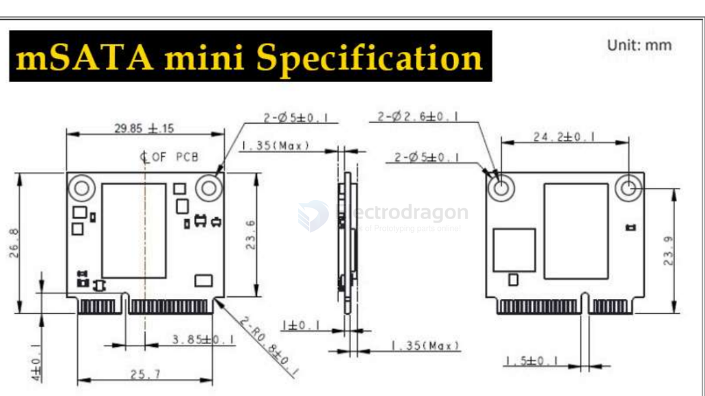
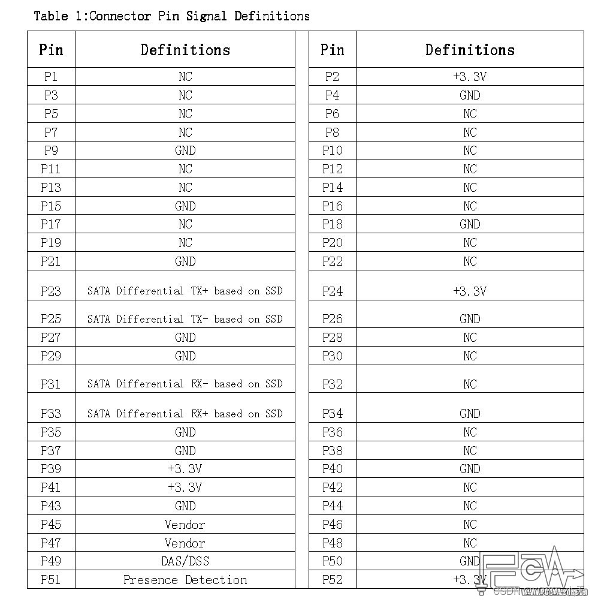

# mSATA-dat

- [[NAS-dat]] - [[mSATA-dat]]

1775862-2
- 品牌 - TE Connectivity(泰科电子)
- 封装 - SMD,P=0.8mm,卧贴
- 类目 - 硬盘连接器(SAS/SATA/M.2)

## SCH 

## specs 

full-height 

half-height 

## pin definitions 

## ref 

