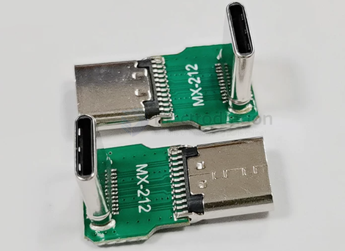
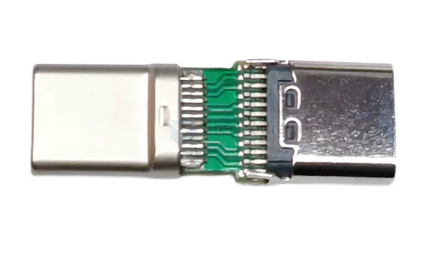
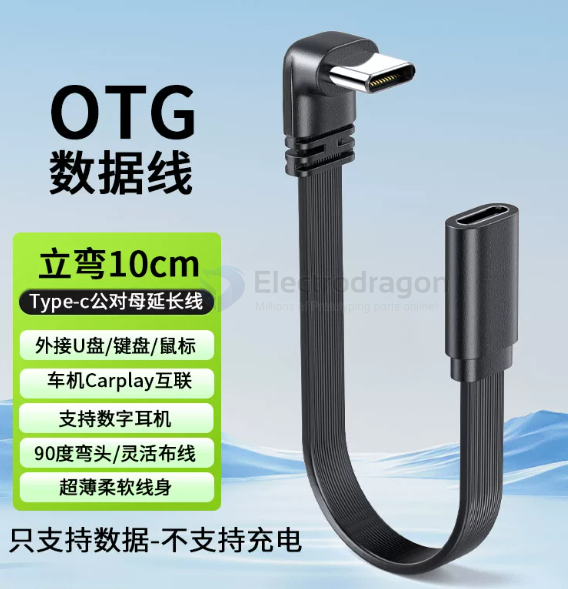

# USB-converter-dat

- [[USB-converter-dat]] - [[USB-hub-dat]] - [[USB-3.1-dat]] - [[USB-tethering-dat]] - [[USB-SDK-dat]] - [[USB-SDK]]

**直接结论：仅仅把 24-pin 1对1（Pin-to-Pin）物理直通焊出来的转接板“一分二”，是绝对不行的；但如果你买的是带协议芯片、且只是作为“公母头延长/90度转角/测试引出”的单路 24-pin 满血直通转接板，在特定连接方式下才可用。**

具体分为以下两种情况，千万不要买错：

### 1. 为什么“1分2 物理 Pin-to-Pin 飞线分线板”不可行？（最容易踩的坑）

如果你买的是那种把一个 Type-C 公头、直接按引脚 1对1 并联焊出两个 Type-C 母座（一个接外设、一个接充电器）的纯物理转接板：

* **USB 协议是点对点拓扑，不能靠焊线“一拖二”并联**：数据线（`D+/D-`、`TX/RX`）和配置线（`CC1/CC2`）直接并联会导致信号冲突、阻抗失配，轻则完全无法识别设备，重则烧毁手机接口或电源管理芯片（PMIC）。
* **供电与角色逻辑冲突**：如果充电器直通 `VBUS` 给手机，而手机同时处于 OTG 主机（Host）模式对外输出 5V 供电，两路 5V 电源直接在 `VBUS` 上对顶，存在极高的硬件损坏风险。
* **正确做法**：要实现“边充电 + 边连网络/USB外设”，必须通过内置 **USB Hub 主控芯片 + PD 协议识别芯片** 的拓展坞进行逻辑分流，不能用纯物理 Pin-to-Pin 分线板。

---

### 2. 什么情况下“24-pin Pin-to-Pin 转接板”是可以用的？

- 外接U盘/键盘/鼠标
- 车机Carplay互联 - [[carplay-dat]]
- 支持数字耳机

只有当它是一个 **1进1出（1公转1母，或母转母）的满血直通转接板**（例如 90 度弯头转接器、或者把 Type-C 引出到 2.54mm 排针的 24P 调试测试板），并且满足以下条件时才可用：

* **24 根引脚全部独立导通、互不短接**：`CC1` 对应 `CC1`、`CC2` 对应 `CC2`、`TX/RX` 差分对等长且有完整接地屏蔽。
* **它的作用仅仅是“延长或转接”**：比如把它插在 Pixel 2 XL 底部，后面再接上**正规的带协议芯片的 USB-C 拓展坞 / USB 网卡**，这种单链路直通是没问题的。

---

### 给你的避坑与实操建议

如果你想在 Pixel 2 XL 上稳定实现 **“有线连路由器（访问 `192.168.0.4:8080`） + 外部供电不掉线”**：

1. **不要买纯物理无芯片的“24pin 一分二转接板”**。
2. 直接买成品的 **“Type-C 转 RJ45 千兆网口 + PD 充电口”二合一/多合一拓展坞**（内置 **AX88179** 或 **RTL8153** 网卡芯片 + PD 协议芯片）。这类成品内部已经做好了 `CC` 角色切换和电源隔离，插上就能让 Pixel 2 XL 稳定识别有线以太网并同时充电。

- [[AX88179-dat]] - [[RTL8153-dat]] - [[USB-controller-dat]] - [[USB-hub-dat]] - [[USB-converter-dat]]

## ref 

