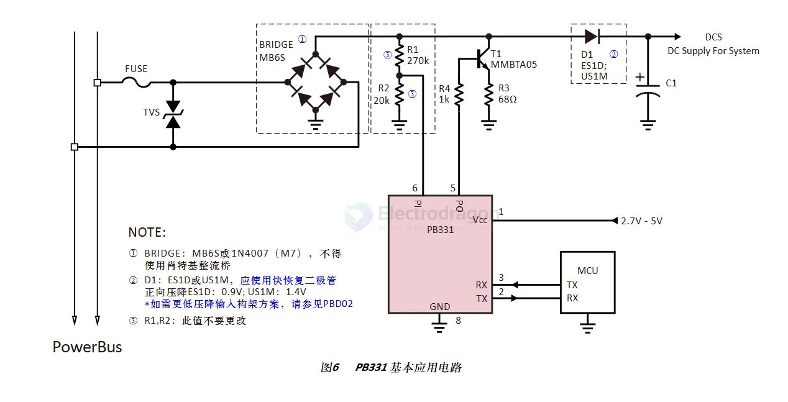
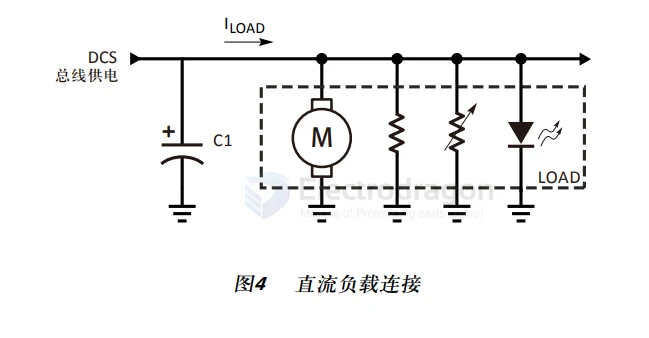
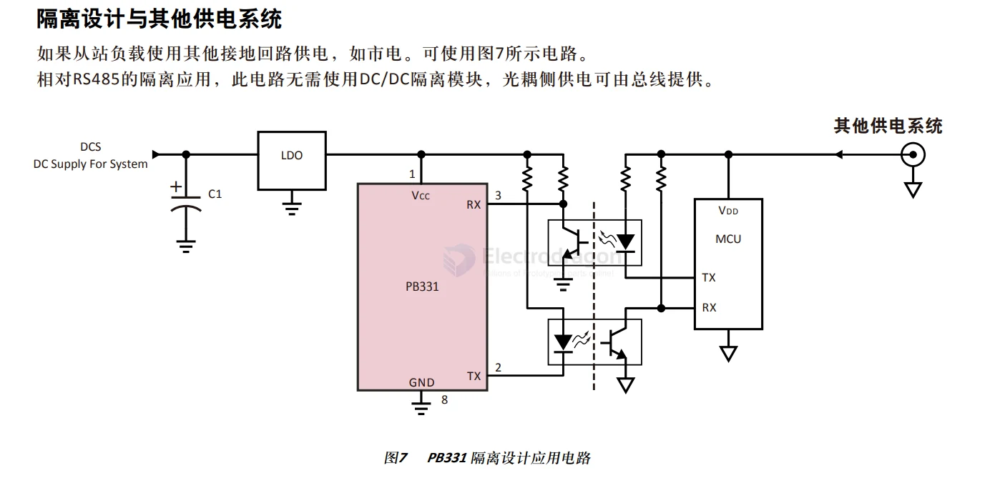

# PB331-dat

- [[powerbus-dat]] - [[PB331-dat]] - [[serial-dat]] - [[ITF1009-dat]]

- [[POWERBUS-PB331.pdf]] 

## SCH 

STD 

NOTE:
- BRIDGE: MB6S或1N4007(M7)，不得使用肖特基整流桥
- D1：ES1D或US1M，应使用快恢复二极管正向压降ES1D：0.9V;US1M：1.4V *如需更低压降输入构架方案，请参见PBD02
- R1,R2：此值不要更改

## load 

POWERBUS总线是智能低压供电二总线，负载可以是任意负载：阻性，感性。负载可以是；电动机、步进电机、电热执行器、继电器、高功率LED。负载电流动态变化，不会影响通讯。

## power 

POWERBUS总线工作电压

PowerBUS最低工作电压需要总线峰值电压在12V以上。请选择合适的主站电压，保证经过传输线后远端从站接口电压峰值大于等于12V即可。

## isolated communication and seperated ground 

- [[optical-coupler-dat]] - [[PB331-dat]] - [[serial-dat]]

## ref 

