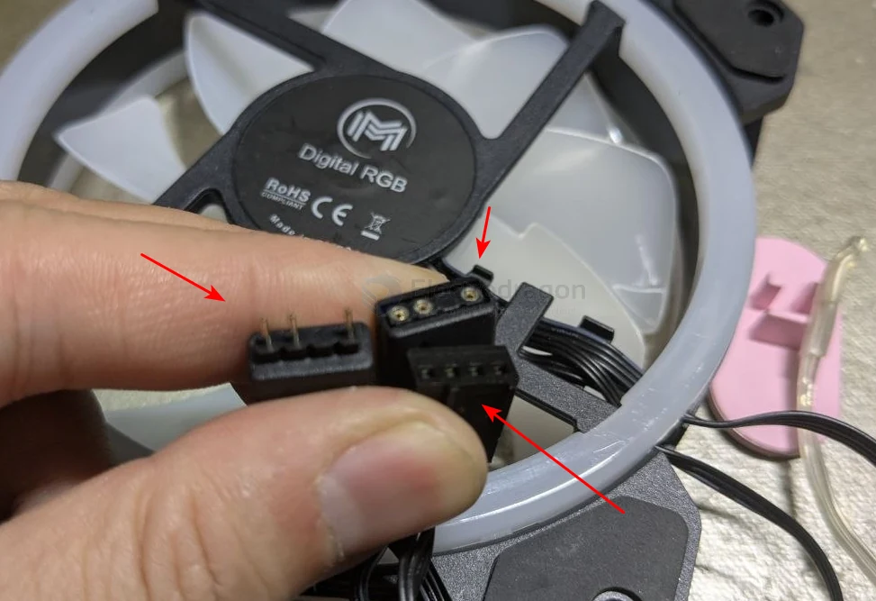

# fan-PC-RGB-dat

- [[fan-dat]] - [[fan-PC-RGB-dat]]

## build 

## info 

The connector you are describing is the standard **3-pin 5V Addressable RGB (ARGB / D-RGB)** PC fan/lighting header, often referred to as a **3-pin 5V D-G-V** or **VDG (with blocked key)** connector.

### Pinout Breakdown (4-pin width, Pin 3 blocked)

Looking at the connector with the **Pin 1 arrow/triangle** on the left:

| Pin # | Physical State | Signal / Function | Typical Wire Color / Marking |
| --- | --- | --- | --- |
| **Pin 1** | Active | **+5V DC** (Power) | Marked with a small triangle/arrow `▲` or `+5V` |
| **Pin 2** | Active | **Data (D / DI)** | Addressable digital signal (`D` or `DIN`) |
| **Pin 3** | **Blocked / Missing** | *Keyed / Empty* | Plugged hole on the female connector; missing pin on motherboard |
| **Pin 4** | Active | **Ground (GND)** | Marked `G` or `GND` |

---

### Why Is Pin 3 Missing?

1. **Physical Polarization (Keying):** Older **12V RGB** headers use a **4-pin** layout (`12V - G - R - B`) with all four pins present. By physically blocking Pin 3 on the 5V ARGB plug and omitting Pin 3 on the motherboard header, it prevents you from accidentally plugging a **5V ARGB** device into a **12V RGB** header—which would instantly burn out the 5V addressable LEDs.
2. **Legacy Compatibility (Gigabyte VDG):** Some older Gigabyte motherboards had a 3-pin header without the gap (Pins 1-2-3 side-by-side, labeled `V-D-G`), which is why some ARGB fan cables include a small adapter branch with a solid 3-pin `VDG` plug alongside the standard `1-2-[blank]-4` plug.

---

### Important Safety Notes

* **Never force it** onto a 4-pin header that has all 4 metal pins intact (that is a **12V non-addressable RGB** header or a **4-pin PWM fan motor** header).
* On your motherboard, look for headers labeled **`ADD_GEN2`**, **`ARGB`**, **`D_LED`**, **`JRAINBOW`**, or **`5V_D_G`**—those will have the matching 3 metal pins with the 3rd pin missing.

## data 

The **Data (Pin 2)** line on a standard 5V PC ARGB fan uses a **single-wire, asynchronous serial protocol** compatible with **WS2812B / SK6812 / WS2811** addressable LEDs (also known as NeoPixels).

Because there is no separate clock wire, the LED controller chip inside each LED relies on **strict pulse-width timing** at **800 kHz** (1.25 µs per bit) to tell the difference between a `0` and a `1`.

---

### 1. Electrical & Timing Protocol (800 kHz NRZ)

* **Voltage Level:** **5V TTL logic** (High = ~5V, Low = 0V). *(Note: If you drive it from a 3.3V microcontroller like an ESP32/STM32, a 3.3V-to-5V level shifter is recommended for reliable signaling, though short wires sometimes work directly).*
* **Bit Period:** **1.25 µs** per bit (800 kbps).
* **How `0` and `1` are encoded:** Every bit starts with a rising edge (`HIGH`), followed by a falling edge (`LOW`). The **duty cycle** (width of the `HIGH` pulse) determines the bit value:

| Symbol | High Time ($T_H$) | Low Time ($T_L$) | Total Bit Time |
| --- | --- | --- | --- |
| **Bit `0**` | **~0.35 µs** (350 ns) | **~0.90 µs** (900 ns) | 1.25 µs |
| **Bit `1**` | **~0.70 µs** (700 ns) | **~0.55 µs** (550 ns) | 1.25 µs |
| **Reset / Latch** | — | **> 50 µs** (up to 300 µs for newer SK6812/WS2812B-V5) | — |

*(Tolerance is typically ±150 ns).*

---

### 2. Data Frame Structure (Color Order)

Each LED in the fan consumes **24 bits (3 bytes)** of color data (8 bits per channel = 256 brightness levels per color):

* **Byte Order (Standard WS2812B / PC ARGB):** **`G - R - B`** (Green first, then Red, then Blue), **MSB (Most Significant Bit) first**.
* Bits `23..16`: **Green** (`G7` down to `G0`)
* Bits `15..8`: **Red** (`R7` down to `R0`)
* Bits `7..0`: **Blue** (`B7` down to `B0`)

*(Note: Some older WS2811-based strips use `R-G-B` order, and RGBW strips use `G-R-B-W` 32-bit frames, though almost all standard PC ARGB fans use 24-bit `GRB`).*

---

### 3. Daisy-Chaining (How Multiple LEDs in a Fan Work)

A typical PC ARGB fan has **8 to 24 LEDs** wired in series internally:

1. You send a continuous stream of $N \times 24$ bits (e.g., for 12 LEDs, $12 \times 24 = 288$ bits) without pausing.
2. **LED #1** captures and strips off the **first 24 bits**, then reshapes and forwards all remaining bits out of its `DOUT` pin to **LED #2**.
3. **LED #2** takes the next 24 bits and passes the rest to **LED #3**, and so on down the chain (and out the fan's pass-through ARGB connector if you daisy-chain multiple fans).
4. Once all bits are sent, you hold the Data line **LOW (`0V`) for > 50–300 µs** (**Reset / Latch code**). All LEDs simultaneously update their PWM outputs to display the new colors.

---

### 4. Practical Firmware Implementation

Because bit-banging 350 ns / 700 ns pulses in C loops requires disabling interrupts and counting CPU cycles, developers normally offload waveform generation to hardware peripherals:

* **ESP32 / ESP32-S3:** Use the **RMT (Remote Control Transceiver)** peripheral or **I2S/SPI DMA** (or libraries like `FastLED` / `Adafruit_NeoPixel` / ESP-IDF `led_strip`).
* **STM32 / AVR:** Use **SPI MOSI** at ~2.4–3.2 MHz (encoding 1 LED bit as 3 or 4 SPI bits, e.g., `100` for `0` and `110` for `1`) or **Timer + DMA** PWM.

## ref 