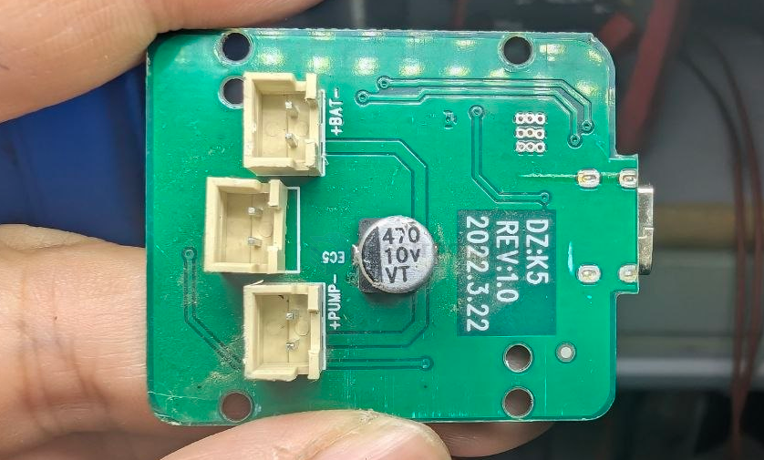

# fan-driver-dat 

- [[driver-hardware-dat]] - [[motor-driver-dat]] - [[fan-driver-dat]] - [[LED-driver-dat]]

## EMC2301

The EMC2301 is an SMBus compliant fan controller with a PWM fan driver. The fan driver is controlled by a programmable frequency PWM driver and Fan Speed Control algorithm that operates in either a closed loop fashion or as a directly PWM-controlled device.

https://www.microchip.com/en-us/product/emc2301

## chip

- [[fuman-dat]] - [[FM5012F-dat]] - [[fan-driver-dat]] - [[pump-dat]]

## build 

build 2 

- [[fuman-dat]] - [[XMC8P53-dat]] - [[MCU-dat]] - [[fan-driver-dat]]

build 1 

## ref 

