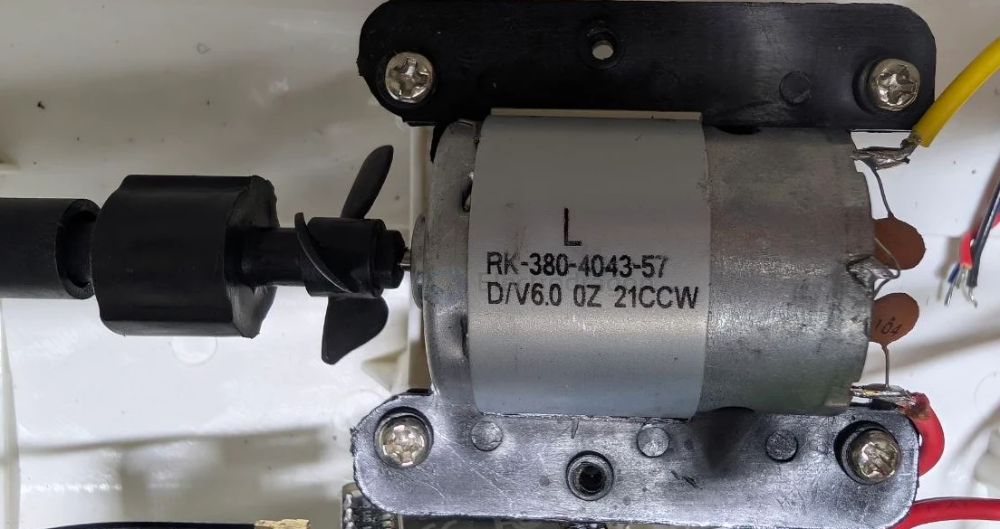
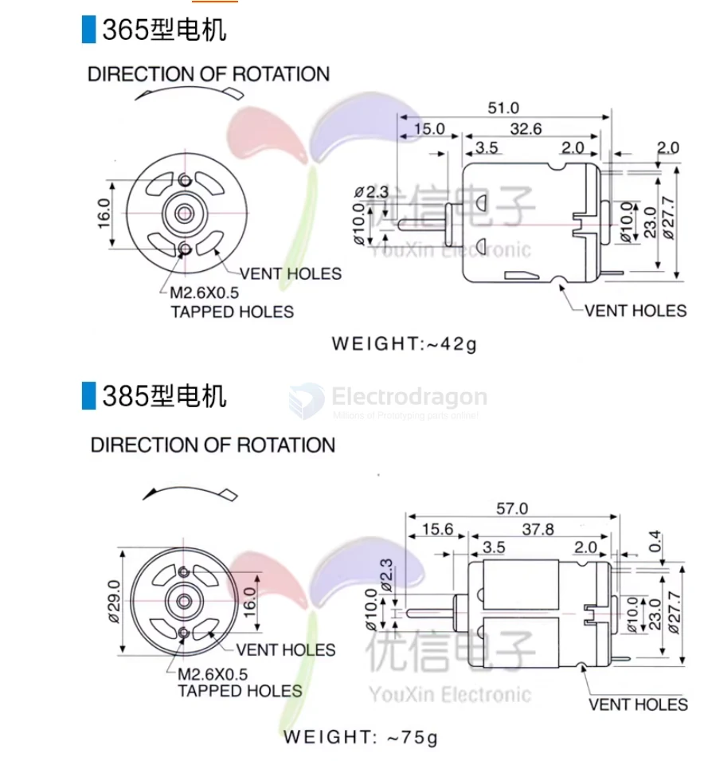
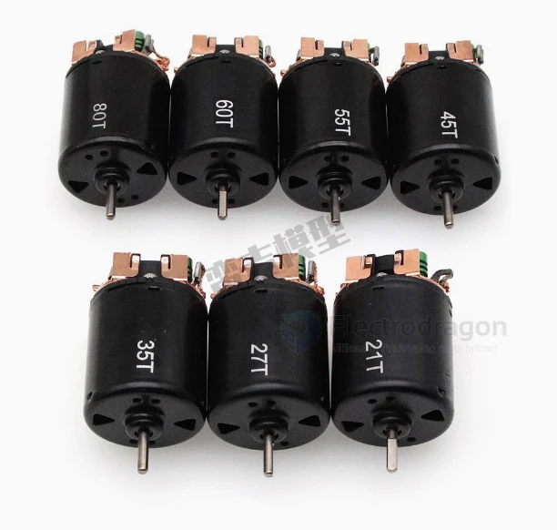
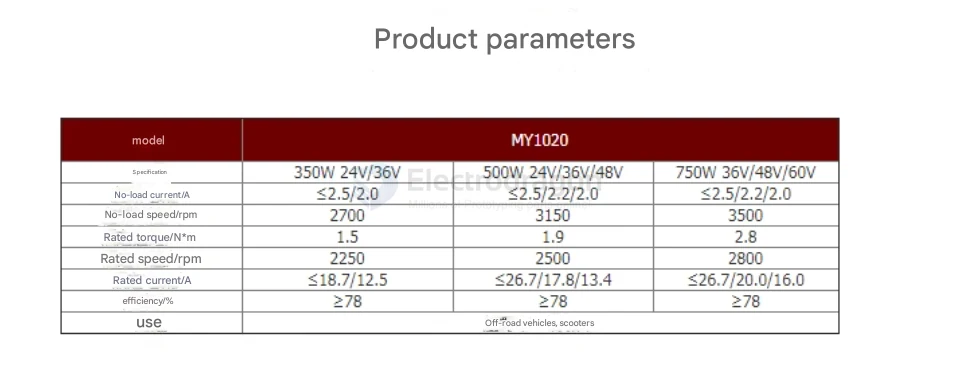
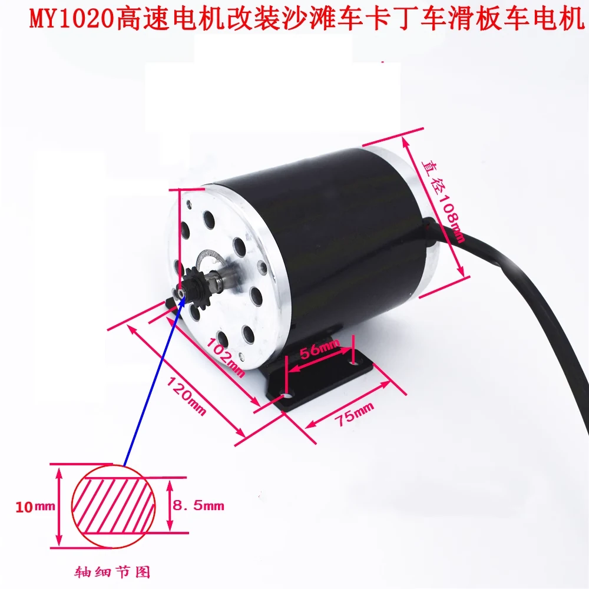

# motor-brushed-dat


- [[Motor-brushed-Coreless-dat]] - [[motor-dat]] - [[motor-brushed-dat]]


- [[motor-540-dat]] - [[motor-380-dat]] - [[motor-130-dat]] - [[motor-brushed-dat]]


## examples motor-380 for boat 

RK-380-4043-57
D/V6.0 0Z 21CCW

- [[rc-boat-dat]] - [[motor-380-dat]] - [[motor-brushed-dat]] - [[motor-dat]] - [[TA6586-dat]] - [[MC10_10A-dat]] - [[BTS7960-dat]]




### Part 1: The Motor Specs (`RK-380-4043-57`)

* **RK / R:** Represents a round metal-can brushed DC motor. 
* **3:** Represents the rotor/armature diameter size class (a 300-series motor, very common in small RC boats, cars, and hand-held tools).
* **8:** Represents the length of the motor housing (an "8" indicates a longer, higher-torque variation of the 300 class).
* **0:** Indicates it uses a standard 3-slot or 5-slot commutator with permanent magnets.
* **4043:** This is the critical part for your speed variance. This is the **winding specification**. It means the internal coils have a wire diameter of **0.40mm** and are wound exactly **43 times** per slot.
* **57:** Usually denotes the specific magnet type or back-cover assembly configuration used in this production batch.

---

### Part 2: The Rotational Direction (`D/V6.0 0Z 21CCW`)

The second line gives us the manufacturing date/voltage line, but the most important part is the very end: **`CCW` (Counter-Clockwise)**.

Brushed DC motors like the 380 series are often manufactured with **internal timing advance**. To maximize efficiency and power, the internal carbon brushes are slightly rotated from the physical center to favor one direction of rotation.

#### Why this matters for your RC Boat:
If your twin-propeller boat is configured using a **counter-rotating setup** (where the left propeller spins clockwise and the right propeller spins counter-clockwise to cancel out torque roll), you might have one motor running forward and the other running in reverse.

* A motor optimized for **CCW** will naturally spin **faster** and draw less current when running Counter-Clockwise.
* If you force that same motor to run **CW** (by reversing the polarity/wires), it will fight its own internal brush timing, resulting in **lower RPM, higher current draw, and more heat generation**.

### How to use this information to fix your problem:

1. **Check the Rotation Direction:** Look at your boat from behind. Are both props spinning the same way, or are they spinning in opposite directions? If one is running CW and one is running CCW, the motor running CW will naturally be the slower one because it's running "backward" relative to its internal timing.
2. **Implement Your Code Scaling:** Because these are standard brushed 380 motors without internal encoders, they are highly prone to variance. You can safely implement the **Open-Loop Compensation** method we discussed earlier. 

If you are using a microcontroller to drive them, keep the CCW-running motor (or the naturally slower one) at 100% throttle, and scale down the faster one by multiplying its PWM signal by a factor (e.g., `0.90` or `0.92`) until the boat drives perfectly straight.


## Small Brushed DC Motor Series


- [[motor-130-dat]] - [[motor-380-dat]]


| Motor Series | Size (approx.)  | Voltage Range | Typical Power | Common Use                                |
| ------------ | --------------- | ------------- | ------------- | ----------------------------------------- |
| **N20**      | 10 × 12 × 15 mm | 3V – 12V      | <1 W          | Micro robots, locks, cameras              |
| **030**      | ~15 mm length   | 1.5V – 3V     | <0.5 W        | Tiny toys, fans                           |
| **130**      | ~20 mm length   | 1.5V – 6V     | ~1–3 W        | Toys, vibrators, mini fans                |
| **180**      | ~25 mm length   | 1.5V – 6V     | ~2–4 W        | Small models, RC cars                     |
| **230**      | ~30 mm length   | 6V – 12V      | ~5–20 W       | Toys, small tools, RC models              |
| **260**      | ~32 mm length   | 6V – 12V      | ~10–25 W      | Slot cars, drills, small pumps            |
| **280**      | ~35 mm length   | 6V – 18V      | ~15–30 W      | Toys, CD drives, robotics                 |
| **360/365**  | ~40 mm length   | 6V – 18V      | ~20–50 W      | Hobby tools, gearboxes                    |
| **380**      | ~45 mm length   | 6V – 18V      | ~20–60 W      | RC cars, fans                             |
| **390**      | ~48 mm length   | 6V – 24V      | ~30–70 W      | Motors with higher torque                 |
| **540**      | ~55 mm length   | 6V – 24V      | ~50–150 W     | RC cars, robots, small drills             |
| **550**      | ~60 mm length   | 6V – 24V      | ~75–200 W     | Power tools, gearboxes                    |
| **775**      | ~70 mm length   | 12V – 24V     | ~150–350 W    | High-power drills, CNC, mobility projects |
| **895**      | ~80 mm length   | 12V – 36V     | ~200–500 W    | High torque, heavy loads                  |

365 type motor : 12V - 11600rpm

385 type motor : 12V - 10000rpm




- more powerful motors  - [[Motor-reduction-Gear-dat]] - [[motor-TT-dat]]

- [[motor-brushless-dat]]


## 1. 45T / 55T Motors

- **"T" = Turns** of wire on the motor armature.
- **Higher T (e.g., 55T)** = **More torque, lower speed**.
- **Lower T (e.g., 12T)** = **Higher speed, lower torque**.
- Typically **540-size** brushed motors.
- Commonly used in **RC crawling/trailing** for torque and control.
- A **45T motor** has **45 wraps (turns)** of copper wire around each pole of the armature.
- The number of turns affects the **motor's speed and torque**.

Series = 19T / 21T / 27T / 35T / 45T / 55T / 60T / 80T



### Summary Table

| Spec   | 45T / 55T Motor       | 130 / 230 Motor           |
| ------ | --------------------- | ------------------------- |
| Type   | Brushed RC Motor      | Toy motor                 |
| Size   | 540-class             | Small can-type            |
| Torque | High (esp. 55T)       | Low                       |
| Speed  | Low (esp. 55T)        | Moderate                  |
| Usage  | RC crawling, trailing | Toys, fans, small gadgets |


### 🔧 Approximate Torque Value
- **Torque (stall):** ~300 to 400 g·cm (gram-centimeter)
- **At 7.2V to 7.4V (common RC voltage)**

> ⚠️ Note: This is an estimate. Some high-end 45T motors may produce more torque.

### 📊 Comparison Table (Typical RC Motors at 7.2V)

| Motor Type | Turns | Torque (g·cm) | Speed (RPM)    |
| ---------- | ----- | ------------- | -------------- |
| Racing     | 12T   | ~100–150      | ~30,000–35,000 |
| Balanced   | 27T   | ~200–250      | ~15,000–20,000 |
| Torque     | 45T   | ~300–400      | ~9,000–11,000  |
| Crawler    | 55T   | ~400–500      | ~7,000–9,000   |

- [[torque-dat]]

## 📊 Size Comparison Table

| Motor Name | Diameter (mm) | Length (mm) | Power Level        | Common Use                         |
| ---------- | ------------- | ----------- | ------------------ | ---------------------------------- |
| 130        | ~15.5         | ~20         | Small / Light-duty | Toys, small fans                   |
| 230        | ~24           | ~30         | Medium             | DIY cars, small robots             |
| 260        | ~24           | ~36         | Medium-High        | Hobby motors, gear motors          |
| 280        | ~24           | ~45         | High               | RC cars, small drills              |
| 380        | ~28           | ~50–60      | Very High          | Power tools, electric screwdrivers |
| 540        | ~36           | ~50         | Ultra High         | RC racing cars, e-bikes            |


## 130 Motor Overview

The **130 motor** is a type of **DC motor** commonly used in toys, small appliances, and DIY electronics projects.

### 🔧 Type

- **Type:** Permanent Magnet Brushed DC Motor
- **Category:** Small-size DC Motor

### ⚙️ Specifications (Typical)

- **Voltage Range:** 1.5V – 6V (Commonly 3V or 5V) ??? try up to 7V 
- **High RPM:** Often from a few thousand to over 10,000 RPM
- **Low Torque:** Suitable for light-load applications
- **Brush Type:** Brushed (uses carbon brushes and a commutator)


## 230 Motor Overview

The **230 motor** is a small **DC motor**, similar in design to the 130 motor but typically **larger in size and power**.

### 🔧 Type

- **Type:** Permanent Magnet Brushed DC Motor
- **Category:** Medium-size DC Motor

### ⚙️ Specifications (Typical)

- **Voltage Range:** Often 3V – 12V
- **Higher Torque and Power** than 130 motor
- **Medium RPM** (usually lower than 130 motor, but stronger)
- **Brush Type:** Brushed (uses carbon brushes)

## Why Is It Called a "230 Motor"?

The name **"230 motor"** comes from an informal naming convention based on the **size of the motor case**, not the voltage or power.

### 📐 Meaning of "230"

- **"2"** = Series or form factor group
- **"30"** = Approximate **length of the motor case in millimeters** (~30 mm)

So, a **230 motor** typically has:
- **Diameter:** ~24 mm
- **Length:** ~30 mm


## 895 motor drive 

## 🔧 Basic Requirements to Drive an 895 Motor

| Item                          | Purpose                                          | Example                                            |
| ----------------------------- | ------------------------------------------------ | -------------------------------------------------- |
| **Power Supply**              | Feeds the motor with appropriate voltage/current | 12V–36V DC, 10–30A depending on load               |
| **Motor Driver / Controller** | Controls speed and direction                     | H-Bridge (e.g., BTS7960, VNH2SP30), PWM controller |
| **PWM Signal (optional)**     | Varies motor speed via duty cycle                | From Arduino, Raspberry Pi, or ESC                 |
| **Heat Dissipation**          | Prevents overheating during operation            | Heatsinks, cooling fans                            |

- [[VNH2SP30-dat]] - [[BTS7960-dat]]

- [[ST-dat]]


## 🔄 3. 1000W+ Brushed DC Motors – ✅ *Direct power jump*

| Motor         | Voltage | Power     | Notes                            |
| ------------- | ------- | --------- | -------------------------------- |
| **MY1020**    | 24–48V  | 500–1000W | E-scooters, carts, heavy DIY use |
| **XYD-16/13** | 36–60V  | 1000W+    | High torque, brushed, affordable |







## issues

## Brushed DC Motor — Usage Taboos & Prevention Manual

### 0. Overview: life = min(insulation life, brush life)

- **Insulation life** is protected by *not overheating*.
- **Brush life** is protected by *not wearing the brushes out*.
- Every taboo below reduces to two rules:
  1. **Don't let it get hot** — stall / overload / overvoltage / poor cooling.
  2. **Don't let it spin unloaded for long** — brush wear ∝ RPM.

### 1. The three fatal things

#### 1.1 Stall (rotor locked / cannot turn) — the #1 killer

A motor that draws 0.9 A when running normally:

| Stall current | Stall power | Heating rate | Time to reach 130 °C |
| ------------- | ----------- | ------------ | -------------------- |
| 2.7 A         | 32 W        | 5.0 K/s      | 21 s                 |
| 4.5 A         | 54 W        | 8.3 K/s      | 13 s                 |
| 7.2 A         | 86 W        | 13.2 K/s     | 8 s                  |

> ⚠️ "I only powered it for a few seconds" looks harmless — but half the service life is already gone.

**Four sources of stall** (not only "something is jammed"):

| Source                        | Typical example                                                             |
| ----------------------------- | --------------------------------------------------------------------------- |
| Mechanical jam                | Seized bearing, debris/string wound on the shaft, locked gearbox            |
| Overload                      | Load torque > rated torque (over-tightened screw, blunt bit, thick mud)     |
| Undervoltage (weak battery)   | Battery cannot deliver breakaway torque → motor stays stalled               |
| Wrong direction / dry running | Pump spinning backwards → no water → dry friction and heating               |

#### 1.2 Poor heat dissipation + Arrhenius law

| Insulation class | Rated max winding temp | Practical limit for small brushed motors |
| ---------------- | ---------------------- | ---------------------------------------- |
| A                | 105 °C                 | keep below ~90 °C                        |
| E                | 120 °C                 | keep below ~100 °C                       |
| B                | 130 °C                 | keep below ~110 °C                       |
| F                | 155 °C                 | keep below ~130 °C                       |
| H                | 180 °C                 | keep below ~150 °C                       |

Most small brushed motors are class **A / E** → ⭐ in practice **never exceed 90–100 °C**.

#### 1.3 Final failure mode: turn-to-turn short → thermal runaway

```
overheat accumulates → enamel becomes brittle → turn-to-turn short
→ winding resistance drops → current rises → hotter still
→ positive feedback → complete short circuit
```

### 2. Voltage taboos

#### 2.1 Overvoltage

Speed ∝ V, and iron / eddy-current loss ∝ V².

| Supply voltage | Speed | Iron / eddy loss | Brush wear | Relative life |
| -------------- | ----- | ---------------- | ---------- | ------------- |
| 100 %          | 1.0×  | 1.0×             | 1.0×       | 1.0×          |
| 120 %          | 1.2×  | ~1.44×           | ~1.2×      | well below    |
| 150 %          | 1.5×  | ~2.25×           | ~1.5×      | ~1/4          |

> ⚠️ 50 % overvoltage → iron loss more than doubles **and** brush wear rises (∝ RPM) → double hit, life may drop to about 1/4.

#### 2.2 ⭐⭐ Undervoltage — the seriously underestimated danger

Starting / stall torque ∝ V:

| Supply voltage | Breakaway / stall torque |
| -------------- | ------------------------ |
| 12.0 V (-0 %)  | 100 %                    |
| 10.8 V (-10 %) | 90 %                     |
| 9.6 V (-20 %)  | 80 %                     |
| 8.4 V (-30 %)  | 70 %                     |
| 7.2 V (-40 %)  | 60 %                     |

> ⭐⭐ A 20 % voltage drop leaves only 80 % breakaway torque → the motor **cannot start under load** → it sits in the stall state → overheats and burns out.

> ⚠️⚠️ This is the real reason "a power tool with a nearly flat battery burns its motor most easily". It is **not** burned by undervoltage — it is burned by **stall**.

#### 2.3 Inductive kickback at switch-off

> ⚠️ A motor is an inductive load. At switch-off it generates a reverse voltage spike → punctures the MOSFET, arcs and burns the commutator.

✅ Fit a **freewheeling diode in anti-parallel** (cathode to +), plus an **RC snubber** or **TVS**.
### 3. Load / operating-mode taboos

| Operating mode              | What happens                                                   | Rule of thumb                                     |
| --------------------------- | -------------------------------------------------------------- | ------------------------------------------------- |
| Long unloaded running       | Highest RPM → fastest brush and commutator wear                | Keep unloaded runs short (≤ 30 min continuous)    |
| Sustained heavy load        | High current → I²R heating → insulation ageing                 | Keep load below rated torque, watch case temp     |
| Frequent start / stop       | Inrush current 3–6× rated, arcing at the brushes               | Avoid rapid on/off cycling                        |
| Long-time stall or "jogging"| Current limited only by winding resistance → fast overheat     | Never exceed ~10 s of stall                       |
| Reverse braking / plugging  | Very high current and brush arcing                             | Don't reverse polarity while spinning             |

> ⚠️ 8 hours unloaded wears the brushes **more** than 8 hours under load — because RPM is highest.

### 4. Mechanical / wear taboos

| Item               | Problem                                            | Prevention                                              |
| ------------------ | -------------------------------------------------- | ------------------------------------------------------- |
| Bearings           | Dry, dirty or overloaded bearings → friction, heat | Keep sealed/oiled per spec, no axial preload            |
| Brushes            | Worn below ~3 mm → weak spring force, heavy arcing | Inspect every 500–1000 h, replace as a pair             |
| Commutator         | Carbon dust, grooves, burning                      | Clean dust out, never mix brush grades                  |
| Shaft / coupling   | Misalignment, eccentric load, side pull            | Align coupling, use flexible coupling, no belt over-tension |
| Magnets            | Ferrite magnets crack or demagnetise on impact     | Never hammer or drop the can                            |

### 5. Environment taboos

| Environment                | Risk                                                  | Prevention                                    |
| -------------------------- | ----------------------------------------------------- | --------------------------------------------- |
| High humidity / condensation| Insulation resistance drops → leakage, corrosion     | Desiccant, periodic power-on to drive out moisture |
| Dust / conductive debris   | Clogs cooling path, bridges commutator slots          | Clean air path regularly, add filter          |
| High ambient temperature   | Smaller thermal margin → shorter life (Arrhenius)     | Derate, add airflow                           |
| Vibration / shock          | Brush chatter, bearing damage, loose terminals        | Rubber mounts, secure wiring                  |
| Corrosive gas / salt spray | Terminal and commutator corrosion                     | Sealed motor or conformal protection          |

### 6. Electrical connection taboos

> ⚠️ Loose terminal → high contact resistance → local arcing → blackened terminal → open circuit

> ⚠️ Abraded wire insulation → short to ground / between phases

> ⚠️ Reversed polarity → on a brushed motor this only reverses rotation, **but**:
> a water pump running backwards pumps nothing → runs dry and overheats;
> a fan runs backwards; a lead-screw mechanism may hit its limit.

> ⚠️ Wrong PWM frequency: below 1 kHz gives audible buzzing/torque ripple; too high increases switching loss.
> ⭐ Small brushed motors usually run **15–25 kHz** — above hearing range, quiet.
### 7. Repair / disassembly taboos

> ⚠️ Opening a permanent-magnet motor → **strong magnets can pinch your fingers** — the magnets snap together with enough force to break a hand.

> ⚠️ Hammering or dropping the can → ferrite magnets demagnetise or crack.

> ⚠️ Improper bearing press-fit (hammering the shaft, off-centre pressing) → early bearing failure.

> ⚠️ Mixing different brush grades → one hard, one soft → accelerated commutator wear.

> ⚠️ Fitting new brushes without bedding them in → small contact area → heavy sparking.

> ⭐ Discharge before disassembly; after reassembly, turn the shaft by hand to confirm it spins freely **before** applying power.

### 8. Life calculation formulas (estimate how long it will run)

**① Insulation life (Arrhenius):**

$$L = L_0 \times 0.5^{\frac{T_{winding} - T_{ref}}{10}}$$

Example: class A, $T_{ref} = 105\ °C$, $L_0 = 20\,000\ h$, run continuously at 135 °C:

$$L = 20\,000 \times 0.5^{3} = 2\,500\ h$$

**② Brush life:**

$$L \approx \frac{\text{usable brush length}}{\text{wear rate}} \times 1000$$

Typical: brushes 8 mm → 3 mm end of life ≈ 500–1500 hours.
⚠️ When running unloaded, multiply the wear rate by 1.2–1.3.

**③ ⭐ Measured method (most reliable):**

Record the initial no-load current $I_0$ → re-measure every 100 hours.
⚠️ If no-load current rises **more than 20 %** above the initial value, internal friction / brushes are clearly worn.

### 9. Prevention checklist (print it and stick it on the bench)

**Selection / installation**

- [ ] ⭐ Fit a 1–2 A self-resetting fuse (PTC) in series
- [ ] ⭐ Freewheeling diode across the motor terminals (anti-parallel)
- [ ] ⭐ Verify with a multimeter that the supply really delivers the nameplate voltage
- [ ] ⭐ Leave airflow space — no sealed enclosure
- [ ] ⭐ Use adequate wire gauge to avoid voltage drop

**Every use**

- [ ] ⭐ Turn the shaft by hand before start-up; confirm it is free and not binding
- [ ] ⭐⭐ Never stall longer than 10 seconds
- [ ] ⭐ No continuous no-load running beyond 30 minutes
- [ ] ⭐ Touch the case: if it is too hot to keep your hand on (> 60–70 °C) → stop

**Periodic maintenance**

- [ ] Every 500–1000 h: check the brushes (replace below 3 mm)
- [ ] Every 100 h: measure no-load current; > 20 % rise needs investigation
- [ ] Every 3–6 months (idle motors): run unloaded for 10–30 minutes
- [ ] Blow dust out of the cooling path regularly
- [ ] In humid places: add desiccant + periodic power-on to drive out moisture

**When something is wrong**

- [ ] ⚠️ Not turning + high current → suspect stall first; do not keep re-powering it
- [ ] ⭐ Current suddenly drops near no-load (pump / fan) → diaphragm torn / seal failed
- [ ] ⚠️ Burning smell → cut power immediately

### 10. Dangerous-operations blacklist

- ❌ Repeatedly re-powering a stalled motor to "see if it turns"
- ❌ Forcing a loaded start on a flat battery (voltage too low)
- ❌ Running a 6 V / 9 V motor on 12 V long-term
- ❌ Running for hours inside a sealed box
- ❌ Heating the motor with a flame / lighter
- ❌ Hitting the motor can with a steel hammer
- ❌ Fitting new brushes with no bedding-in
- ❌ Mixing brush grades
- ❌ Blowing water-containing compressed air into the motor
- ❌ "Lubricating" the bearings with engine oil / WD-40 and then powering it up


## ref 

- [[start-capacitor-dat]] <- [[capacitor-dat]]

- [[DC-motor-driver-dat]]

- [tear-down info of a RC car](https://www.electrodragon.com/disassemble-and-learn-a-good-build-20-rc-toy-car/)

- [[motor-dat]] - [[robot-dat]]

