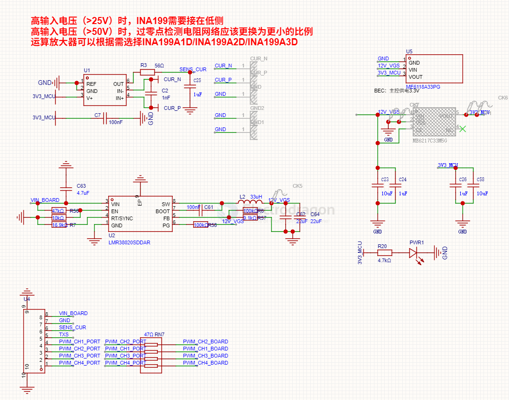

# ESC-FPV-dat

- [[ESC-FPV-dat]] - [[ESC-dat]]

- [[motor-FPV-dat]]

ESC Configurator（BLHeli_S / Bluejay）

    → 连接 → Read Setup
    → 每个电机的 "Motor Direction"：Normal ↔️ Reversed
    → 4 个全改 → Write Setup

- [[ESC-FPV-dat]] - [[ESC-dat]] == 4-in-1 ESC driver - [[MCU-dat]] - [[driver-gate-dat]] - [[mosfet-dat]] - [[motor-brushless-dat]]

## build 

- [[TI-power-dcdc-down-dat]] - [[LMR38020-dat]] == 80V 2A - [[dcdc-down-dat]]

- [[sensor-current-dat]] - [[INA199-dat]] - [[ESC-FPV-dat]]

高输入电压（>25V）时，INA199需要接在低侧。

高输入电压（>50V）时，过零点检测电阻网络应该更换为更小的比例运算放大器。

可以根据需要选择INA199A1D/INA199A2D/INA199A3D。

## ref 

