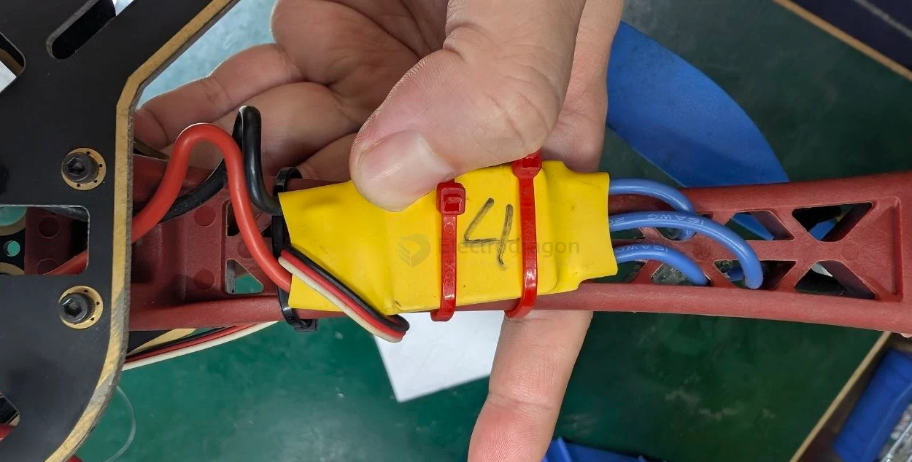
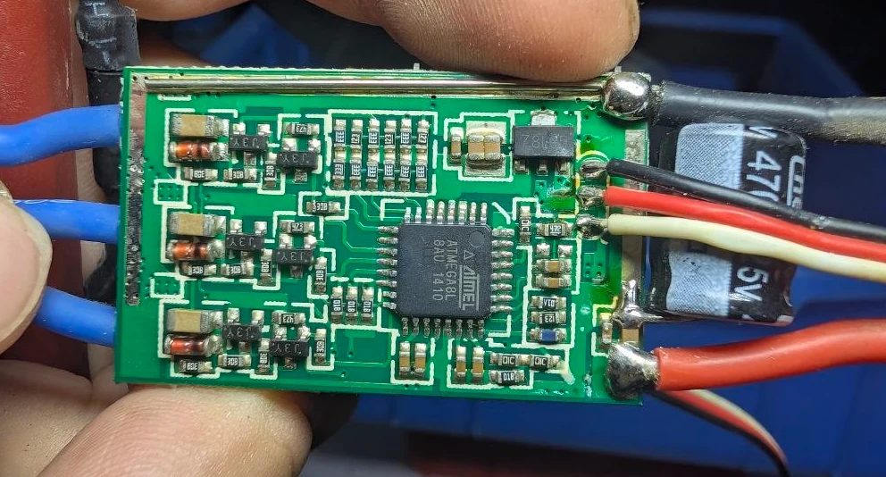
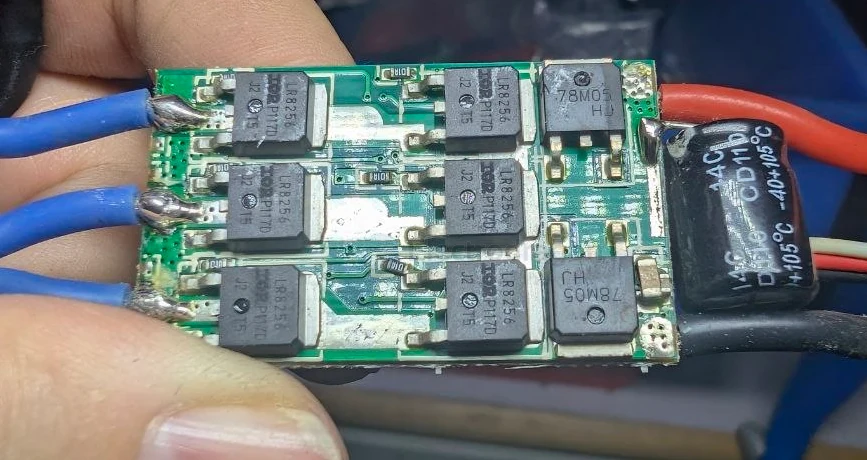
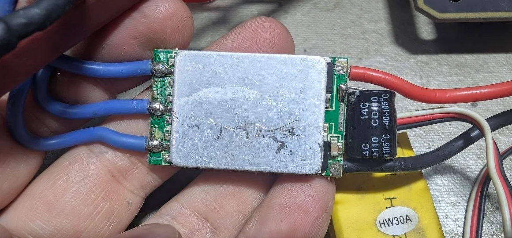

# ESC-single-dat

- [[ESC-single-dat]] - [[ESC-4in1-dat]] - [[power-PDB-dat]]

## wiring

### 4 线单体电调的线序

| 线径 | 颜色 | 判定 | 作用 |
| --- | --- | --- | --- |
| 粗 ×2 | 红 / 黑 | ⭐️ **BATT+ / BATT−** | 接 PDB 的电调焊盘（⚠️ 极性不能反） |
| 细 ×1 | ⭐️ 白 | ⭐️⭐️ **Signal**（信号） | 飞控 M1–M4 输出的油门信号 |
| 细 ×1 | ⚠️ 黑 | ⚠️⚠️ **Signal GND**（信号地） | ⭐️ 厂家说"没用"，但严格讲该接 |

⭐⭐ 标准线序：**粗红 BATT+** · **粗黑 BATT−** · **细白 Signal** · **细黑 Signal GND**

### 厂家为什么说"细黑没用"

> 电调内部 Signal GND 与 BATT− 在板上是连通的
> → 信号地可以走电源地回流，理论上不接也能工作

### ⚠️⚠️ 但"黑线没用"这个说法要打个问号

⚡ 信号地不接的后果，是一条因果链：

1. 信号回路改走 **电源地**
2. 而电源地上流的是 **大电流** → 地线本身有电阻 → 产生压降（**地弹 Ground Bounce**）
3. 压降估算（20AWG，走线 10 cm ≈ 3.33 mΩ）：

| 电流 | 压降 | 占 DShot 3.3V 电平的比例 |
| --- | --- | --- |
| 40A（满油） | **133 mV** | 4.0% |
| 60A | **200 mV** | 6.1% |
| 80A | **266 mV** | 8.1% |

4. ⚠️ 数字信号一般抗扰余量约 10–15% ⇒ 大油门时地弹接近临界 → 可能丢帧 / 电机抖动 / DShot 误码

### 协议对信号地缺失的敏感度

| 协议 | 敏感度 |
| --- | --- |
| PWM 1000–2000 µs | ⭐️ 较宽容，能忍 |
| OneShot125 / 42 | ⭐️ 一般 |
| ⚠️ DShot600 | ⚠️⚠️ 最敏感 |

> ⭐️⭐️⭐️ **建议**：即使厂家说没用，如果 4 针端子里有空位，把细黑线也接上（单独信号地）—— 特别是打算跑 DShot600。

## build 

### ESC-atmega8

ESC build 1 - old tech - [[ESC-atmega8-dat]]

- [[PWM-dat]] - [[motor-brushless-dat]] - [[battery-3s-dat]]

❌ 不支持 DShot（150/300/600）—— 只支持 PWM / OneShot125
❌ 无双向 DShot / RPM 遥测（不能玩 RPM Filter）
⚠️ 刷新率低（PWM 最高约 400-490Hz）
❌ 不支持 Bluejay（那是给 BLHeli_S 的 SiLabs EF8 用的）
✅ 可刷：SimonK 或 BLHeli（原版）—— 但收益有限

build inside 

- [[atmega8-dat]] - [[AVR-dat]]

- [[LR8256-dat]] - [[mosfet-dat]] - [[IOR-dat]] - [[infineon-dat]] - [[ESC-dat]] - [[infineon-mosfet-dat]]

- [[LDO-dat]] - [[LM7805-dat]]

## ref 