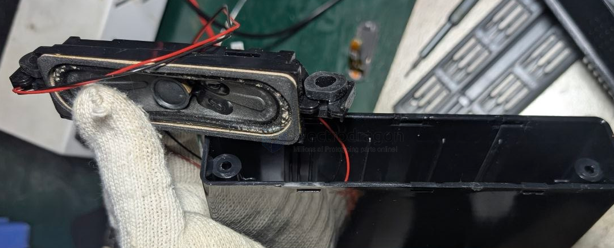
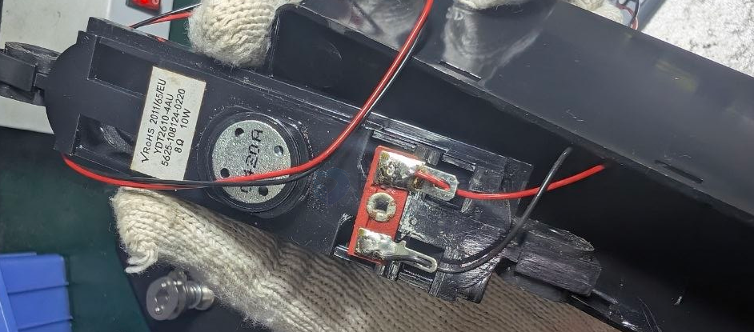
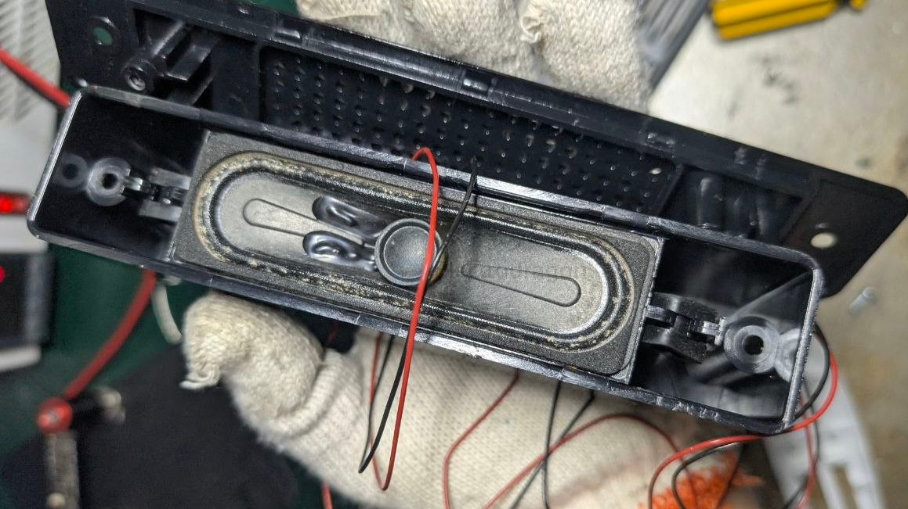
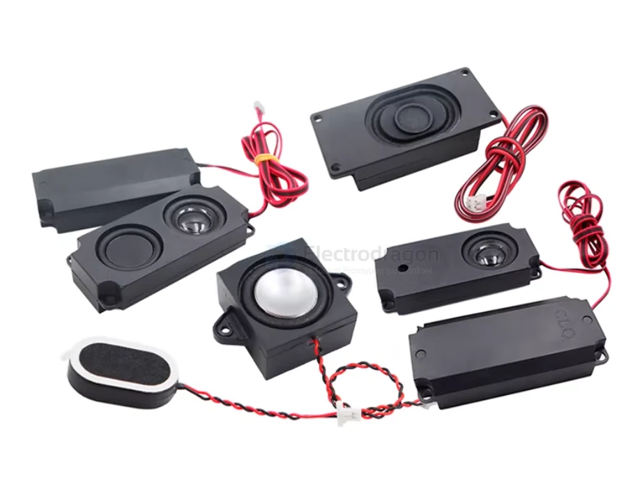

# speaker-cavity-dat

- [[speaker-dat]] - [[speaker-cavity-dat]] - [[audio-dat]]

## build 

build 1 - 8Ω 10W 

## Cavity Speakers (Box Speakers)

A **Cavity Speaker** (often called a "Box Speaker" in electronics) is not a different type of speaker driver, but rather a **complete acoustic system**. It consists of a standard speaker driver pre-installed into a precisely engineered, sealed plastic or metal enclosure (the "cavity").

Think of it as a professional, miniature version of a bookshelf speaker designed to fit inside compact devices like smartphones, laptops, or your DIY projects.

---

### 1. The Anatomy of a Cavity Speaker
A typical unit includes three main parts:
* **The Driver:** The diaphragm and magnet that create vibration.
* **The Enclosure (Cavity):** A sealed box that manages the air pressure behind the driver.
* **The Port/Outlet:** A specific opening that directs the sound toward the user.

---

### 2. Why Use a Cavity Instead of a Bare Speaker?
If you hold a "bare" speaker in your hand and play music, it will sound "tinny" and weak. This is because of **Acoustic Cancellation**.

* **The Problem:** When the speaker membrane moves forward, it creates high pressure in front and low pressure behind. Without a cavity, these two waves meet at the edge and cancel each other out—especially the **bass (low frequencies)**.
* **The Solution:** The cavity traps the rear sound wave, preventing it from canceling the front wave. This results in much deeper, louder, and clearer audio.

### 3. Application in Projects

For an outdoor adventure or robotics project, a cavity speaker is almost always the better choice over a bare driver.

| Feature           | Bare Speaker Driver                      | Cavity/Box Speaker                     |
| :---------------- | :--------------------------------------- | :------------------------------------- |
| **Audio Quality** | Thin, high-pitched, quiet                | Full-bodied, louder, better bass       |
| **Installation**  | Requires custom 3D printed housing       | Plug-and-play (usually has adhesive)   |
| **Protection**    | Membrane is exposed to dust/damage       | Fully protected inside the box         |
| **Complexity**    | You must calculate "air volume" yourself | Acoustic tuning is done by the factory |

## cavity speaker types 

- 商品型号：3718腔体喇叭_8欧2瓦_带线2P_2.0
- 产品类型：腔体喇叭
- 封装尺寸：3718带线2P_2.0
- 阻抗：8欧
- 功率：2瓦
- 工作频率：0-20KHz
- 输出声压：95±3dB

more 

| Model | diaphragm | Size (mm) | Impedance | Power | Connector       |
| ----- | --------- | --------- | --------- | ----- | --------------- |
| 2415  |           | 24x15     | 8Ω        | 1W    | Wired 2P 1.25mm |
| 3020  |           | 30x20     | 4Ω        | 3W    | Wired 2P 1.25mm |
| 3020  |           | 30x20     | 8Ω        | 2W    | Wired 2P 1.25mm |
| 3525  |           | 35x25     | 4Ω        | 3W    | Wired 2P 1.25mm |
| 3525  |           | 35x25     | 8Ω        | 2W    | Wired 2P 1.25mm |
| 3020  |           | 30x20     | 4Ω        | 3W    | Wired 2P 2.0mm  |
| 3020  |           | 30x20     | 8Ω        | 2W    | Wired 2P 2.0mm  |
| 3525  |           | 35x25     | 4Ω        | 3W    | Wired 2P 2.0mm  |
| 3525  |           | 35x25     | 8Ω        | 2W    | Wired 2P 2.0mm  |
| 2828  |           | 28x28     | 4Ω        | 2W    | Wired 2P 1.25mm |
| 2828  |           | 28x28     | 4Ω        | 2W    | Wired 2P 2.0mm  |
| 2828  |           | 28x28     | 4Ω        | 3W    | Wired 2P 1.25mm |
| 2828  |           | 28x28     | 4Ω        | 3W    | Wired 2P 2.0mm  |
| 2831  |           | 28x31     | 4Ω        | 3W    | Wired 2P 1.25mm |
| 2831  |           | 28x31     | 4Ω        | 3W    | Wired 2P 2.0mm  |
| 2831  |           | 28x31     | 4Ω        | 3W    | Wired 2P Dupont |
| 4014  |           | 40x14     | 4Ω        | 2W    | Wired 2P 2.54mm |
| 4014  |           | 40x14     | 8Ω        | 2W    | Wired 2P 2.54mm |
| 3718  |           | 37x18     | 8Ω        | 2W    | Wired 2P 2.0mm  |
| 5318  |           | 53x18     | 8Ω        | 2W    | Wired 2P 2.0mm  |
| 3070  |           | 30x70     | 8Ω        | 3W    | Wired 2P 2.0mm  |
| 3370  |           | 33x70     | 8Ω        | 3W    | Wired 2P 2.0mm  |
| 3080  |           | 30x80     | 8Ω        | 3W    | Wired 2P 2.0mm  |
| 6423  |           | 64x23     | 8Ω        | 2W    | Wired 2P 2.0mm  |
| 45100 |           | 45x100    | 8Ω        | 5W    | Wired 2P 2.0mm  |
| 45100 | dual      | 45x100    | 8Ω        | 5W    | Wired 2P 2.0mm  |
| 3718  |           | 37x18     | 8Ω        | 2W    | Wired 4P 2.0mm  |
| 5318  |           | 53x18     | 8Ω        | 2W    | Wired 4P 2.0mm  |
| 3070  |           | 30x70     | 8Ω        | 3W    | Wired 4P 2.0mm  |
| 3370  |           | 33x70     | 8Ω        | 3W    | Wired 4P 2.0mm  |
| 3080  |           | 30x80     | 8Ω        | 3W    | Wired 4P 2.0mm  |
| 6423  |           | 64x23     | 8Ω        | 2W    | Wired 4P 2.0mm  |
| 45100 |           | 45x100    | 8Ω        | 5W    | Wired 4P 2.0mm  |
| 45100 | dual      | 45x100    | 8Ω        | 5W    | Wired 4P 2.0mm  |

## build 

## ref 