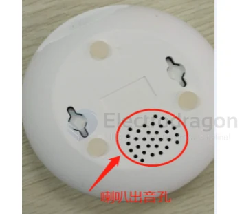
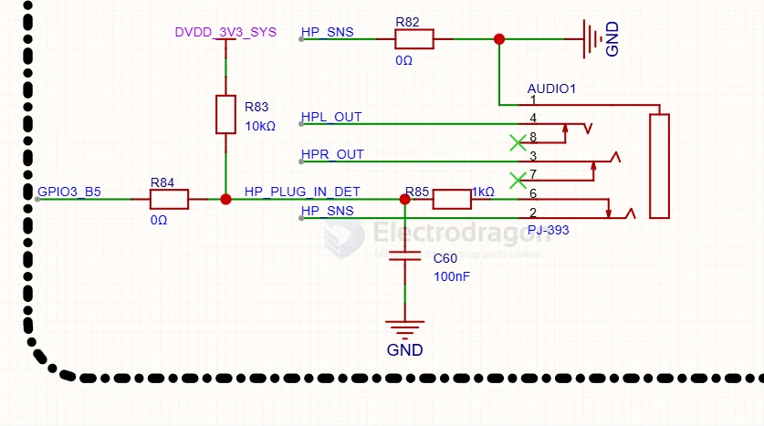

# speaker-dat

- [[sensor-microphone-dat]] - [[speaker-dat]] - [[buzzer-dat]]- [[I2S-dat]] - [[audio-dat]]

- [[max98357-dat]]

- [[I2S-dat]] - [[speaker-I2S-dat]] - [[sensor-microphone-I2S-dat]] - [[PDM-dat]]

- [[amplifier-audio-dat]] - [[8002-dat]] - [[speaker-dat]] - [[bt-audio-dat]]

[legacy wiki page](https://www.electrodragon.com/w/Speaker)

- [[speaker-driver-dat]]

- [[speaker-dat]] - [[speaker-cavity-dat]] - [[audio-dat]]

## chip 

- [[NS4150-dat]] - [[NSIWAY-dat]]

## boards 

- [[SSL1030-dat]] - [[SSL1031-dat]]

## apps 

- [[alarm-dat]]

- [[impedance-dat]] - [[impedance-audio-dat]]

## audio impedance 

Impedance (Z)?

In electronics, **Impedance** (symbol: $Z$) is the total opposition that a circuit presents to alternating current (AC). It combines basic resistance ($R$) with "reactance" ($X$), which depends on the frequency of the signal.

For your ESP32-S3 and robotics projects, impedance plays four critical roles:

---

### 1. Power Transfer & Efficiency
In audio systems, matching the impedance of your **amplifier** to your **speaker** is vital.

* **The Rule:** Your MAX98357A amplifier is rated for specific loads (usually $4\Omega$ or $8\Omega$).
* **Low Impedance ($4\Omega$):** Draws more current. The speaker will be louder, but the amplifier will run hotter and consume more battery.
* **High Impedance ($8\Omega$):** Draws less current. The system is more stable and produces less heat, but the maximum volume is lower.

---

### 2. Circuit Protection (Current Limiting)
Impedance acts like a "throttle" for electricity.
* If you connect a device with **$0\Omega$ impedance** (a short circuit) to an ESP32 GPIO, the current will spike instantly and burn the internal transistors.
* By choosing components with the correct impedance (or adding resistors), you ensure the current stays within the ESP32's safe limit of **20mA to 40mA**.

## 4-ohm and 8-ohm

The terms 4-ohm and 8-ohm refer to the impedance of the speaker. Impedance is a measure of the resistance the speaker provides to the electrical current coming from the amplifier. It is measured in ohms (Ω) and directly impacts how the speaker interacts with an amplifier.

Key Points about 4-Ohm and 8-Ohm Speakers:

Electrical Resistance:

- 4-ohm speakers offer less resistance to electrical current, meaning they allow more current to flow through.
- 8-ohm speakers offer more resistance, meaning they draw less current from the amplifier.

Power Requirements:

- A 4-ohm speaker generally requires an amplifier that can deliver more current because of the lower resistance.
- An 8-ohm speaker is less demanding on the amplifier, so it is compatible with a wider range of amplifiers.

Compatibility with Amplifiers:

- Amplifiers must be rated to handle the speaker's impedance. For example:
- An amplifier rated for 4–8 ohms can drive both 4-ohm and 8-ohm speakers safely.
- Using a 4-ohm speaker with an amplifier not designed for such low impedance may overheat the amplifier or cause it to shut down.
Sound Performance:

There is no inherent sound quality difference between 4-ohm and 8-ohm speakers. However:

- A 4-ohm speaker may be slightly louder if the amplifier can handle it because it draws more power from the amplifier.
- Matching the amplifier's power output with the speaker's impedance ensures optimal sound quality and avoids distortion or damage.

## tech 

- [[amplifier-dat]] - [[amplifier-audio-dat]]

- [[signal-dat]] - [[signal-differential-dat]]

- [[I2S-dat]] 

- [[speaker-dat]] - [[headphone-dat]]

## Speaker Selection Guide

### Speaker Introduction & Selection

1. For module boards, refer to our amplifier circuits — selection can be made from our product range.
2. For custom designs, select speaker specifications based on output power requirements.
3. For products with **AEC (Acoustic Echo Cancellation)**, use a **cavity speaker** with THD optimized over **150Hz–3000Hz**, and output distortion less than **10%** at maximum volume.

---

### Enclosure Sound Outlet Design

1. Place the speaker sound outlet **away from the microphone** — refer to microphone structural design guidelines. The sound outlet hole is required; **round holes** are recommended. Common shapes: **round, oval, square, triangular**.
2. Recommended hole diameter: **1mm** (range: **0.8–1.5mm**). Do not go below **0.5mm** — too small a hole restricts sound output, resulting in quiet, thin audio.
3. The total sound outlet area should be **5%–15%** of the speaker diaphragm area. **10% is recommended** for optimal volume and sound quality. Too large may introduce excessive high-frequency noise; too small may reduce volume.

---

### Speaker Installation Guidelines

1. The speaker must be **firmly secured** — any looseness will degrade sound output.
2. Place the speaker **fully into the mounting slot** to avoid tilting.

## models 

- 4R内阻喇叭选择大于2.4W的
- 8R喇叭要选择大于1.6W的
- 尽量不要超过太大，例如4R5w模块带不太动

## build 

headset 

## ref 

