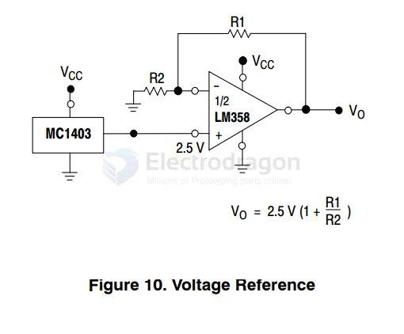
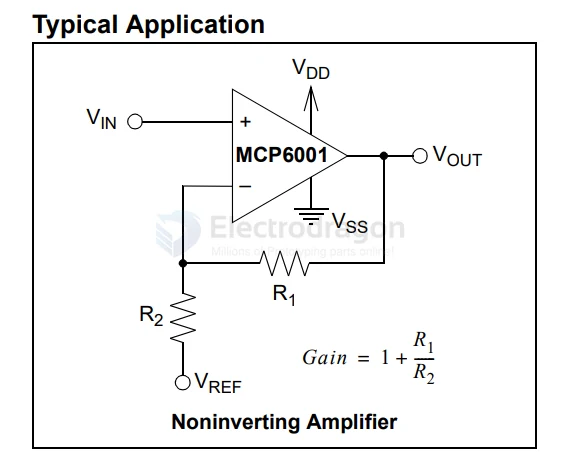
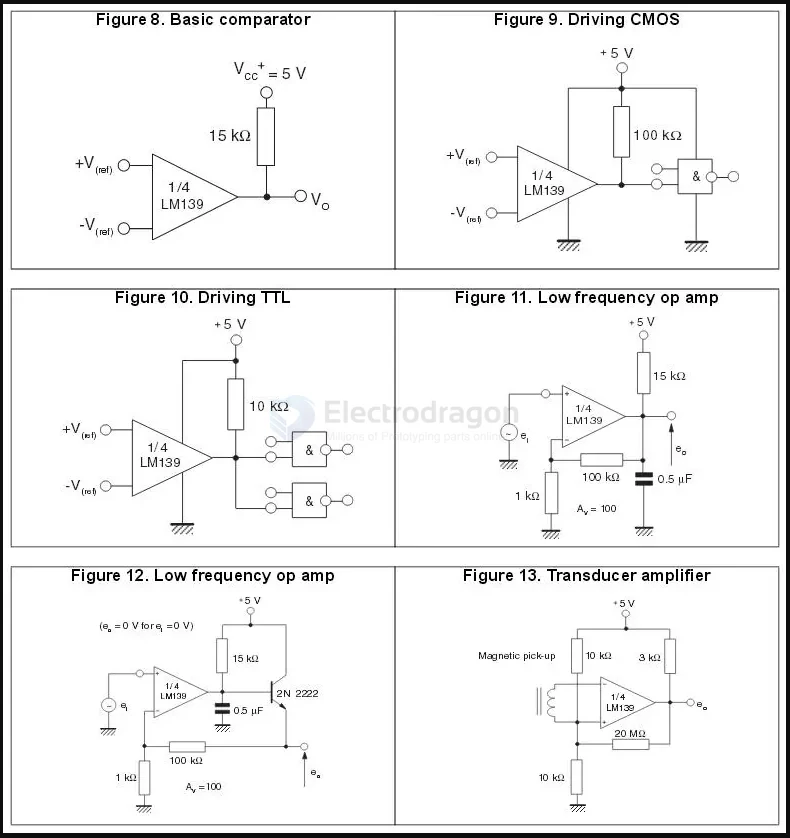
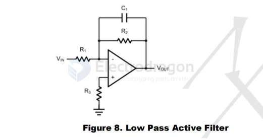
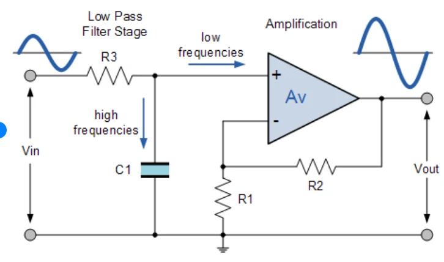

# amplifier-dat

- [[amplifier-transimpedance-dat]] - [[amplifier-dat]] - [[TLV8544-dat]] - [[impedance-dat]] - [[sensor-motion-dat]] 

- [[skyworks-dat]] - [[wifi-adapter-dat]] - [[RTL8812AU-dat]] - [[SKY85601-dat]] - [[amplifier-dat]] - [[amplifier-5ghz-dat]]

- [[amplifier-power-dat]]

- [[amplifier-video-dat]] - [[THS7374-dat]] - [[amplifier-dat]]

- [[amplifier-GNSS-dat]]

- [[amp-op-dat]] - [[amplifier-audio-dat]] - [[DAC-dat]] - [[ADC-dat]]

- [[virtual-ground-dat]]

- [[audio-dat]] - [[audio-amplifier-dat]]

- [[I2S-daC-dat]]

- ISL3283EFHZ - Miniature Broadband Gain Stage 70 - 3000 MHz

M/A-COM’s MAALSS0034 broadband gain stage is a GaAs MMIC amplifier in a lead-free SOT-89 surface mount plastic package. It can be operated from a single 3 to 5 volt supply.

- [[amplifier-dat]] - [[LM324-dat]]

- [[LM358-dat]] - [[LMV321-dat]]

- [[amplifier-multiple-dat]]

## specs 

Gain-bandwidth product (GBWP)

Slew rate

CMRR

Input Voltage Noise Density

Input Bias / Offset Current

Input Offset Voltage Drift

Input Offset Voltage

这 7 个是运算放大器（Op-Amp）数据手册中最核心的性能指标，直接决定了运放能处理多快的信号，以及直流和交流精度有多高。结合你前面提到的 **PIR 传感器微弱低频信号放大** 场景，我把它们分成“速度指标”、“精度指标”和“噪声/抗干扰指标”来解释：

### 一、 速度与频率指标（决定运放能处理多快的信号）

#### 1. Gain-Bandwidth Product (GBWP，增益带宽积)

* **通俗理解**：运放的“增益”和“带宽”是一对反比搭档，它们的乘积在特定范围内是一个常数（单位通常为 Hz、kHz 或 MHz）。
* **核心公式**：$\text{闭环带宽 } f_{-3\text{dB}} \approx \frac{\text{GBWP}}{\text{闭环增益 } A_v}$
* **举例说明**：
* 如果一个运放的 $\text{GBWP} = 1\text{ MHz}$，你把它配置成 **100 倍放大**，那么它能正常工作的有效带宽就只剩 $1\text{ MHz} / 100 = 10\text{ kHz}$。
* 像前面提到的超低功耗运放 **TLV8544**，$\text{GBWP}$ 只有 **8 kHz**；但因为 PIR 传感器信号频率极低（0.1Hz ~ 10Hz），即使放大 1000 倍（60dB），理论带宽仍有 $8\text{ Hz}$ 左右，刚好够用且极其省电。如果你用它去放大音频（20kHz），信号就会被严重衰减。

#### 2. Slew Rate (SR，压摆率)

* **通俗理解**：运放输出电压“变脸”的最大速度，单位通常是 $\text{V}/\mu\text{s}$（或超低功耗运放的 $\text{mV}/\mu\text{s}$）。
* **为什么重要**：GBWP 衡量的是**小信号**下的频率响应，而 Slew Rate 限制的是**大幅度、快速跳变信号**的输出能力。如果输入信号变化太快，运放输出跟不上，原本的正弦波就会被拉扯成“三角波”，产生严重失真。
* **估算公式**：不失真输出最大正弦波所需的压摆率 $\text{SR} \ge 2\pi \cdot f \cdot V_{\text{peak}}$（$f$ 为频率，$V_{\text{peak}}$ 为峰值电压）。

---

### 二、 直流精度指标（决定微弱信号放大后偏不偏）

#### 3. Input Offset Voltage ($V_{OS}$，输入失调电压)

* **通俗理解**：理想运放两个输入端电压相等时，输出应该为 0V；但现实中由于内部晶体管制造不可能绝对对称，相当于在输入端串联了一个微小的“虚假电池”（几微伏到几毫伏）。
* **实际影响**：这个虚假电压会被**同等地乘以你的放大倍数**！
* 比如 $V_{OS} = 3\text{ mV}$，电路放大 1000 倍，输出端就会平白无故多出 $3\text{ V}$ 的直流误差（直接把输出顶到电源轨饱和）。
* **解决思路**：做直流高精度放大（如电子秤应变片、热电偶）必须选零漂移/低失调运放（$V_{OS} < 10\mu\text{V}$）；而 PIR 传感器只关心交流变化，可以通过电容隔直（AC 耦合）把 $V_{OS}$ 滤掉。

#### 4. Input Offset Voltage Drift ($\Delta V_{OS}/\Delta T$，输入失调电压温漂)

* **通俗理解**：上面那个“虚假电池”的电压随温度变化的程度，单位通常是 $\mu\text{V}/^\circ\text{C}$。
* **实际影响**：初始的 $V_{OS}$ 可以通过软件校准减掉，但**温漂极难校准**。环境温度一变（比如设备刚开机发热或昼夜温差），输出零点就会跟着漂移。对高精度直流测量来说，温漂往往比初始失调电压更致命。

#### 5. Input Bias Current ($I_B$) & Input Offset Current ($I_{OS}$)（输入偏置电流 / 输入失调电流）

* **Input Bias Current ($I_B$，输入偏置电流)**：理想运放输入阻抗无穷大、不吃电流，但实际运放的输入级晶体管需要一点微小的静态电流才能工作（范围从几飞安 $\text{fA}$ 到几微安 $\mu\text{A}$）。
* **Input Offset Current ($I_{OS}$，输入失调电流)**：同相端（+）和反相端（-）两个输入偏置电流的**差值**（$\vert{}I_{B+} - I_{B-}\vert{}$）。
* **实际影响**：当你的电路里用到**超大电阻**（比如 PIR 电路或光电二极管里常用的 $1\text{ M}\Omega \sim 10\text{ M}\Omega$ 电阻）时，微小的 $I_B$ 流过 $10\text{ M}\Omega$ 电阻就会产生不可忽视的压降（$V = I_B \times R$），变成额外的直流误差。
* **选型经验**：高阻抗传感器必须选 **CMOS 或 JFET 输入级**的运放（$I_B$ 通常在 $\text{pA}$ 级别，几乎可忽略），避开双极性（BJT）输入运放。

---

### 三、 噪声与抗干扰指标（决定信噪比 SNR）

#### 6. Input Voltage Noise Density ($e_n$，输入电压噪声密度)

* **通俗理解**：运放内部热噪声和散粒噪声在频谱上的分布强度，单位是 $\text{nV}/\sqrt{\text{Hz}}$。
* **实际影响**：它决定了运放能分辨的**最小信号下限**。总噪声电压粗略等于 $e_n \times \sqrt{\text{带宽}}$。
* 如果你在放大只有几十微伏（$\mu\text{V}$）的传感器信号，若运放本身的噪声密度太高，微弱信号就会被淹没在“沙沙”的底噪里。
* **注意低频段**：在 0.1Hz ~ 10Hz 的极低频段（比如 PIR 信号），通常还会额外看一个指标叫 **0.1Hz to 10Hz Peak-to-Peak Noise（1/f 闪烁噪声）**，直接给出峰峰值噪声（如 $3\mu\text{V}_{\text{pp}}$），对照它就能知道信号会不会被底噪吞掉。

#### 7. CMRR (Common-Mode Rejection Ratio，共模抑制比)

* **通俗理解**：运放“只放大两个输入端之间的差值，忽略两边同时出现的干扰”的能力，单位是 **dB**（越大越好，通常在 80dB ~ 130dB）。
* **举例说明**：长导线传过来的传感器信号，往往同时混入了 50Hz/60Hz 工频干扰或电源波动（两个引脚上都有相同的干扰电压，即“共模信号”）。
* 如果 $\text{CMRR} = 80\text{ dB}$（即 $10^4$ 倍），输入端有 $1\text{ V}$ 的共模干扰，等效到输入端的误差只有 $1\text{ V} / 10^4 = 0.1\text{ mV}$。
* 差分放大器、仪表放大器（INA）以及单电源轨到轨运放中，CMRR 是衡量抗干扰能力的核心指标（且 CMRR 会随频率升高而下降）。

---

### 总结对照表（快速查用）

| 参数 | 英文缩写 | 关注场景 | 选型口诀 |
| --- | --- | --- | --- |
| **增益带宽积** | GBWP | 交流/高频放大 | 带宽 $\times$ 增益要留出 5～10 倍余量 |
| **压摆率** | SR | 大信号、方波/脉冲 | 输出幅度大、频率高时防波形变三角 |
| **输入失调电压** | $V_{OS}$ | 直流高精度放大 | 直流放大越小越好；交流耦合可放宽 |
| **失调电压温漂** | Drift | 宽温工作、精密测量 | 无法靠单点校准消除，精密仪表核心指标 |
| **偏置/失调电流** | $I_B / I_{OS}$ | 高内阻传感器（MΩ级） | 高阻电路选 CMOS/JFET 输入（pA 级） |
| **电压噪声密度** | $e_n$ | 微弱信号（µV级） | 传感器输出越弱，要求该值越低 |
| **共模抑制比** | CMRR | 差分信号、强干扰环境 | 抑制工频干扰和电源波动，dB 越高越好 |

## types 

- [[amp-LNA-dat]] - [[TQP3M9008-dat]] - [[qorvo-dat]] - [[amplifier-dat]] - [[amp-LNA-dat]]

- [[amp-LNA-dat]]

- [[amplifier-dat]] - [[amp-VGA-dat]] - variable gain amplifier

## chips 

### operational amplifiers (op-amps)

| Feature               | LM387                           | MCP6002                      |
| --------------------- | ------------------------------- | ---------------------------- |
| **Type**              | Low-noise audio op-amp          | General-purpose CMOS op-amp  |
| **Voltage Supply**    | ±3V to ±18V                     | 1.8V to 6V (single supply)   |
| **Bandwidth**         | ~4.5 MHz                        | ~1 MHz                       |
| **Noise Performance** | Low noise (optimized for audio) | Higher noise than LM387      |
| **Power Consumption** | Higher                          | Lower (low-power design)     |
| **Rail-to-Rail I/O**  | No                              | Yes                          |
| **Input Impedance**   | High (audio optimized)          | High                         |
| **Best for**          | Audio applications              | Battery-powered, general use |

- [[amplifier-audio-dat]]

| Alternative Chip | Key Differences/Advantages                         |
|-----------------|----------------------------------------------------|
| **MCP6022**     | Higher bandwidth (10 MHz vs. 1 MHz), lower noise  |
| **TLV2372**     | Similar specs, slightly better bandwidth (3 MHz)  |
| **TLV9002**     | Lower power consumption, similar bandwidth (1 MHz) |
| **OPA2333**     | Higher precision, lower offset voltage            |
| [[LM358-dat]]   | Similar voltage range but not rail-to-rail        |
| **TSV912**      | Lower voltage noise, better for precision applications |

OP07x Precision Operational Amplifiers

- [[AD620-dat]] - [[AD-amplifier-dat]] - 

- [[OP07-dat]] - [[LM386-dat]]

- [[MS6002-dat]] - [[LM358-DAT]] 

- [[NS4150-dat]] 
  
- [[MCP6002-dat]]

- [[OPA1641-dat]] - [[NE5532-dat]] - [[AD828-dat]] - [[TL072-dat]]

- [[PAM-dat]] - [[diodes-dat]] - [[PAM8302-dat]]

## Voltage Reference

LM258, LM358, LM358A, LM358E, LM2904, LM2904A, LM2904E, LM2904V, NCV2904

## Noninverting Amplifier

## rail to rail 

### Rail-to-Rail Input & Output (RRIO)

Both the input and output can swing close to both power rails (VCC & VEE).

Example: MCP6002, TLV9002, OPA2333

### Non-Rail-to-Rail Op-Amps

Neither input nor output reaches the full supply range.

Example: 741 op-amp (Needs at least ±12V to operate properly).

## Driver 

- [[ESP32-DAC-dat]]

## LM139 

## APPs 

- read more at [[LM358-dat]]

### Low Pass Active Filter

The low pass active filter is shown in Figure 8.The DC gain is defined by -R2/R1.The filter hasa -20dB/decade roll-off after its corner frequency fc=1/(2πR3C1).

online simuation - https://www.circuitlab.com/editor/#?id=z84zq5

- [[circuit-lab-dat]] - [[EDA-simulation-dat]]

Active Low Pass filter with Amplification

## tuto 

- [Application of Rail-to-Rail Operational Amplifiers](https://www.ti.com/lit/an/sloa039a/sloa039a.pdf)

## read more 

- [Op-Amps – Analog Building Blocks](https://dronebotworkshop.com/op-amps/)

## more chips 

- [[3peak-dat]] - [[TP102-dat]] - [[Wireless-Video-Doorbell-dat]] - [[xiaomi-dat]] - [[amplifier-dat]]

- TL062, TL062A, TL062B == Low-power JFET dual operational amplifiers

- TL082 == Wide Bandwidth Dual JFET Input Operational Amplifier

- [[TI-interface-dat]] - [[TI-AMP-dat]]

- [[Analog-device-dat]]

MC4558 - Wide bandwidth dual bipolar operational amplifier

- LM324DR2G - Operational Amplifiers - Op Amps 3-32V Quad 5mV VIO Commercial Temp

ths9000 - 50 MHz to 750 MHz CASCADEABLE AMPLIFIER

THS4150, THS4151 - HIGH-SPEED DIFFERENTIAL I/O AMPLIFIERS

SN54LVC138A, SN74LVC138A - SN74LVC138A 3-Line to 8-Line Decoders Demultiplexers

HMC589AST89 - IC GAIN BLOCK AMPLIFIER DC-4GHz HMC589AST89E

IC GAAS MMIC AMP DC-8GHz

HMC311SC70E

HMC311ST89E

HMC326MS8GE

HMC589AST89E

HMC624ALP4E

HMC633LC4

HMC634LC4

HMC649ALP6E

HMC788LP2E

HMC902LP3E

HMC903LP3E

## ref 

- [[tech-dat]] - [[DAC-dat]] - [[audio-dat]]

