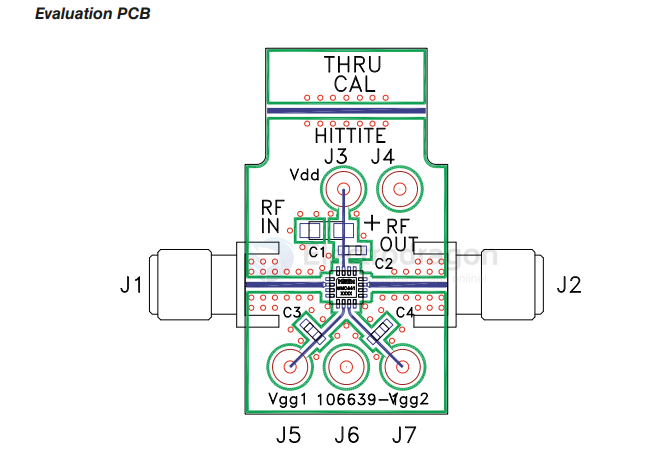

# amplifier-power-dat

HMC441LP3 / 441LP3E == GaAs pHEMT MMIC MEDIUM POWER AMPLIFIER, 6.5 - 13.5 GHz

The HMC441LP3 & HMC441LP3E are broadband GaAs PHEMT MMIC Medium Power Amplifiers which operate between 6.5 and 13.5 GHz. The leadless plastic QFN surface mount packaged amplifier provides 14 dB of gain, +20 dBm saturated power at 20% PAE from a +5V supply voltage. An optional gate bias is provided to allow adjustment of gain, RF output power, and DC power dissipation. This 50 Ohm matched amplifier does not require any external components making it an ideal linear gain block or driver for HMC SMT mixers.

https://www.analog.com/media/en/technical-documentation/data-sheets/hmc441lp3.pdf

## EVM PCB 

## 258A 

- [[amplifier-power-dat]] - [[RTL8187-dat]] - [[realtek-dat]] - [[wifi-adapter-dat]] 

在早期的经典大功率无线网卡（如搭载 **RTL8187L** 或 **RT3070 / RT3072** 芯片的“卡王”设备）中，**“6649”** 和 **“008A”** 同样是指代网卡上外挂的**射频功率放大器（PA）芯片型号或丝印批次代号**。

### 1. 关于 “6649” 功放
* **定位**：6649 是早期山寨及发烧级大功率无线网卡上非常著名的一款高线性射频功放芯片（常见于搭配 RTL8187L 或 RT3070 芯片的主板上）。
* **特点**：其标称发射功率和增益在当时较为可观（通常单颗或配合电路能达到约 400mW 甚至更高水平）。它通过外置放大显著增强了 2.4GHz 频段信号的发射推力和接收灵敏度，但也带来了比较明显的工作发热量。

### 2. 关于 “008A” 功放
* **定位**：类似于你之前问过的“258A”，“008A” 也是这类大功率网卡电路板上常见的**功放芯片丝印代码、内部批次号或代工厂型号**（常被商家宣传为“双 008A 功放”或与 3070 芯片搭配组合）。
* **特点**：代表网卡硬件方案中采用了带有该钢印标识的射频放大元器件，用于增强双通道或单向多收发切换的信号强度。

## ref 

