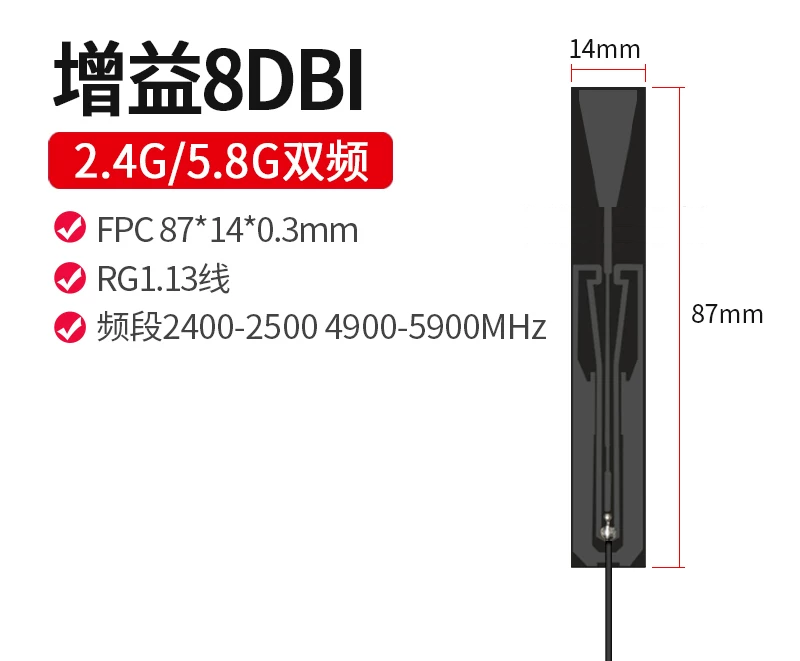
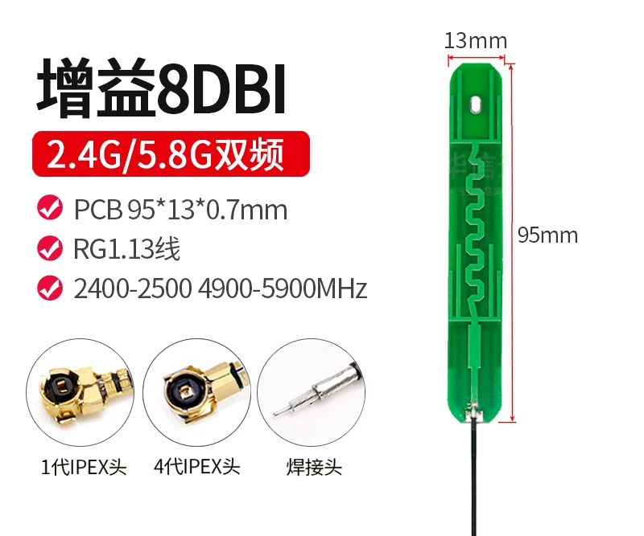
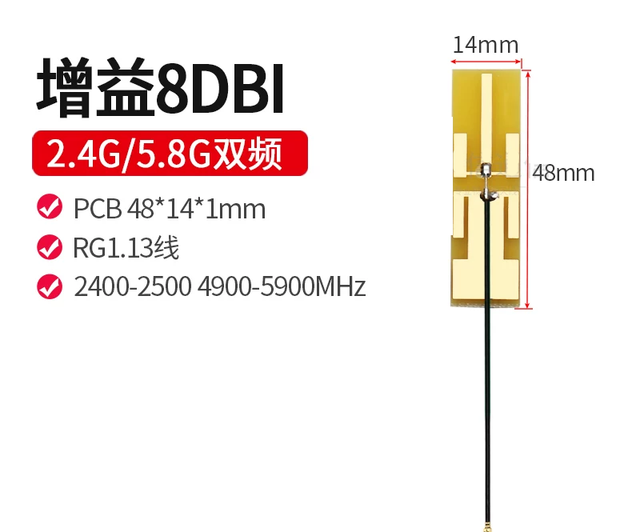
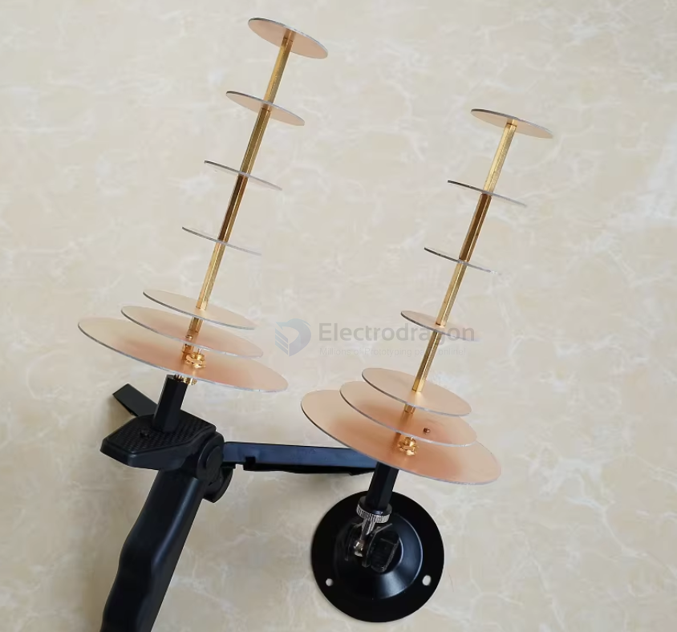
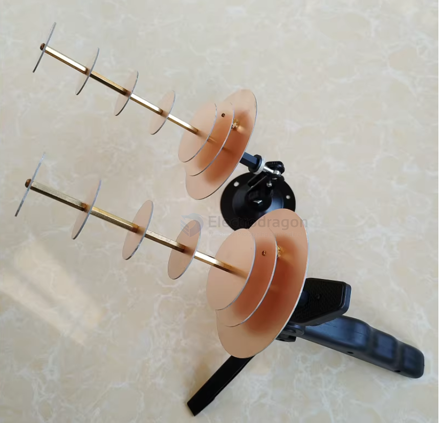
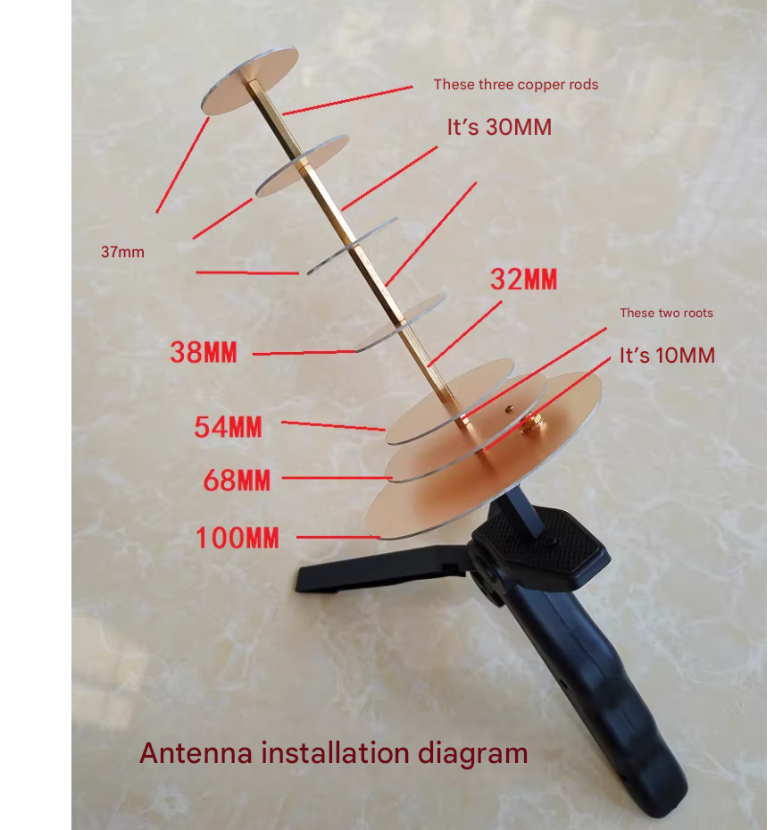
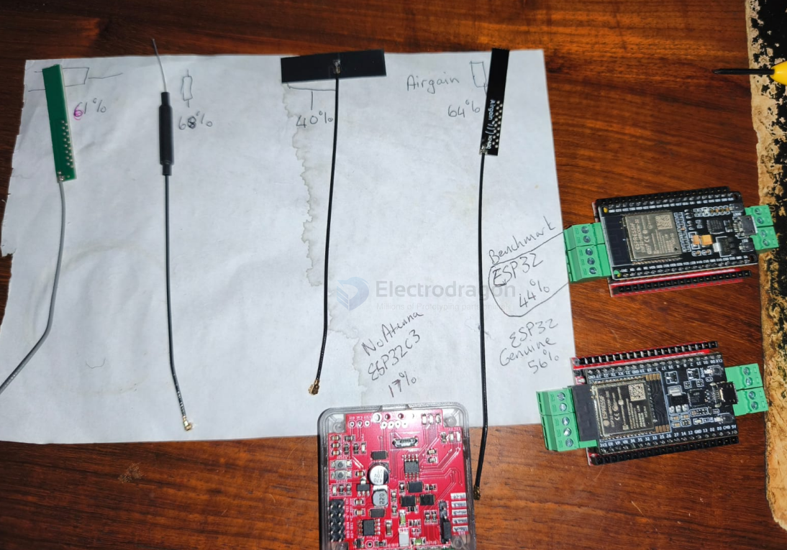

# antenna-wifi-2.4ghz-dat

- [[antenna-dat]] - [[wifi-dat]] - [[antenna-wifi-dat]]

# antenna-linear-2.4ghz-dat

- [[2.4ghz-dat]] - [[antenna-linear-dat]] - [[antenna-dat]] 

- [[antenna-patch-dat]]

- [[antenna-whip-dat]]

Here is a side-by-side comparison to help you decide which one fits your project:

### 1. Copper Sleeve Antenna (Coaxial / Sleeve Dipole)
* **Performance / Efficiency:** **Higher.** Copper sleeve/dipole antennas are generally self-contained, highly tuned resonant structures. They typically offer higher radiation efficiency, stable gain, and do not rely on a large ground plane to work effectively.
* **Radiation & Omnidirectionality:** Excellent, clean 360-degree omnidirectional radiation pattern (doughnut shape).
* **Durability:** High mechanical strength. Often housed in a rigid plastic tube (like a standard rubber duck or a flexible rod) or made of sturdy brass/copper tubing.
* **Best Used For:** External mounting, devices with exposed antennas, or inside large plastic/fiberglass enclosures where you want maximum range and stable performance without worrying about internal component interference.

### 2. FPC (Flexible Printed Circuit) Antenna
* **Performance / Efficiency:** **Moderate to Good.** While well-designed FPC antennas perform decently, their actual efficiency is easily influenced by their environment (the plastic housing they stick to, proximity to batteries, screens, or internal shielding).
* **Radiation & Omnidirectionality:** Quasi-omni, but its pattern can get skewed depending on where and how it is curved or stuck inside the casing.
* **Form Factor & Installation:** Extremely thin (0.15mm) with a sticky backing. It can be plastered against the inner wall of a tight, enclosed plastic shell and connected via a micro coaxial cable (RF0.81/IPEX).
* **Best Used For:** **Internal mounting** in compact, space-constrained consumer electronics (smart home hubs, small routers, IoT devices, or embedded modules) where an external protruding antenna is unacceptable.

### Summary: Which should you choose?

* **Choose the Copper Sleeve Antenna if:** You are building an external antenna setup, need maximum possible range and efficiency, or want a robust, independent antenna element that performs consistently.
* **Choose the FPC Antenna if:** You are designing a sleek, fully enclosed internal 2.4GHz Wi-Fi device (like a smart home sensor or compact gateway) where everything must fit inside a plastic case with zero protruding parts.

## 7.59 dbi 

高增益全向2.4G天线，支持蓝牙 WIFI ZigBee 天线 IPEX接口 == 2.4G 铜管天线 IPEX一代接口

## 3 dbi 

（2.4G铜管）IPEX头天线总长15CM == 2.4G 3DB内置铜管天线蓝牙wifi接收器收发航模遥控天线全向IPEX

## ref 

- [[antenna-linear-2.4ghz]] - [[antenna-linear]] - [[antenna]]

## high gain anntenna 

efficient high gain 8DBI wifi antenna 

## rank 

12dBi WIFI

When used with a repeater, a Wi-Fi antenna can connect to a desktop computer and can also be used with a phone. However, you need to know the router password and configure settings on the phone. 

It should not be too far from the router, generally no more than 3 meters. You can also connect directly to the router with an Ethernet cable. 

In obstacle-free conditions, the transmission distance can reach 200–300 meters. 

In other words, the receiving distance is short, while the transmitting distance is long.

When used with a USB Wi-Fi adapter, a Wi-Fi antenna is suitable for laptops or desktop computers (not suitable for phones) and can receive Wi-Fi signals over long distances. In obstacle-free conditions, the range can reach 200–300 meters.

## demo and references 

https://x.com/i/status/2025020047861723433

[[wifi-antenna-1.mp4]]

## user test antenna result 

## ref 

- [[antenna-dat]] - [[wifi-dat]] - [[antenna-wifi-dat]]

- [[antenna]] - [[wifi]] - [[antenna-wifi]]