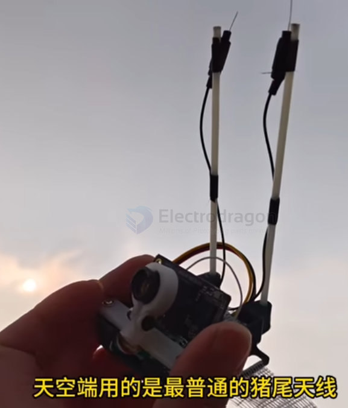
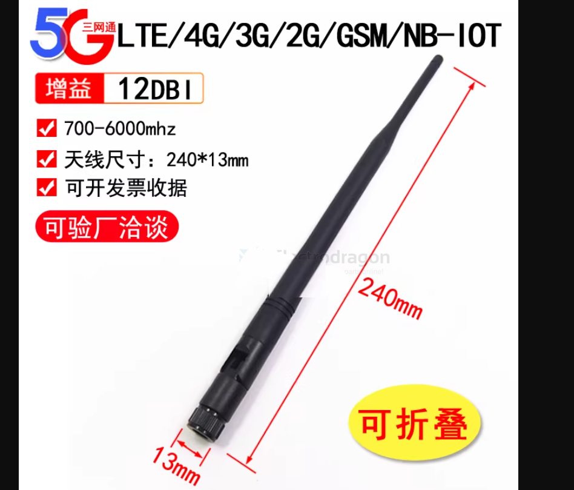

# antenna-linear-dat

omni


- [[antenna-linear-dat]] - [[1.2ghz-dat]]

- [[antenna-sword-dat]] - [[antenna-linear-dat]] - [[antenna-polarization-dat]] - [[antenna-dat]]


- [[antenna-linear-dat]] - [[anteann-linear-yagi-dat]] - [[antenna-T-dat]]


- [[antenna-dat]] Polarization == - [[antenna-RHCP-dat]] // [[antenna-patch-dat]] - [[antenna-linear-dat]] - [[antenna-polarization-dat]] - [[antenna-polarization-mixed-dat]] - [[antenna-helical-dat]] - [[antenna-lolipop-dat]]


type of antennas by shape == [[antenna-type-dat]] - [[antenna-T-dat]] - [[antenna-linear-dat]] - [[antenna-spring-dat]] 


- [[antenna-linear-2.4ghz-dat]]


## Why the gain can't go higher — do the math

Omni pattern: `D = 41253 / (360 × θ_El) = 114.6 / θ_El`

| Gain | Vertical beamwidth | Note |
|---:|---:|---|
| 1.0 dBi | 91° | ← normal for a mushroom omni |
| 2.0 dBi | 72° | ← a good mushroom |
| 3.0 dBi | 57° | ← already close to the limit |
| 5.0 dBi | 36° | ← only a linear fibreglass omni achieves this; very hard with CP |
| 9.0 dBi | 14° | ← only a linear collinear array |

> ⭐⭐ The core conflict: the narrower the beam, the higher the gain — but the moment the aircraft climbs or dives it leaves the main lobe
> 2 dBi → drops beyond ±36°; 5 dBi → drops beyond ±18°
> → so a "high-gain omni" is essentially unusable on an aircraft

## common suppliers

### 3. Common circularly-polarised omni (mushroom) products

| Model | Structure | Nominal gain | Reference price | Note |
|---|---|---|---|---|
| ⭐️ TrueRC Singularity (incl. Stubby) | patented omni | ~1.9 dBic | ¥150+ | one of the best in efficiency and consistency; Oscar's first choice for VRX |
| ⭐️ TBS Triumph Pro | skew-planar | ~1.5–2.5 dBi | ¥150–200 | the long-standing benchmark, durable |
| ⭐️ Foxeer Lollipop 4 Plus | cloverleaf family | 1.6–2.6 dBi | ¥60–90 | king of value (two sources quote 1.6 / 2.6, both inside the range) |
| Lumenier AXII 2 / Double AXII | omni | ~2.2 dBi | ¥120–180 | extremely small and light (~2 g) |
| Maple Leaf Mini / Sandwich | cloverleaf | 2–3 dBi | ¥60–100 | domestic (CN), cheap and good |
| VAS Mad Mushroom / Bluebeam Ultra | skew-planar | ~1.6 dBi | ~$25 | long-established brand, good axial ratio |
| Realacc Pagoda | pagoda | ~2 dBi | ¥40–80 | DIY-friendly; ⚠️ Oscar measured poor penetration — "it drops out once you fly behind" |
| Emax / BetaFPV stock | mixed | 1–2 dBi | ¥30–60 | good enough for a beginner |

### 4. ⚠️ Selection criteria (more important than looking at gain)

**① ⭐ Axial ratio is the core metric of a CP antenna**

```
< 1.5  excellent  |  > 2  polarization purity clearly degrades
a high nominal gain with a bad axial ratio is worthless
```

**② Cloverleaf (3-lobe) suits the airborne transmitter**

**Skew-planar wheel (4-lobe)** is better for ground reception
— per Oscar: a cloverleaf's cross-polar rejection is not consistent, so use skew-planar for RX

**③ Stubby versions are durable but give up a little gain (~1 dBi); long versions gain a little but snap off easily**

**④ Keep the two supports at least 3 cm apart to avoid mutual coupling**


## Dual pigtail antenna




在 FPV（第一人称视角）无人机或图传系统中，**“天空端”**指的是搭载在无人机上的**图传发射端**（例如 DJI 晓、O3、Walksnail Avatar、各个开源模拟或数字图传的 VTX 等）。

而 **“猪尾天线”（Pigtail Antenna）** 则是指**带有一段柔软同轴电缆（线尾）的天线**，通常长这样：
* 一端是一个射频连接器（如 **IPEX / U.FL** 插头，用来直接卡扣在图传高频头上，或者 SMA / RP-SMA 螺纹头）；
* 中间是一段细软的高频射频同轴线（线缆）；
* 另一端连接着天线本体（如棒状胶棒、蘑菇头、棒状全向天线等）。

### 为什么说“用的是最普通的猪尾天线”？

这句话通常带有一定的**调侃、无奈或“凑合着用”**的意味，具体含义如下：

1. **结构廉价且常见：** 
   它不是那种直接焊接在 PCB 上的硬质天线，也不是昂贵的专业定制高增益天线，而是市面上几块钱、十几十块钱一把、随处可买的“大众货”。
2. **机械缓冲作用（猪尾巴的本意）：** 
   因为带有软线，当无人机发生炸机、碰撞时，天线受到撞击可以随之弯曲、缓冲，不容易直接把图传模块上的高频接口（如脆弱的 IPEX 座子）给扯断或撕裂。
3. **性能平平：** 
   “最普通”意味着它的增益（Gain）、驻波比（VSWR）和方向性表现中规中矩，没有针对极端远距离或复杂多路径干扰（Multipath Interference）做过特殊优化。

### 总结场景
如果在讨论图传信号不好、距离近、或者画面有雪花/卡顿时，别人说“天空端用的是最普通的猪尾天线”，潜台词通常是：
> **“当前的图传天线配置很基础、很凑合，可能是导致信号不佳、穿透力弱或者容易受干扰的短板，建议升级换成好一点的定向/高增益天线或原厂优质天线。”**


## linear high gain

- [[antenna-Whip-dat]] - 12DBI 




## ref 

- [[antenna-dat]]