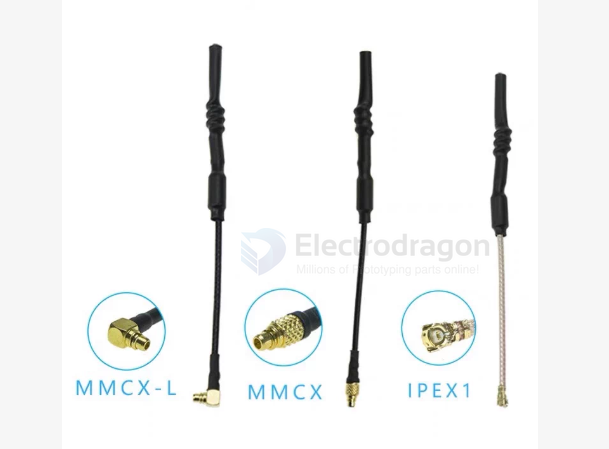
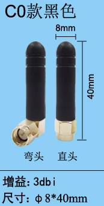
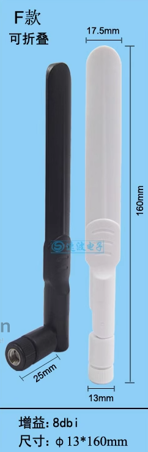
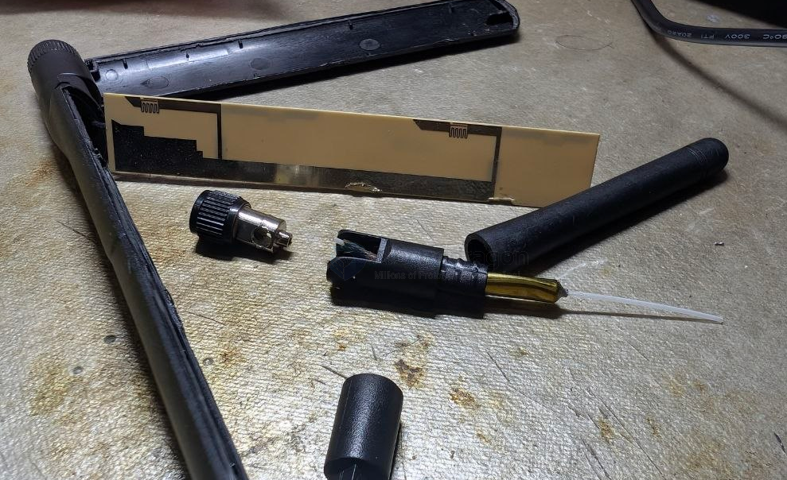
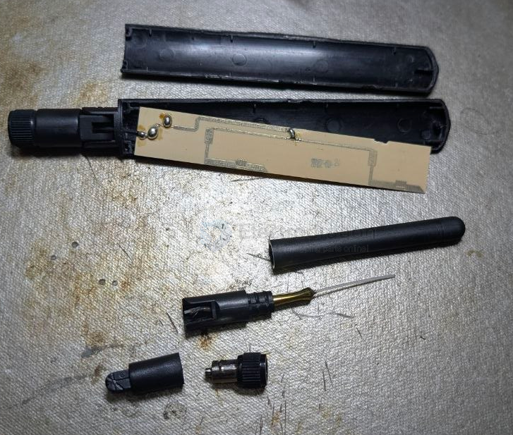

# antenna-sleeve-dat

antenna-whip-dat

Sleeve Dipole Antenna（套筒偶极天线） / Coaxial Antenna（同轴天线）   

适用场景：如果在无线电通信、基站或 FPV/RC 遥控接收中，利用铜管/黄铜管套在同轴电缆外皮外侧作为1/4波长下端臂（Ground/Counterpoise），这种结构在专业射频领域通常被称为 Sleeve Antenna。

## 5dbi 

## rod 

== antenna rod 

- **Type:** Whip Antenna (Monopole)

- **Features:**
  - Single element design (simpler than dipole)
  - Compact and lightweight
  - Commonly used in:
    - Receiver modules
    - Transmitters where space is limited
  - Benefits:
    - Easy to install
    - Cost-effective
  - Appearance:
    - Slim vertical rod inside heat shrink tubing

## antenna shape, size and gain 

| type     | rod                          | paddle                       |
| -------- | ---------------------------- | ---------------------------- |
| style    |  |  |
| gain     | 2dbi                         | 8dbi                         |
| Features | -                            | foldable                     |

## whip antenna inside 

- [[PCB-dat]] or [[cable-dat]]

## ref 