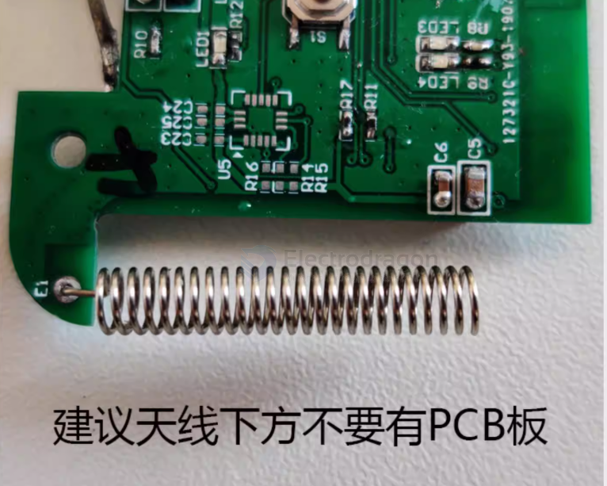

# antenna-position-dat

- [[antenna-dat]] - [[antenna-position-dat]] 

- ① 两根天线彼此隔开 ≥3cm —— 否则 400mW 的 VTX 近场会堵住接收机前端
- ② 遥控器天线与机载 ELRS 天线要保持【平行】（都竖直）→ 正交会掉 20dB
- ③ ⚠️ VTX 天线叶片断了立刻换，别通电 —— 400mW 反射能量会烧功放

## antanna installation 

- [[antenna-spring-dat]]

better NO PCB under the antenna 

## ref 

