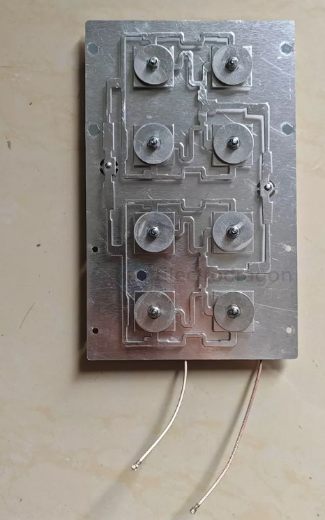

# antenna-Radiator-dat

- [[5.8gzh-dat]] - [[antenna-Radiator-dat]]

5.8G天线阵子，8振子，增益16dBi，铝材质，规格200*120*14mm

接口1代IPEX、SMA内针内孔，馈线RG178/316，线长0.2-1m，阻抗50Ω，驻波比≤1.3

### 1. 是全向还是定向？

* **结论：定向天线（Directional Antenna）**
* **原因**：
* **高增益**：16dBi 对于 5.8GHz 频段来说是一个非常高的增益。全向天线（如蘑菇头、鞭状天线）由于要把能量均匀分散在水平 360 度，增益很难做到这么高（通常在 2~9dBi 左右）。
* **平板阵列形态**：200×120mm 的长方形铝质外壳里面排列了 8 个振子，这属于典型的**平板阵列天线**。它通过相位叠加，把能量像手电筒的光束一样**集中推向正前方**的一个特定扇形角度内，从而实现超远距离的图传接收或发射。使用时必须将天线正面朝向无人机。

### 2. 极性（极化方式）是什么？

* **结论：线极化（Linear Polarization）**（通常为**垂直极化**，具体取决于你安装时天线振子的朝向）。
* **原因**：
* 这种由多个金属振子或微带贴片组成的平面阵列，绝大多数都是基础的**线极化**设计，不具备圆极化（RHCP/LHCP 顺时针/逆时针圆极化）特性。
* **搭配建议**：因为它是线极化，你在飞机图传发射端也必须使用**线极化天线**（例如普通的 5.8G 棒状天线、T型偶极子、或者简易双叶线极化天线），并且在安装时要确保地面端和飞机端的**极化方向保持一致**（比如都竖直放置），否则会产生严重的极化损耗，导致信号大幅衰减。

In antenna technology, a **"radiator" or "element" (振子)** is the core physical unit of an antenna responsible for radiation and reception. Simply put, it is the **metal conductor** that converts high-frequency electrical signals into radio waves (during transmission) or converts radio waves back into electrical signals (during reception).

Relating this to the specifications you provided (5.8GHz, 8 elements, 16dBi gain, aluminum material, dimensions 200×120×14mm), we can understand the role of the elements as follows:

### 1. What Does an Element Look Like?
At high frequencies like 5.8GHz, the physical size of an element is very small.
* Common forms include specific shapes of copper foil etched onto a printed circuit board (PCB), or precisely sized pieces or rods of aluminum/copper fixed in specific positions.
* Inside the aluminum rectangular antenna (200×120mm)—typically a high-gain flat panel or microstrip patch antenna array—there are **8 metal radiating units** precisely calculated and arranged in an array. These are the **"8 elements."**

### 2. Why Are Multiple Elements (8 Elements) Needed?
A single piece of metal wire (like the single core wire inside a standard 5.8GHz mushroom or whip antenna) typically has only 1 element, yielding a low gain of around 1.5 to 2.5 dBi and an omnidirectional radiation pattern of 360 degrees.

By utilizing special circuit designs to combine **8 elements** in a specific geometric arrangement (forming an **antenna array**), a powerful physical effect is achieved:
* **Constructive Interference (Beamforming):** The electromagnetic waves transmitted or received by these 8 elements superimpose upon one another. They gather the energy that would otherwise spread in all directions and concentrate it toward a fixed direction (typically directly in front of the antenna).
* **High Gain:** Single elements scatter energy, whereas multi-element arrays concentrate energy. This is why this panel antenna can achieve a high gain of **16dBi** (directivity turns the radiation pattern into a narrow cone or sector, allowing it to reach much greater distances).

### 3. Summary
In this aluminum flat panel antenna:
* **Elements (振子) =** The 8 aluminum metal resonance units responsible for actually transmitting and receiving radio waves.
* **200×120mm Enclosure =** The physical structure that houses and protects the 8 elements, along with the rear feeding network (the circuit board that evenly distributes signals to all 8 elements).

## ref 