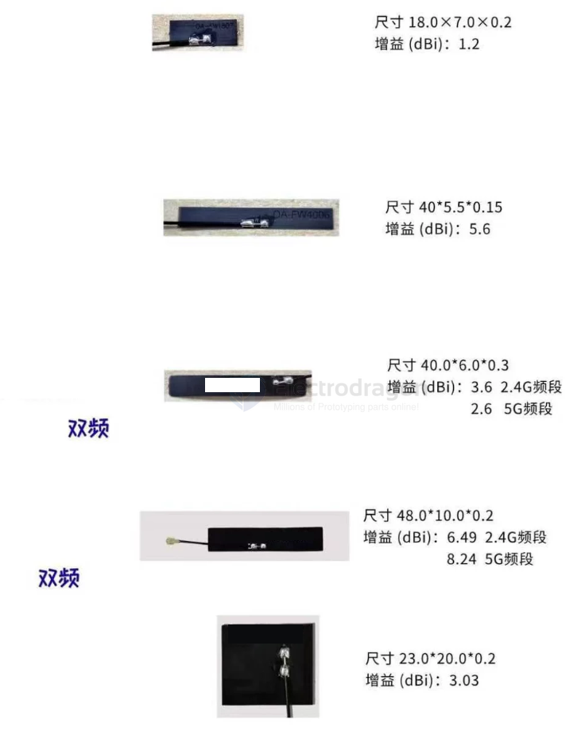
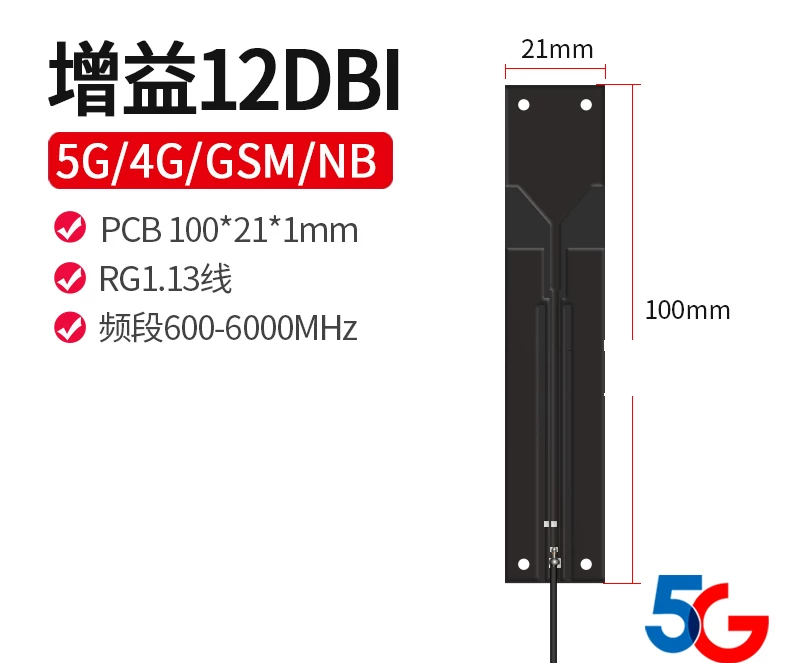

# antenna-FPC-dat

## 型号对比

| 型号         | 频段 | 接口/线长       | 尺寸 (mm)         | 增益 (dBi)              | 方向性 |
| ------------ | ---- | --------------- | ----------------- | ----------------------- | ------ |
| `ED1807`  | 2.4G | 未标注          | 18.0 × 7.0 × 0.2  | 1.2                     | 全向   |
| `ED4006`  | 2.4G | IPEX一代 / 10cm | 40 × 5.5 × 0.15   | 5.6                     | 全向   |
| `ED4007B` | 双频 | IPEX一代 / 20cm | 40.0 × 6.0 × 0.3  | 3.6 (2.4G) / 2.6 (5G)   | 全向   |
| `ED4810`  | 双频 | IPEX一代 / 20cm | 48.0 × 10.0 × 0.2 | 6.49 (2.4G) / 8.24 (5G) | 全向   |
| `ED2320`  | 2.4G | IPEX一代 / 20cm | 23.0 × 20.0 × 0.2 | 3.03                    | 全向   |

## small antenna and gain 

## antenna examples == high gain 

see more high gain antennna at [[antenna-wifi-dat]]

- [[antenna-FPC-dat]] - 12DBI 

## ref 

