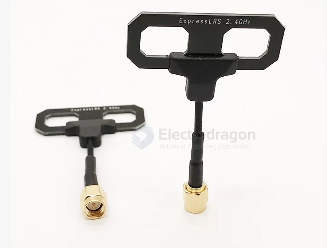
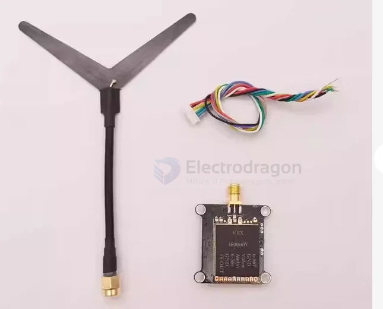
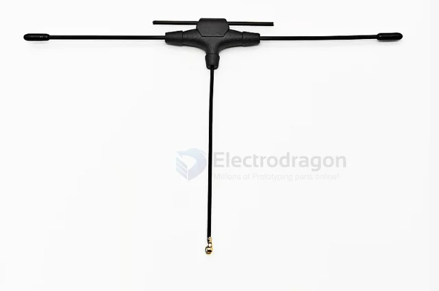
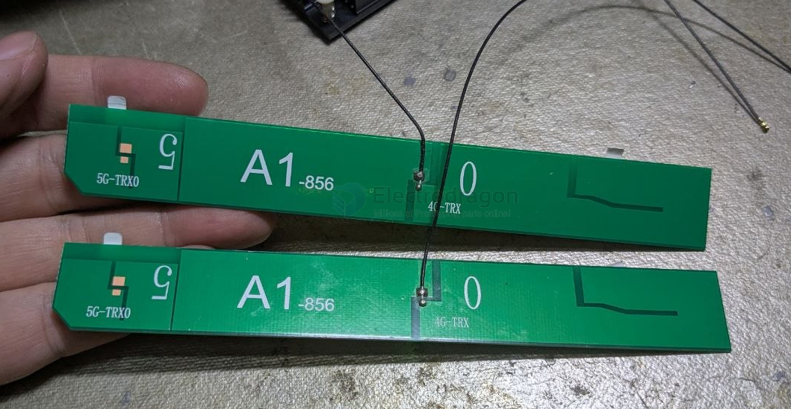

# antenna-dipole-dat

- [[antenna-dat]] - [[antenna-linear-dat]] - [[antenna-dipole-dat]]

- [[ELRS-RX-dat]] - [[antenna-dipole-dat]]

一、先说「偶极」是什么

偶极（Dipole）= 天线的最基本形式：
两根【等长】的金属振子，从中间馈电，左右对称
   ──────┬──────     ← 两根振子的总长 = 半个波长（λ/2）
         │           ← 每臂 = λ/4
       电缆

尺寸随频率变（这是"波长决定天线大小"的直接体现）
频段        波长 λ        偶极全长(λ/2)     每臂(λ/4)
5.8 GHz     51.7 mm       25.9 mm          12.9 mm
2.4 GHz    125.0 mm       62.5 mm          31.2 mm
1.28 GHz   234.4 mm      117.2 mm          58.6 mm
915 MHz    327.9 mm      163.9 mm          82.0 mm

它的两个特性（要记住）
① 增益 ≈ 2.15 dBi（理论最佳值），实用 2dBi
② 方向图是"甜甜圈"：垂直于天线轴的方向最强，⭐ 沿轴的尖端是【零点】
③ 极化：线性极化 → 必须与地面天线【平行】

---

二、「机上偶极」在 OpenIPC 语境里指什么 - [[openIPC-dat]]

OpenIPC 摄像头模组的【原厂天线】通常是：PCB 微带天线
   = 一小块印在电路板上的铜箔，1-2dBi
   缺点：效率低、带宽窄、极易被机身/电池/碳纤影响

⭐ "机上偶极" = 把原厂 PCB 天线拆掉，换成一根【独立的正经偶极】
   （硬质偶极、或柔性 FPC 偶极贴机架）
        ↓
常见收益：+3 ~ +5 dB  ← 这就是 OpenIPC 最便宜的提升手段之一（¥20-50）

机载天线形式对比
形式              增益        极化      评价
原厂 PCB 微带     1-2 dBi     线性      效率低、带宽窄、易受机身影响
柔性 FPC 偶极     2 dBi       线性      ⭐ 贴机架、便宜、比 PCB 明显好
硬质偶极/鞭状      2-2.15 dBi  线性      ⭐ 效率最好、最经典，但怕摔
圆极化蘑菇头       1.5-2 dBi   圆极化    不受姿态影响，但大、重（小机装不下）

用的时候三条要点
① ⭐ 必须竖直安装（与地面天线的极化方向平行）
   正交 = 直接 −20dB
② 别让天线【轴线】正对地面站 —— 轴向是零点，那个方向信号最弱
③ 远离 VTX 天线、电池、碳纤板（至少 3cm）

## cases 

- [[antenna-FPV-dat]] - [[FPV-long-range-dat]] - [[antenna-dipole-dat]]

* **Receiver Upgrade:** Desoldered internal resistors on the flight controller to switch to an external long-range receiver with a proper T-antenna.

## Sleeve Dipole

- 频率(MHz):2400.0
- 效率(dBi):-2.94
- 增益(dBi):4.18
- 效率(%):50.77
- 方向性(dB):7.12
- 峰值增益位置(Theta):0.00
- 峰值增益位置(Phi):270.00
- 重量(克):5.83
- 长(mm)*宽(mm):69*45

**T-dipole / T-style dipole** • Note: most commonly used (FPV/RC circles) **"T" antenna** • Note: colloquial name **Sleeve dipole** • Note: technical name — describes a "T-shaped dipole made from coaxial cable" **Coaxial dipole** • Note: equivalent technical name **Half-wave dipole** • Note: name of the underlying principle

(The TBS Immortal T you know is the classic commercial version of the T-dipole)

🔬 Structural anatomy (how this antenna is built)

        ┌──────┬──────┐
        │upper │lower │   ← T-shaped radiator (two 1/4-wavelength arms)
        └──────┴──────┘
               │
        coaxial cable (feed line)
               │
          SMA connector

Construction principle (Sleeve Dipole):
1. The center conductor of the coax extends out = one arm
2. The cable's shield folds back (the sleeve) = the other arm
3. Total length of both arms = half wavelength, feed point at the center → forms a T shape

The type in your picture (dual-loop PCB version):
- Uses a PCB to etch a double rectangular loop structure (Moxon variant)
- ✅ Advantages: wider bandwidth (covers the entire 2.4G band), rigid structure that won't deform

📐 Working principle

**Polarization**
• Note: linear (the electric field runs along the axis of the element)

**Radiation pattern**
• Note: donut shape 🍩 — strongest perpendicular to the element; zero (null) along the element's axis

**Gain**
• Note: ~2 dBi (an ideal dipole is 2.15 dBi)

**Directivity**
• Note: omnidirectional (360° in the plane perpendicular to the element)

⭐️ What the donut pattern means in practice:
Antenna held vertically → strongest signal all around horizontally ✅
                       → straight above / straight below is the "null" (weakest signal) ⚠️

(So when the RC antenna is held vertically, the signal is actually weak when the aircraft is directly overhead)

📏 Dimensions (calculated by frequency)

**2.4GHz (ELRS)**
• 1/4 wavelength (per arm): ≈ 31mm
• Total length (half wave): ≈ 62mm

**5.8GHz (video link)**
• 1/4 wavelength (per arm): ≈ 13mm
• Total length (half wave): ≈ 26mm

(So a 5.8G T antenna is tiny, while a 2.4G one is noticeably longer)

✅❌ Pros and cons

Pros:
- Light (a few grams) · cheap (¥10-40) · simple and reliable
- Omnidirectional (no aiming needed)
- High efficiency (theoretical dipole efficiency is close to 100%)
- Wideband (the dual-loop PCB version covers the entire 2.4G band)

Cons:
- Linear polarization → -3dB with circular-polarized goggles; aircraft attitude changes cause mismatch
- Axial null (weak signal straight above/below)
- Low gain (2dBi, not great for long range)

🎯 Its role in FPV

**RC receiver antennas (the pair you have)**
• Note: standard on ELRS/CRSF RX (2.4G)

**Video VTX antennas (5.8G micro quads)**
• Note: lightweight choice (weight saving on racers/micros)

**Radio (transmitter) antennas**
• Note: ELRS TX modules (SMA connector)

Why the RC link loves them:
- The RC link doesn't demand the extreme latency/range that video does
- ELRS has frequency hopping + diversity → the system's fault tolerance masks the weak point of linear polarization
- Light / cheap / reliable → no heartbreak when you crash it

📌 One-sentence summary

 T-dipole (Sleeve Dipole) = a half-wave dipole made from coaxial cable: linear polarization, omnidirectional (donut), 2dBi — the most classic RC antenna in the RC world (standard on ELRS), and a lightweight choice for micro-quad video links.

## antenna-Y 

Y Dipole
Shape: the feed line splits into two elements at the end (forming a Y / V shape)
Type: linear polarization (a dipole = linear polarization)
Directivity: omnidirectional (dipole radiation pattern)

## Antenna-T-dat

✅ Features (why micro quads love them)

- Light (less than half the weight of a mushroom antenna)
- Cheap (¥10-40)
- Omnidirectional (no aiming needed)
- High efficiency (linear-polarized dipoles radiate efficiently, around 98%)
- Commonly found on: micro quads / racers (where weight saving comes first)

- [[NAN1011-dat]] - [[antenna-dipole-dat]]

- **Type:** T-style Dipole Antenna (a.k.a. T-antenna)

- **Features:**
  - Balanced dipole configuration with horizontal arms.
  - Provides an omnidirectional radiation pattern in the horizontal plane.
  - Commonly used in:
    - RC aircraft telemetry
    - Ground modules
  - Benefits:
    - Better signal uniformity
    - Enhanced range and consistency
  - Appearance:
    - Red heat shrink tubing
    - Horizontally extended elements

## dual frequency - double T 

915mhz / 2.4Ghz

- [[antenna-tech-dat]] - [[antenna-dipole-dat]] / dual frequency - double T 

## build 

从这张照片的丝印、走线和结构来看，这是一块典型的**路由器或 5G CPE（室内无线网关/随身 Wi-Fi）内置的多频段共板（组合）PCB 天线**。

具体可以看出以下几个非常明显的射频与结构特征：

### 1. 频段与功能分区（丝印信息解读）

* **双天线合板设计（Left & Right 共板）：** 这块长条形 PCB 上集成了两路独立的蜂窝通信天线，中间通过一条垂直的隔离缝/馈电区隔开：
* **左侧（标注 `5G-TRX0`）：** 负责 **5G Sub-6GHz 主收发（TRX0）**，大概率覆盖 **N78 (3.3–3.8GHz)** / **N79 (4.4–5.0GHz)** 或 **N41 (2.5–2.6GHz)** 等高频段。注意它左侧有一个**空焊盘（露铜区域）**，目前没有焊接同轴线，处于未启用或预留分支的状态（上方隐约还能看到另一块同款 PCB，属于 MIMO 阵列中的另一组天线）。
* **右侧（标注 `4G-TRX`）：** 负责 **4G LTE 全频段（以及 5G 低频重耕频段）收发**，覆盖范围通常在 **700MHz ~ 2700MHz**（如 B1/B3/B5/B8/B38/B39/B40/B41）。

* **料号与版本丝印（`A1 -856` 以及 `5` / `0`）：** 这是天线厂的模具/版号标识，数字 `5` 和 `0` 分别对应 5G 单元与 4G 单元的装配方向/编号。

### 2. 天线辐射体拓扑与宽频特征

* **对称偶极子 / 变种单极子 + 耦合寄生单元结构：**
* 观察板子中央焊有黑色同轴线的馈电点（Feed Point）：**同轴线屏蔽层（地）焊在左半侧覆铜上，芯线跨越中央缝隙焊在右半侧覆铜上**，这是标准的**中央馈电偶极子（Dipole）或双臂不对称振子**的馈电方式。
* **右侧（4G-TRX）的阶梯状宽带走线：** 右侧铜皮内部刻蚀出了阶梯状缝隙（Slot）和折线分支，这是为了在有限的狭长板框内**展宽阻抗带宽**——通过不同长度的电流路径分别谐振在低频（700–960MHz）和中高频（1710–2690MHz）。
* **左侧（5G-TRX0）的寄生/高频单元：** 左侧的辐射体长度明显更短，符合 3.5GHz 左右波长更短（$\lambda/4 \approx 21\text{mm}$）的物理特征；同时，即使左侧 `5G-TRX0` 的焊盘没有直接焊线，它在电磁场上也会与右侧产生一定的**寄生耦合（Parasitic Coupling）**，辅助拓展高频响应。

### 3. 馈电工艺与线缆特征

* **直接焊线工艺（Direct Solder，无 IPEX 座子）：** 厂商为了节省成本并减少连接器插损（在 3.5GHz 以上的 5G 频段，一个劣质 IPEX 座子就能带来 0.3~0.5dB 的损耗且容易松脱），直接将极细的 **1.13mm 或 0.81mm 射频同轴线** 剥皮后点焊在 PCB 馈电点上。
* **阻抗匹配：** 走线宽度与板材厚度（目测为常规 0.8mm~1.0mm 厚度的 FR-4 绿油玻纤板）配合，直接针对 **50Ω** 特征阻抗做了免外部匹配元件（无额外贴片电感/电容）的微带化调谐。

### 4. 结构与安装特征

* **切角防呆与卡扣定位：** 左下角有斜切角（Chamfer），顶部边缘有一个白色的塑料/胶带定位凸起，说明它是通过**塑料卡槽直插固定**在设备外壳内壁边缘的，且为了保证净空区（Clearance），安装位置远离主板大面积地平面和金属屏蔽罩。

## ref 

