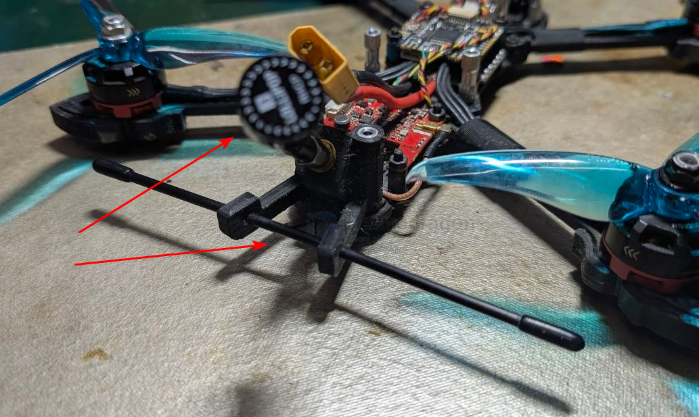
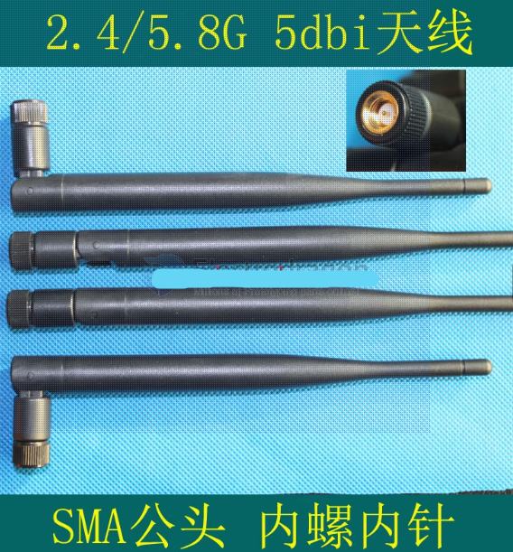
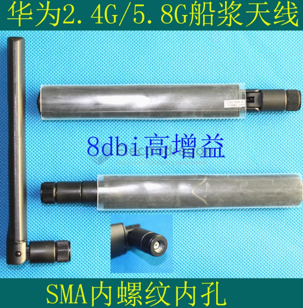
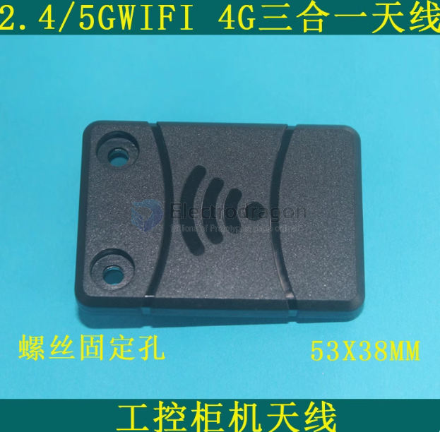

# antenna-type-dat

- [[antenna-app-dat]] - [[antenna-type-dat]]

- [[antenna-type-dat]] - [[antenna-omni-linear-dat]] - [[antenna-omni-circular-dat]] - [[antenna-directional-circular-dat]] - [[antenna-direction-linear-dat]]

by - [[antenna-polarization-dat]] - [[antenna-radiation-dat]] - [[antenna-type-dat]]

Here is the summary of the relationship between omnidirectional, directional, linear polarization, and circular polarization:

### 1. The Two Independent Dimensions
* **Spatial Radiation Dimension (Omnidirectional vs. Directional):** Describes **where** the energy is radiated in space.
  * **Omnidirectional:** Radiates energy uniformly in 360 degrees (doughnut-shaped pattern). Best for broad, all-around coverage.
  * **Directional:** Concentrates energy into a specific beam or sector (like a flashlight). Best for point-to-point links and higher gain.
* **Electromagnetic Polarization Dimension (Linear vs. Circular):** Describes the **oscillation trajectory** of the electric field vector as the wave travels.
  * **Linear Polarization:** The electric field oscillates along a fixed straight line (Vertical or Horizontal). Requires matching polarization between Tx and Rx to avoid massive signal loss.
  * **Circular Polarization:** The electric field vector rotates in a circle as it propagates (Left-Hand or Right-Handed). Highly resilient against multi-path reflections (multipath interference).

### 2. The Combination Matrix

| Polarization \ Radiation  | Omnidirectional                                                                                                                                                      | Directional                                                                                                                                                                                                        |
| :------------------------ | :------------------------------------------------------------------------------------------------------------------------------------------------------------------- | :----------------------------------------------------------------------------------------------------------------------------------------------------------------------------------------------------------------- |
| **Linear Polarization**   | **Most Common.** Examples: Standard whip antennas, most 2.4GHz FPC internal antennas, rubber duck antennas. Radiates 360 degrees with a fixed linear electric field. | Examples: Patch directional antennas, Yagi antennas. Concentrates energy in one direction with a fixed linear field.                                                                                               |
| **Circular Polarization** | **Rare/Complex.** Achieving true circular polarization uniformly across a full 360-degree spherical space is physically difficult.                                   | **Very Popular.** Examples: FPV "mushroom" (cloverleaf/skew-planar wheel) antennas used in drone video links. They provide a broad forward beam with circular polarization immunity against multipath reflections. |

- [[antenna-dat]]

- [[antenna-ceramic-dat]] - [[antenna-lolipop-dat]] 

- [[antenna-spring-dat]] 

- [[antenna-T-dat]] 

- [[antenna-whip-dat]]

## SMA antenna 

5DBi

8DBi 

## box antenna 

## ref 

- [[antenna-dat]]