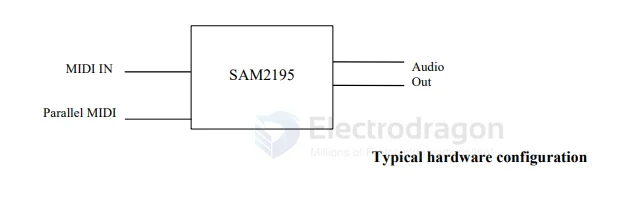
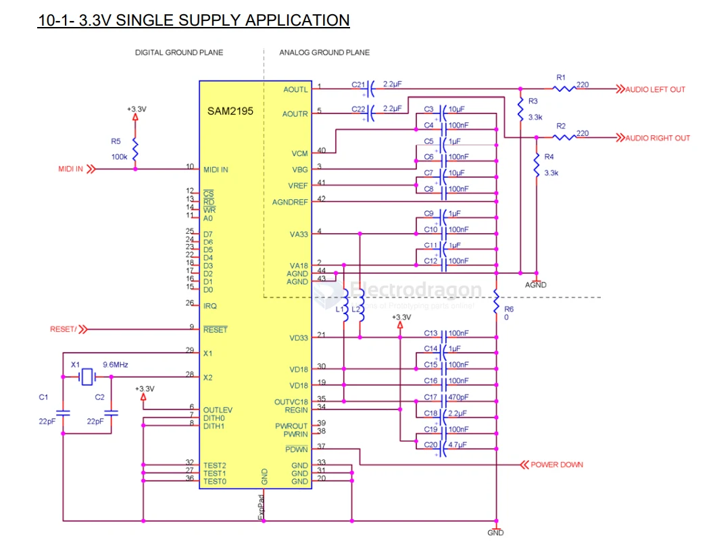

# SYNTHESIZER-dat

- [[audio-dat]] - [[MIDI-dat]] - [[SYNTHESIZER-dat]] - [[DDS-dat]] - [[Digital-Synthesizer-dat]] - [[Voice-Synthesizer-dat]]

- [[CLOCK-SYNTHESIZER-dat]] - [[Digital-Synthesizer-dat]] - [[Voice-Synthesizer-dat]]

tech stack 

- [[digital-dat]] - [[midi-dat]] - [[analog-dat]] - [[audio-dat]]

## chip 

- [[SAM2195-dat]] - [[SAM2695-dat]] - [[dream-dat]] 

## diagram 

## SCH 

## ref 

