# OLED-PCB-dat

- [[OLED-I2C-dat]] - [[OLED-SPI-dat]]

## PCB OLED 

### 0.96"

- [[IOD1003-dat]] - [[IOD1001-dat]]

https://www.electrodragon.com/product/0-96-12864-oled-display-iicspi/

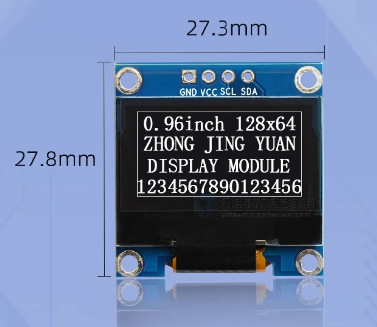

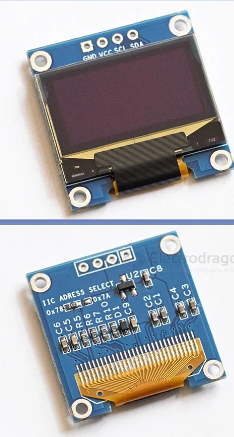

#### specs 

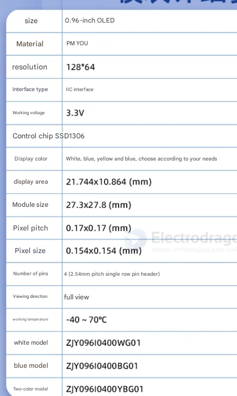

#### Pin definitions and Wiring  

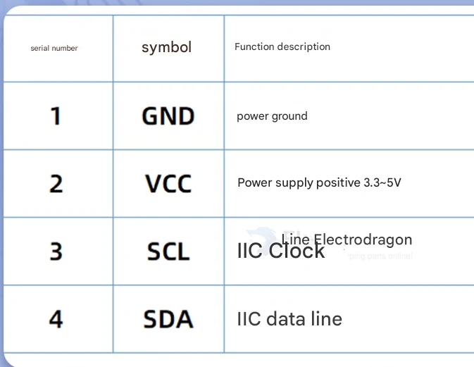

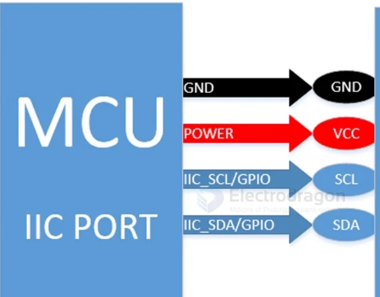

#### Dimension 

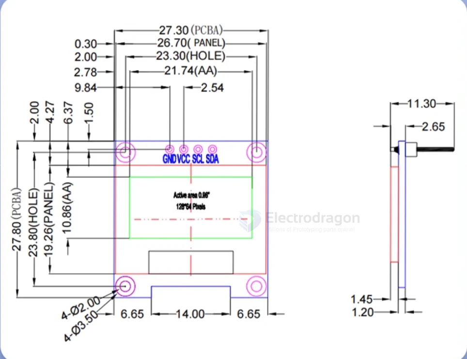

### 1.3"

- [[IOD1004-dat]] - [[IOD1005-dat]]

https://www.electrodragon.com/product/1-3-12864-blue-oled-display-iicspi/

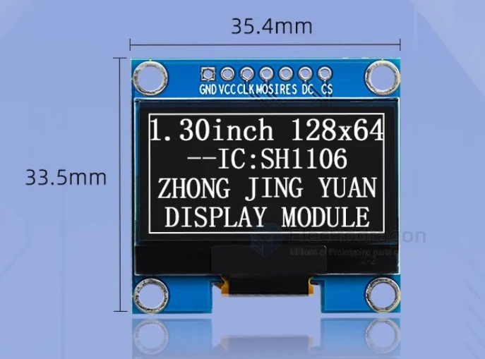

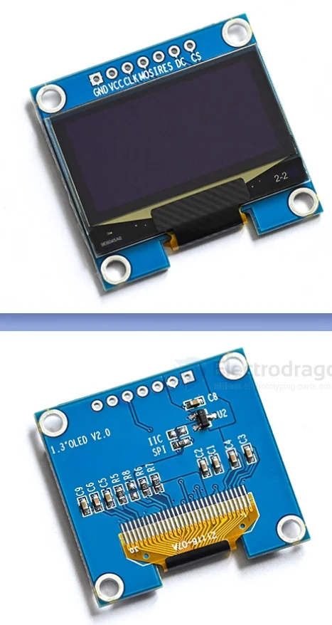

#### specs 

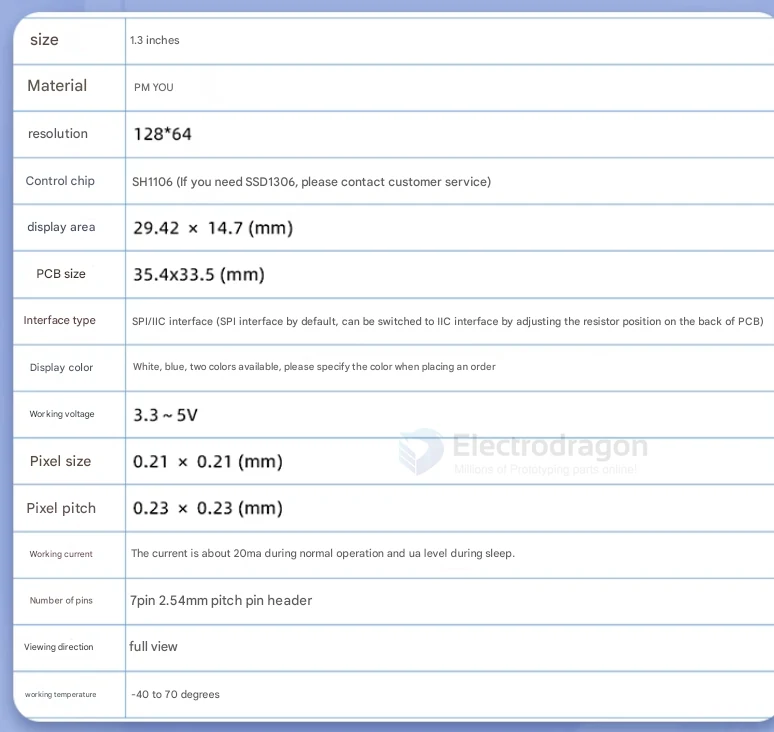

#### Pin definitions and Wiring

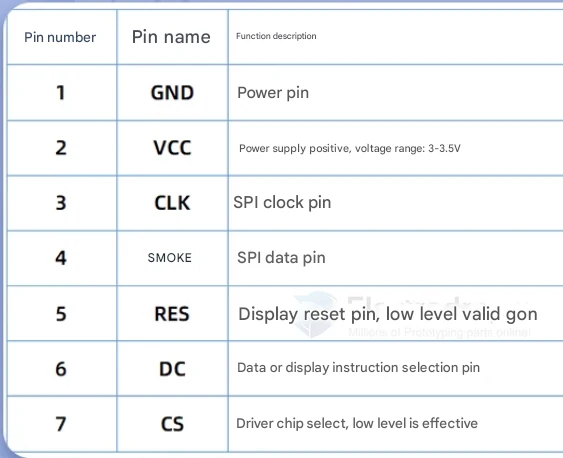

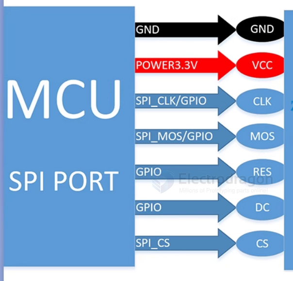

#### Dimension 

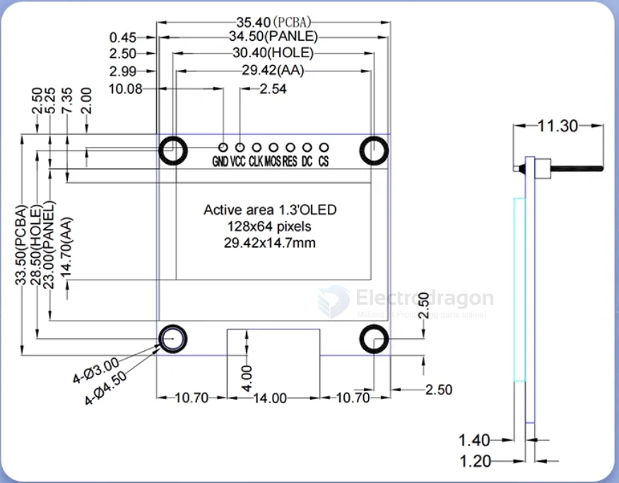

### demo video 

- https://www.youtube.com/watch?v=-S0XRB664-M&feature=youtu.be

- https://www.youtube.com/watch?v=-S0XRB664-M&feature=youtu.be

## ref 

- [[OLED-dat]]
