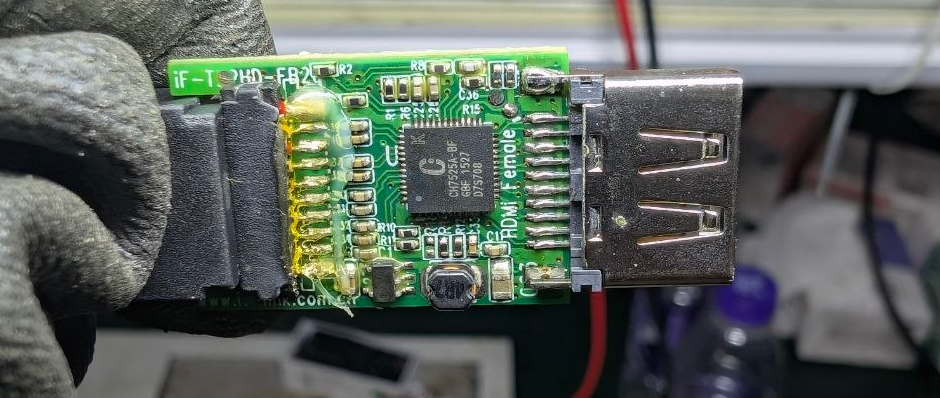
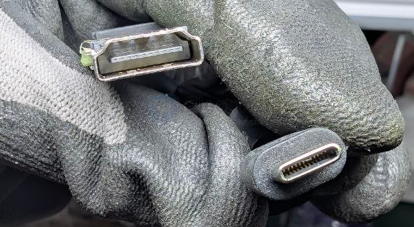
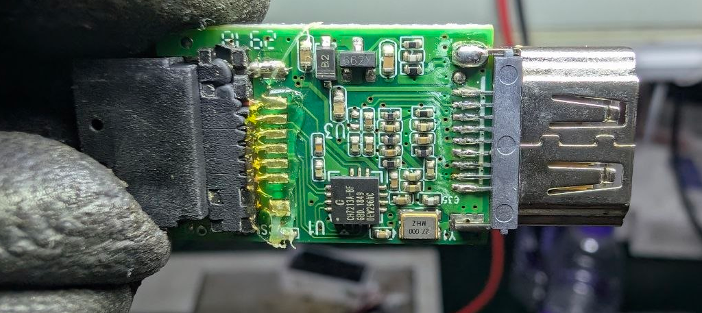

# displayport-dat

- [[USB-controller-dat]] - [[USB-Hub-dat]]

- [[intel-dat]] - [[JHL6340-dat]] - [[USB-Thunderbolt-dat]]

- [[pixel9-dat]] - [[pixel8-dat]]

- [[CONN-USB-C-dat]] - [[PCIE-dat]] - [[displayport-dat]] - [[USB-Thunderbolt-dat]]

## build case 

- [[HDMI-dat]] - [[displayport-dat]] - [[USB-type-c-dat]]

- [[chrontel-dat]] - [[CH7525A-dat]] - [[HDMI-dat]] - [[displayport-dat]] - [[USB-type-c-dat]]

- [[chrontel-dat]] - [[CH7213A-dat]] - [[USB-type-C-dat]]

## info 

- [[USB-3.0-dat]] - [[USB-4.0-dat]] 

DisplayPort (DP) is definitely **not** an exclusive protocol of USB 3.0.

DisplayPort is an independent **digital video interface standard** created by the Video Electronics Standards Association (VESA) primarily for connecting computers to monitors, TVs, and other displays. USB 3.0 (along with newer standards like USB 3.1, USB 3.2, and USB4) is a **universal serial bus data transmission standard** developed by the USB-IF organization.

These two technologies belong to completely different standards bodies, but they have achieved deep integration in the era of the **USB Type-C** interface.

---

### Why do people associate DisplayPort with USB 3.0?

The misconception that DP is exclusive to USB largely stems from the incredible versatility of modern **USB Type-C** interfaces and cables, which support a technology called **Alternate Mode (Alt Mode)**:

1. **Physical Pin Multiplexing (Alt Mode):** A USB Type-C connector includes several high-speed differential signal lines. When a compatible display device is detected, internal switches in the cable repurpose these high-speed pins—which normally carry USB data—to directly transmit native DisplayPort video signals.
2. **Sharing a Single Type-C Cable:** This means a fully-featured USB-C cable can carry USB 3.0/3.1/3.2 high-speed data while simultaneously "borrowing" a few pairs of lanes to stream actual DisplayPort video.
3. **Integration in USB4 / Thunderbolt:** With USB4 and Thunderbolt 3/4, integration goes a step further. DisplayPort video data and regular USB data are packaged together into **data packets** and transmitted concurrently over the exact same high-speed link, eliminating the need to physically switch pin functions.

---

### Summary of Differences

* **What DisplayPort is:** A pure **video/audio transmission protocol**. Aside from USB-C, it is widely used on standard **DisplayPort (DP)** ports, **Mini DP**, and is closely related to digital video transmission principles found in HDMI.
* **What USB 3.0 is:** A pure **universal data transmission protocol** (running at 5 Gbps). It can operate over traditional USB-A ports, older Type-C implementations, or share space cooperatively on a Type-C port alongside a separate DisplayPort stream.

In short, DisplayPort is not exclusive to USB 3.0; it simply "hitches a ride" using USB-C's Alternate Mode to transmit video signals through the USB-C physical connector.

## ✅ Pixel Models That Support DisplayPort
These models **can output video** over USB-C using **DisplayPort Alt Mode**:

### **Pixel 9 Series**
- Pixel 9  
- Pixel 9 Pro  
- Pixel 9 Pro XL  
- Pixel 9 Fold  

**Status:** Full, native DP Alt Mode support.

---

### **Pixel 8 Series**
- Pixel 8  
- Pixel 8 Pro  
- Pixel 8a  

**Status:** Hardware supports DP Alt Mode.  
**Activation:** Enabled through system updates (Pixel 8/8 Pro in June 2024 Feature Drop; Pixel 8a later via update).

---

## ❌ Pixel Models That Do NOT Support DisplayPort
These models **cannot output video** through USB-C:

- Pixel 7a, Pixel 7, Pixel 7 Pro  
- Pixel Fold (1st generation, 2023)  
- Pixel 6a, Pixel 6, Pixel 6 Pro  
- Pixel 5, Pixel 5a  
- Pixel 4, 4a, 4 XL  
- Pixel 3, 3a  
- All older Pixel phones  

**Reason:** Google removed DisplayPort support after Pixel 2 and only restored it for the Pixel 8 series and newer.

---

## ⚠ Important Details
- Requires a **USB-C cable/adapter that supports DP Alt Mode**.  
- Output mode is typically **screen mirroring**, not a desktop UI.  
- Works with **USB-C to HDMI** or **USB-C to DisplayPort** adapters.

## info 

DisplayPort (DP) is a **digital video and audio interface standard** used to connect computers, GPUs, and monitors. It supports **high resolution**, **high refresh rate**, and **multi-monitor setups**.

---

## 🖥️ What DisplayPort Does
- Transmits **digital video** from computer to monitor.
- Transmits **audio** through the same cable.
- Supports **USB-C DisplayPort Alt Mode** for modern devices. - [[USB-type-c-dat]]

---

## ⚡ Main Features
- **Higher bandwidth** than older HDMI versions.
- Supports **4K / 5K / 8K / 10K** resolutions.
- Supports **high refresh rates** (144Hz, 240Hz, 360Hz).
- **Daisy-chain** multiple monitors with MST (Multi-Stream Transport).
- Full-size DP has a **locking connector**.

---

## 🎮 Why Gamers & Creators Like DisplayPort
- Best for **high refresh rate monitors**.
- Very stable at **high resolution + high FPS**.
- Recommended for PC gaming setups.

---

## 🔌 DisplayPort Versions

| Version | Bandwidth | Max Example Resolution |
|--------|-----------|------------------------|
| **1.2** | 17.28 Gbps | 4K @ 60Hz |
| **1.3** | 32.4 Gbps | 4K @ 120Hz |
| **1.4** | 32.4 Gbps | 4K @ 144Hz, 8K @ 60Hz (DSC) |
| **2.0 / 2.1** | 77–80+ Gbps | 4K @ 240Hz, 8K @ 165Hz, 10K |

---

## 🔌 Connectors That Can Carry DisplayPort
- **DisplayPort (full-size)**
- **Mini DisplayPort**
- **USB-C (DP Alt Mode)**
- **Thunderbolt 3/4/5** (compatible with DP Alt Mode)

---

## 🆚 DisplayPort vs HDMI (Quick Comparison)
- **DisplayPort** → Best for PC monitors & high refresh rates  
- **HDMI** → Best for TVs & game consoles

---

If you want, I can also output:
- DisplayPort vs HDMI for **your RX550 GPU**
- Which DP/HDMI cable you need for **144Hz / 165Hz / 240Hz**
- Whether your **monitor** supports DP version X
