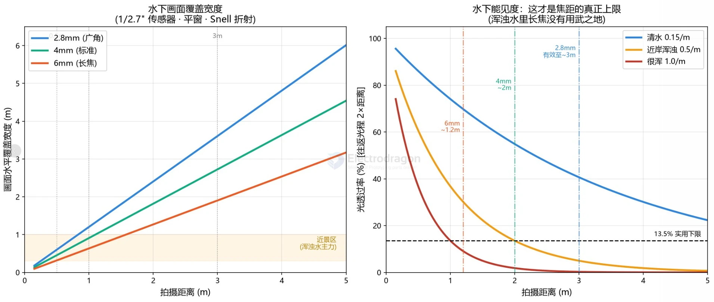
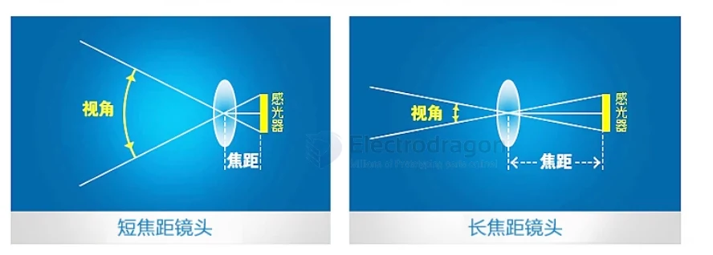
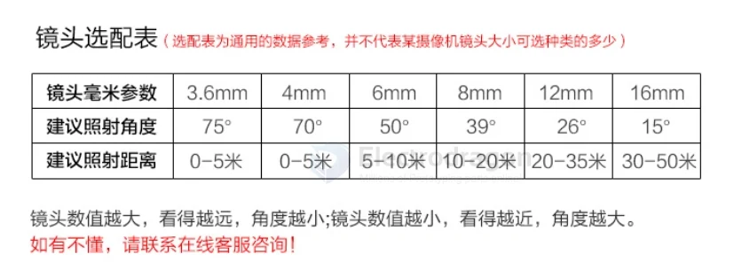
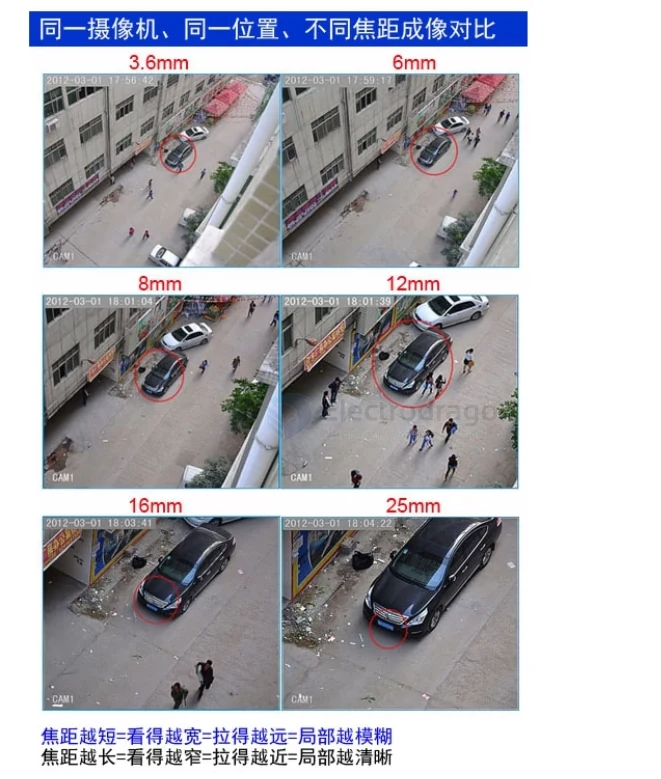
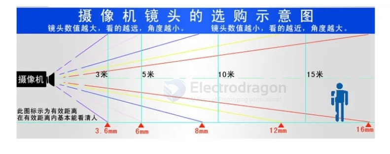

# lens-focal-length-dat

## 拍摄距离 

二、⭐️⭐️⭐️ 关键：能见度决定焦距上限

光往返 2× 距离的透过率

| 目标距离 | 清水 0.15/m | 近岸浑浊 0.5/m | ⚠️ 很浑 1.0/m |
| -------- | ----------- | -------------- | ------------ |
| 0.5 m    | 86.1%       | 60.7%          | 36.8%        |
| 1.0 m    | 74.1%       | 36.8%          | ⚠️ 13.5%      |
| 1.5 m    | 63.8%       | 22.3%          | ⚠️ 5.0%       |
| 2.0 m    | 54.9%       | ⚠️ 13.5%        | ⚠️ 1.8%       |
| 3.0 m    | 40.7%       | ⚠️ 5.0%         | ⚠️ 0.2%       |

⭐⭐⭐ 浑浊水(0.5/m) 下 2m 处只剩 13.5% 亮度
   → 6mm 长焦拍 3m 外，光根本不够
        ↓
⚠️ 长焦放大的是【浑浊造成的低对比】，不是细节
   → 只会得到"更大更糊"的画面
        ↓
📌 实际有效距离：
   · 2.8mm → ~3-5 m（视场大，细节少）
   · 4mm   → ~2-3 m ⭐ 最平衡
   · 6mm   → ~1-1.5 m（只有极清水才划算）

## 等效焦距 

焦距	水平 FOV 空气	⭐️ 水平 FOV 水下	等效焦距
2.8 mm	86.5°	⭐️ 62.0°	3.72 mm
4.0 mm	66.7°	⭐️ 48.9°	5.32 mm
6.0 mm	47.4°	⭐️ 35.2°	7.98 mm

场景	能见度	⭐️ 推荐
渔探/找鱼/赶海/看水下结构	0.5-2 m	⭐️ 2.8mm
通用水下拍摄（鱼、底部、环境）	1-3 m	⭐️⭐️ 4mm
拍清水远处目标/鱼群	> 5 m	6mm
拍结构细节（船底、桩基）	1-2 m	⭐️ 4mm 或 6mm

在监控摄像机中，焦距（单位：mm）越小，监控视野越广，但是画面中物体成像小；
焦距越大，监控视野越窄，但画面物体成像更清楚。一下为焦距与视野对比图：

## ref 