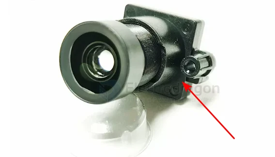

# lens-mount-dat

- [[lens-dat]] - [[lens-mount-dat]]

· 20mm 孔距 M12 座淘宝 ¥5-20，一大把
· 座高 6 / 7 / 8.5 / 10 / 12 / 13 / 14.5 / 16.5 mm 任选
        ↓
📌 三条可行组合：
   ① ⭐ 原装 4mm F0.95（自带 20mm 座）→ 直接固定，先试能否合焦
   ② ⭐⭐ 自配 20mm 孔距 M12 矮座（6-7mm）+ M12 版 4mm F1.2
        → 座高可精确匹配后焦，最稳妥
   ③ 自配 M12 座 + 2.8mm 广角（要更广视野时）

| 产品                            | 螺纹    | 座高    | 孔距  |
| ------------------------------- | ------- | ------- | ----- |
| Commonlands CLA020              | M12×0.5 | 10.0 mm | 20 mm |
| Scorpion 套件 #1                | M12     | 16.5 mm | 20 mm |
| Scorpion 套件 #4                | M12     | 10 mm   | 20 mm |
| Scorpion 套件 #5                | M12     | 7 mm    | 20 mm |
| 淘宝睿智鑫 矮款                 | M12     | 14.5 mm | 20 mm |
| hupuu HLD-M12-13.5 | M12     | 3.5 mm  | 20 mm |

⚠️ 孔距几乎都是 20mm，但座高从 6mm 到 16.5mm 都有
        ↓
📌 孔距对上 = 螺丝能拧上 ≠ 能合焦

## 镜头机械后焦 = 5.48 mm

- [[yutong-dat]] - [[lens-dat]] - [[lens-mount-dat]]

装配条件：座的有效高度 h + 传感器凸出 PCB 高度 d = 5.48 mm

情形	处理
- h + d = 5.28 mm	加 0.2 mm 垫片
- h + d = 5.48 mm	⭐️ 直接匹配
- h + d = 5.70 mm	车削座底 / 换矮座
- h + d = 6.50 mm	换矮座或换镜头

⭐ 传感器封装凸出 PCB 常见 0.3-1.0 mm
⭐ 5.48mm 属【短后焦】→ 需要【矮座】（6-7mm 档）

## ref 

