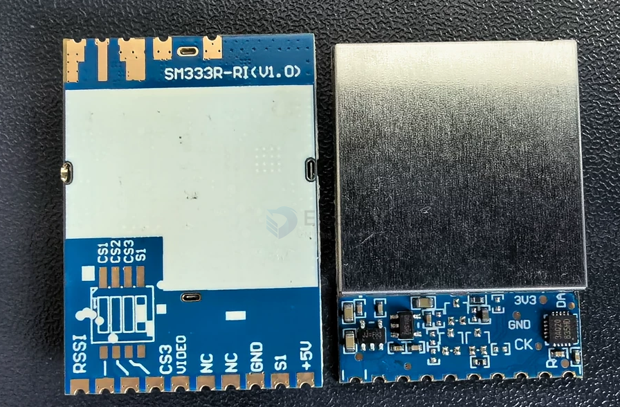
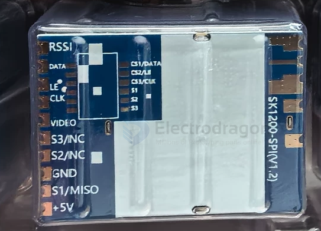
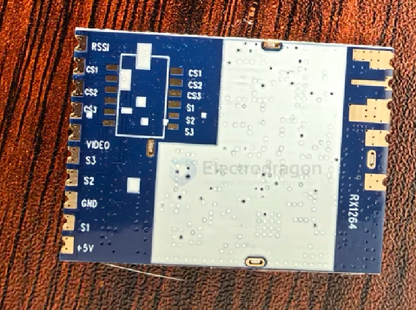
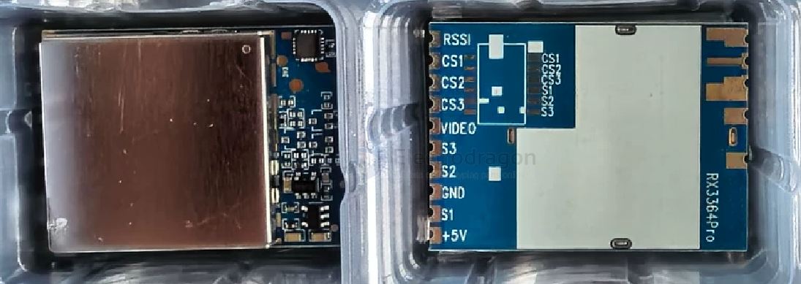
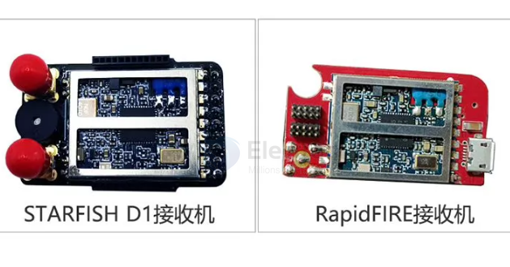

# VRX-analog-dat

- [[VRX-analog-dat]] - [[VRX-dat]] - [[5.8Ghz-dat]] - [[RTC6705-dat]] - [[RX5808-dat]]

- [[RX5808-dat]] - [[5.8Ghz-dat]] - [[RTC6715-dat]] == [[VRX-analog-dat]] - [[RTC6705-dat]] == [[VTX-analog-dat]] - [[video-analog-dat]]

- MM238RW
- [[RX5808-dat]]
- RX3364
- RX3364PRO
- SM333R
- RX1264
- SK1200
- SK3500
- RX5808（V3.3）
- 

- [[1.2Ghz-dat]]
- [[3.3Ghz-dat]]
- [[5.8Ghz-dat]]

## SM333R 

## SK1200-SPI 

## RX1264 

## RX3364pro

## receiver 

## ref 