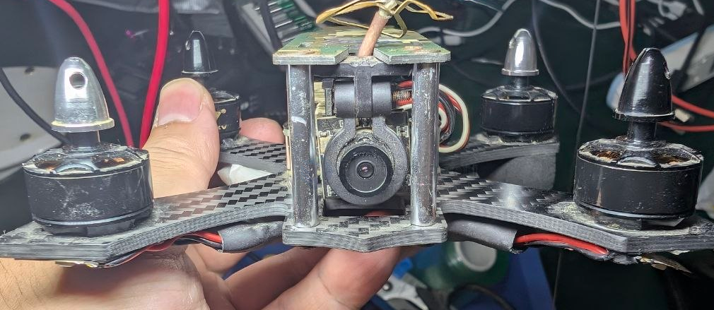
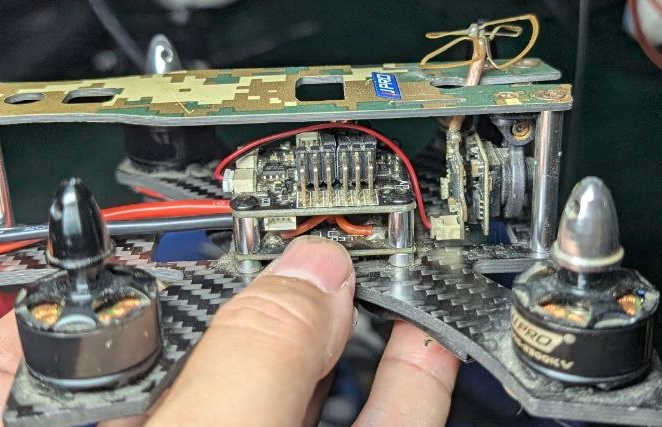
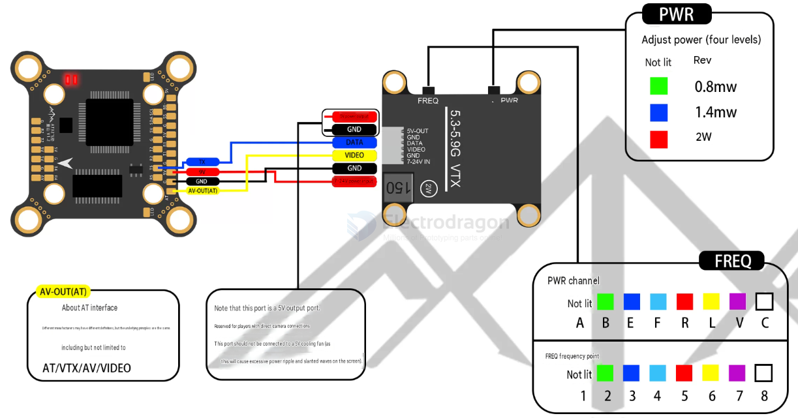
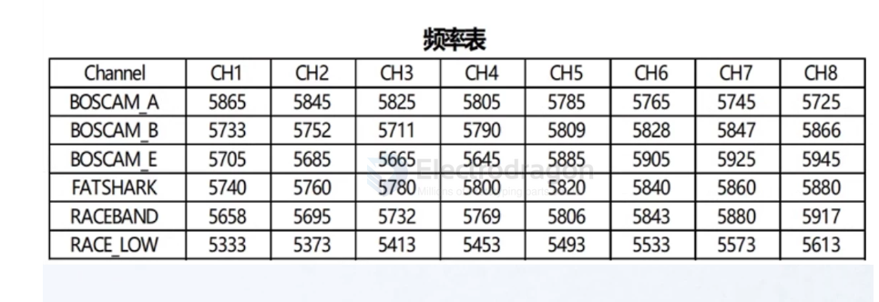

# VTX-analog-dat

## VTX+CAM integrated 

## build 

build 1 

- [[RTC6705-dat]]

## installation and tuning 

- [[5.8Ghz-dat]] - [[frequency-dat]] - [[VTX-dat]]

physical installation 

- [[camera-FPV-dat]] - [[camera-FPV-canopy-dat]] - [[FPV-build-dat]] - [[FPV-dat]] - [[VTX-dat]] - [[sensor-camera-dat]] - [[camera-mount-dat]]

### frequency table 

## chip solutions 

### 1. RF / Video Transmitter Chips
| Chip / IC                 | Function                        | Notes / Typical Use                       |
| ------------------------- | ------------------------------- | ----------------------------------------- |
| **MAX1476**               | RF Power Amplifier              | Low-power analog VTX, 25–200 mW           |
| **MAX2606 / MAX2608**     | VCO / PLL / Frequency Generator | Generates carrier frequency, used with PA |
| **RFPA022 / RFPA023**     | RF Power Amplifier              | Popular in 600 mW–1 W micro/mini VTX      |
| **AVT / TX5823 / TX5828** | Integrated VTX module ICs       | Often in “all-in-one” VTX PCBs            |

### 2. Video Input / Processing
| Chip / IC                                  | Function                                    | Notes / Typical Use              |
| ------------------------------------------ | ------------------------------------------- | -------------------------------- |
| **LMH1980 / LMH1981**                      | Sync separator / video input                | For analog video sync processing |
| **MAX7456**                                | OSD (On-Screen Display)                     | Overlay telemetry / battery info |
| **Microcontrollers (STM8 / ATtiny / PIC)** | Channel selection, power control, OSD logic | Common in Tramp / SmartAudio VTX |

### 3. Voltage Regulation & Power
| Chip / IC                  | Function                     | Notes / Typical Use                        |
| -------------------------- | ---------------------------- | ------------------------------------------ |
| **LM2596 / LM1117**        | Linear / Switching Regulator | Provides stable voltage for VTX            |
| **AMS1117**                | Linear Regulator             | Low-cost 5V or 3.3V rail for low-power VTX |
| **Inductors / Capacitors** | Filtering & smoothing        | Reduce RF noise on power lines             |

### 4. RF Output / Matching Components
- **Discrete components**: Inductors, capacitors, microstrip traces for impedance matching (50 Ω).
- Sometimes **MMCX / U.FL / SMA connector ICs** for external antennas.

---

### 💡 Notes
- Many **modern VTX modules** combine RF PA + PLL + video input + microcontroller in a **single small IC or module**, like those found on Mobula8.  
- High-end HD digital VTX (DJI, Walksnail) use **custom ASICs** rather than discrete PA chips.  
- For typical analog 5.8 GHz micro drones: MAX1476/MAX2606 + LMH1980 + STM8 is a very common combo.

## ref 

