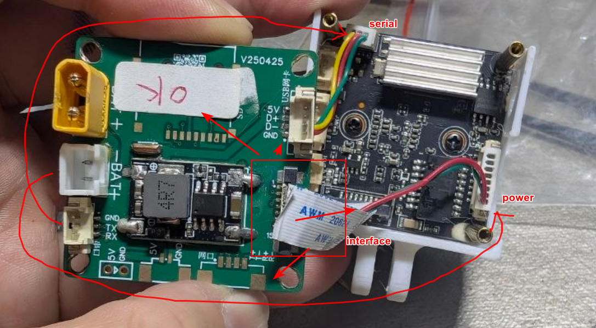
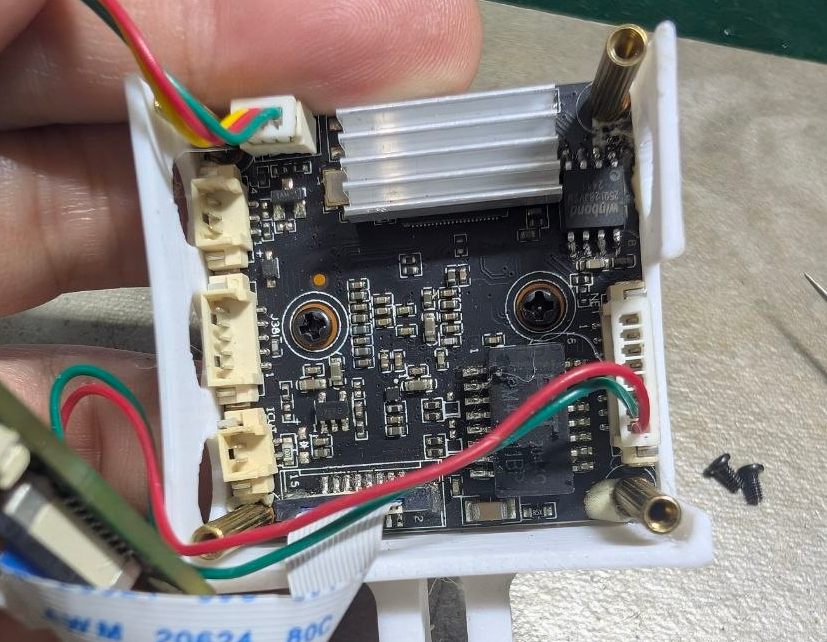
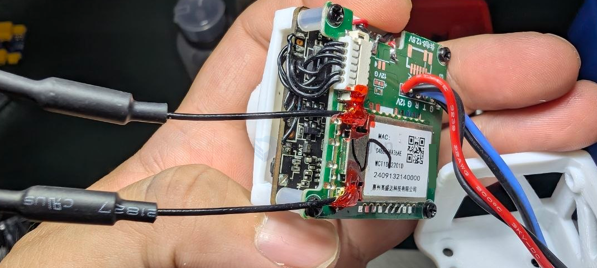

# VTX-openIPC-build-dat

- [[VTX-openIPC-dat]] - [[HI3516-dat]] - [[RTL8812-dat]]

https://openipc.org/cameras/vendors/hisilicon/socs/hi3516ev200

- [[VTX-openIPC-log-dat]] 

- [[flash-dat]]

- [[IVG-G2S-dat]] - [[HI3516-dat]] - [[VTX-openIPC-dat]]

- [[CONN-FPC-dat]] - [[PCB-stack-dat]]

## build 2 

## build 1 

- [[VTX-openIPC-dat]] - [[VTX-dat]] - [[HI3516-dat]] - [[VTX-openIPC-build-dat]] - [[IVG-G2S-dat]]

- [[flash-NOR-dat]] - [[flash-NAND-dat]]

- [[openIPC-dat]]

- [[MSPOSD-dat]] - [[mavlink-dat]] - [[OSD-dat]] - [[VTX-openIPC-dat]]

- [[VTX-openIPC-dat]] - [[VTX-dat]]

- [[hi3516-dat]]

## ref 

