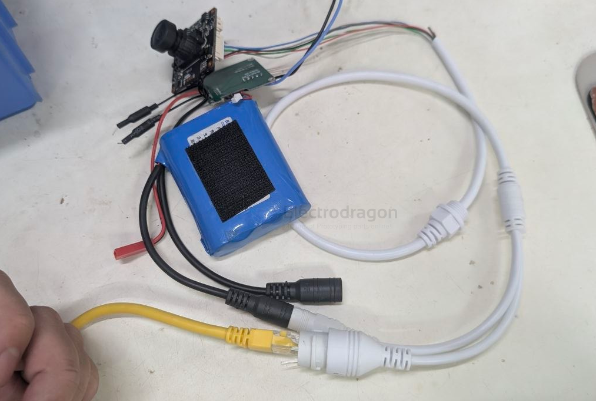
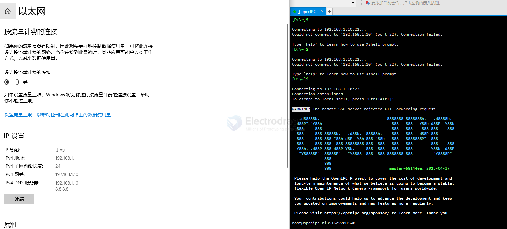

# VTX-openIPC-dat

- [[VTX-openIPC-build-dat]]

- [[openIPC-chip-dat]] - [[VTX-openIPC-dat]]

- [[VTX-openIPC-log-dat]] - [[VTX-openIPC-ethernet-dat]]

== [[camera-IP-dat]] - [[hi3516-dat]] +++ [[wifi-sdio-dat]] // [[wifi-adapter-dat]] - [[RTL8812eu-dat]] - [[RTL8812-dat]]

- [[VTX-openIPC-dat]] - [[VRX-openIPC-dat]]

- [[OSD-dat]]

- [[ethernet-dat]] - [[cable-enthernet-dat]] - [[ethernet-POE-dat]] - [[cable-dat]] - [[power-dat]]

## OSD 

- [[hi3516-dat]] - [[OSD-dat]]

PWM1 

关于OSD接线：飞控端口设置：mavlink，波特率115200，飞控TX接的摄像头上的pwm1 

## Setup ethernet Configuration 

Connection setup 

1、电脑网络 IP 改手动设置（192.168.1.1 255.255.255.0 192.168.1.10 8.8.8.8）；

- [[WIN10-net-dat]] - [[WIN10-dat]]

账号root，密码12345，

2、CMD 命令（win+r）输入 ssh root@192.168.1.10+回车;
3、输入“yes”+回车;
4、输入“12345”（输入不显示）+回车；
5、按调参教程操作。

- [[serial-dat]] - [[SSH-dat]] 

输入vi/etc/wfb.conf回车，注意空格
vi /etc/wfb.conf

setup wfb.conf 

    ### unit: drone or gs
    unit=drone

    wlan=wlan0
    region=00
    ### By default used channel number, but, you may set freq instead. For ex: 2387M
    channel=161
    channel=161
    txpower=1
    driver_txpower_override=45
    bandwidth=20
    stbc=0
    ldpc=0
    mcs_index=1
    vht_mode=0
    vht_nss=1
    stream=0
    link_id=7669206
    udp_port=5600
    rcv_buf=456000
    frame_type=data
    fec_k=8
    fec_n=12
    pool_timeout=0
    guard_interval=long
    dis_cca=0
    edcca_thresh_override_en=0
    edcca_thresh_override=-40
    bf_en=0
    bf_remote_mac=00:11:22:33:44:55
    bf_ackto=100
    bf_interval=0.1

    ~
    ~
    ~

切换Msposd输入vi /etc/telemetry.conf回车 - [[MSPOSD-dat]] - [[mavlink-dat]] - [[OSD-dat]] - [[VTX-openIPC-dat]]

vi /etc/wfb.conf
vi /etc/telemetry.conf

setup info telemetry.conf

    ### unit: drone or gs
    unit=drone

    serial=/dev/ttyAMA0
    baud=115200

    ### router: use simple mavfwd (0), classic mavlink-routerd (1) or msposd instead of mavfwd (2)
    router=2

    wlan=wlan0
    bandwidth=20
    stbc=1
    ldpc=1
    mcs_index=1
    stream_rx=144
    stream_tx=16
    link_id=7669206
    frame_type=data
    port_rx=14551
    port_tx=14550
    fec_k=1
    fec_n=2
    pool_timeout=0
    guard_interval=long
    one_way=false
    aggregate=15

    ### for mavfwd: RC override channels to parse after first 4 and call /usr/sbin/channels.sh $ch $val, defa
    channels=8

    ### for msposd: OSD over video
    fps=20
    ahi=0
    tel_port=14551
    tun_ip=10.5.0.1
    tun_port=14551
    ~
    ~
    ~

resolutions 

vi /etc/majestic.yaml

## connect to flight controller OSD 

飞控 5V接摄像头USB线正极(如果想用12V供电，可以改到另一个座子供电，要到群里确认，接错板子会烧掉)
飞控 GND接板上金色飞线(下方有示意图)
飞控 T6摄像头串口 R

飞控 5V 或者 9v 接 图传 JST 母座红线 5V-12V（建议直接接到 2-3S 电池上）
飞控 GND 接 图传 JST 母座黑线（建议直接接到 2-3S 电池上）
飞控 TX6 接 图传杜邦线（黄线 R 上）
飞控 RX6 接 未焊线（一般不用）

- [[INAV-dat]] - [[VTX-openIPC-dat]] - [[OSD-dat]] - [[mavlink-dat]] - [[rc-system-dat]] - [[betaflight-OSD-dat]]

## ref 

