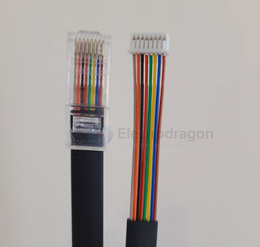
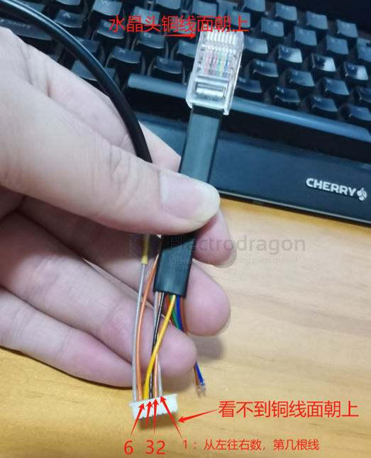
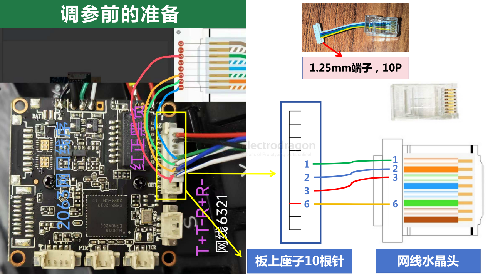

# VTX-openIPC-ethernet-dat

- [[openIPC-dat]]

- [[VTX-openIPC-ethernet-dat]] - [[VTX-openIPC-dat]] - [[ethernet-dat]]

## connect to PC for debugging 

查看路由器的设备，可以看到新的连接上来了（主板使用DHCP获取IP地址，用路由器方便看地址和分配地址，直接网线插电脑也可以，但是IP需要自己想办法获取

## ref 

