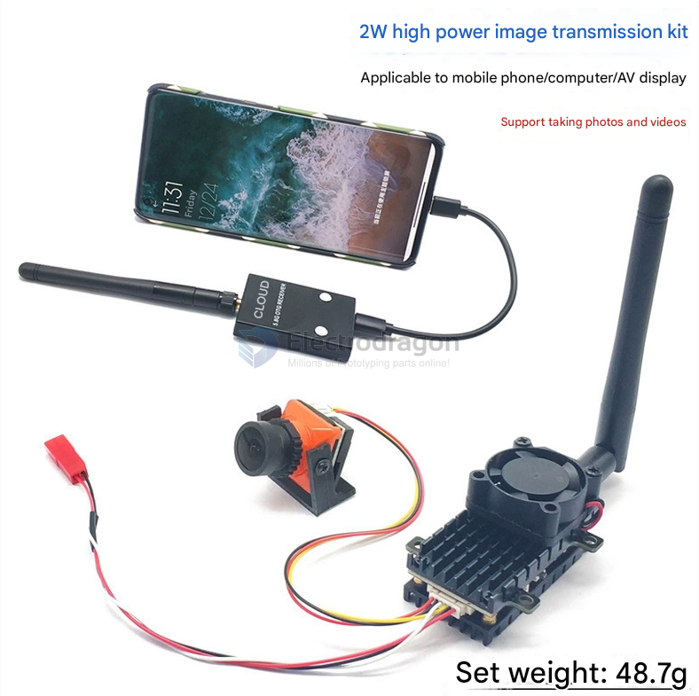
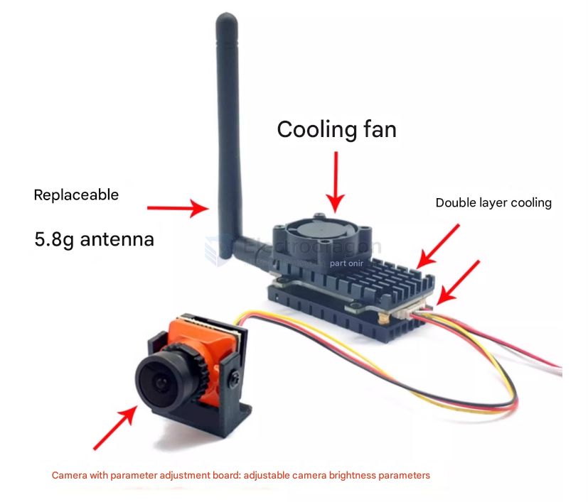
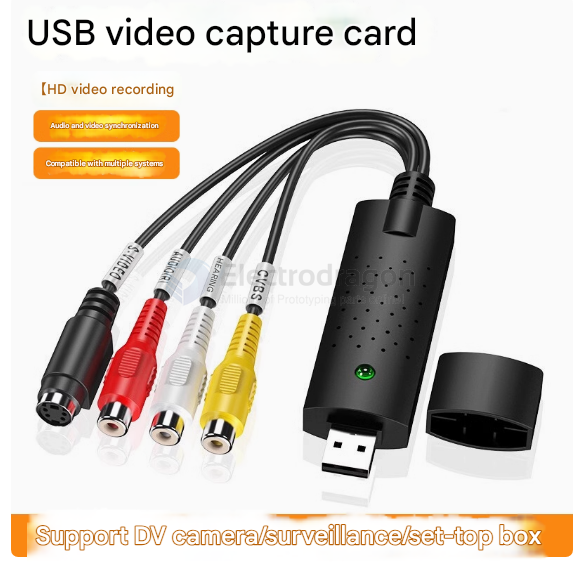
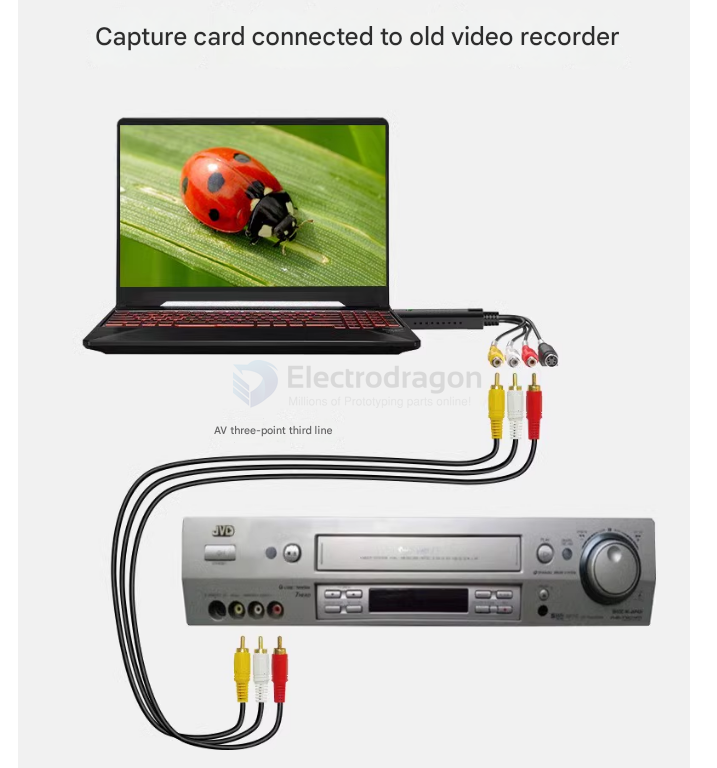
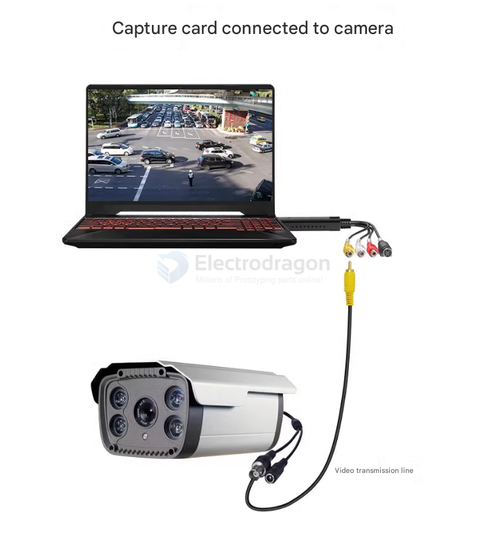

# video-analog-dat


- [[video-analog-dat]] - [[video-digital-dat]] - [[video-transmission-dat]] - [[video-dat]]

- [[VTX-dat]] - [[VRX-dat]]


- [[video-analog-dat]] - [[video-transmission-dat]] - [[video-dat]] - [[camera-analog-dat]]


- [[video-digital-dat]] - [[video-dat]] - [[video-analog-dat]]


- [[CVBS-dat]] - [[AHD-dat]] - [[TVI-dat]] - [[CVI-dat]] - [[analog-video-dat]]


- [[sensor-camera-dat]] - [[camera-analog-dat]] - [[camera-FPV-dat]]


- [[frequency-dat]] - [[VTX-analog-dat]] - [[VRX-analog-dat]]

- [[1.2ghz-dat]] - [[3.3ghz-dat]] - [[5.8ghz-dat]] - [[7.2ghz-dat]]

- [[antenna-dat]]


- [[NTSC-dat]] - [[PAL-dat]] - [[seCAM-dat]] - [[video-analog-dat]] - [[DVR-dat]]


## apps 

- [[video-analog-switcher-dat]] - [[video-analog-dat]]

- [[true-diversity-dat]] - [[antenna-diversity-dat]]

## solutions 

RX5808【带音频】

RX5808【不带音频】

SK3500-SPI【3.3G/3100~3800MHz】

RX3364-CPB【3.3G带RSS】

3301Rx【3.1-3.7G带宽SPI模式】

RX3364PRO【带RSSI/3.3GHz】

VM1373R【1.2G/1.3G】

RX3364【不带RSSI/3.3G】原装

RX3364【不带RSSI/3.3G】低配

SM1312T【1.2G/1.3G 800mW】发射模块

RX1264【1.2G/1.3G】原版

RX1264【1.2G/1.3G】低配

VRX 9-CH【1.2G/1.3G】

TX5823【5.8G/200mW 8CH】

TX5813【5.8G 20mW 7CH】

RX5808【带宽4.8G/6.0G】带音频

RX5808【带宽4.8G/6.0G】不带音频

TX5823S 【SPI模式】发射模块

TX5823S 【开关控制】发射模块

TX5813【SPI模式】发射模块

TX5813【开关控制】发射模块

VRX-75D 6.1G-7.2G带宽


## 1.2ghz 

- [[VTX-analog-dat]] - [[VRX-analog-dat]]

1.2ghz

5W VTX ++ 10 dBi（HFJ-1205Y）+ VRX -95 dBm


### build 

build 1 


#### 1. Specs at both ends

**Transmitter:** 5 W = 37 dBm (1.28 GHz)

**Receiver:** Matek VRX-1G3 (V2)

- Frequency: 1080–1360 MHz (9 channels)
- ⭐ Sensitivity: ≈ −95 dBm
- Front-end band-pass: 950–1450 MHz
- Dual receiver (true diversity) + AV output

#### 2. Distance table (120 m altitude · 2 dBi airborne · 10 dB margin · 2 dB cable loss · −95 dBm)

> *Source note: the table itself is missing in the original document.*

#### 3. ⭐⭐ Key finding: 5 W is not over-spec, but it still cannot fill the line of sight

| Case | Value |
|---|---:|
| Horizon limit (k = 4/3) | 4.12 × (√120 + √1.5) = 50.2 km |
| Geometric horizon | 3.57 × (√120 + √1.5) = 43.5 km |
| 1.28G two-ray breakpoint | 9.65 km |

| Configuration | Range | Share of line of sight |
|---|---:|---:|
| 5 W + 10 dBi | 26.8 km | 53% |
| 5 W + 14 dBi | 33.7 km | 67% |
| 5 W + 20 dBi | 47.6 km | ⭐ 95% (hugging the horizon) |

> ⭐ Want to reach 50.2 km with a 10 dBi antenna? You would need 47.9 dBm ≈ 62 W.
> In other words: 5 W on 10 dBi is "enough but not at the limit"; reaching the horizon is a job for antenna gain, not power.

#### 4. ⭐ Power vs antenna gain: same dB, completely different cost

Baseline 400 mW + 10 dBi:

| Change | Range | Multiplier |
|---|---:|---:|
| 400 mW → 1 W (+4 dB power) | 17.9 km | ×1.26 |
| 400 mW → 5 W (+11 dB power) | 26.8 km | ×1.88 |
| 10 → 14 dBi (+4 dB antenna) | 17.9 km | ×1.26 |
| 10 → 20 dBi (+10 dB antenna) | 25.3 km | ×1.78 |

> ⭐ The same dB value buys exactly the same range whether it comes from power or from gain —
> but the cost is nothing alike:

```
5 W transmit:   10–14 W DC · 0.45–0.64 A on 6S · must dump 5–9 W of heat · heavier · plus regulatory limits
20 dBi receive: swap to a bigger antenna on the tripod · no heat · no current draw · zero cost on the aircraft
```

> ⭐ Put the gain on the ground; only consider power on the aircraft

#### 5. The real engineering cost of 5 W

| Item | Estimate |
|---|---|
| DC input | 10–14 W (PA efficiency 35–50%) |
| 6S current | 0.45–0.64 A |
| Heat to dissipate | 5–9 W — a heatsink alone is not enough, you need airflow |
| RF exposure (5 W + 10 dBi = 47 dBm = 50 W EIRP) | 3.99 W/m² at 1 m in the main lobe ≈ 40% of the public limit (10 W/m²) → do not stand within 1 m in front of the antenna |

> ⚠️ Regulatory: 5 W on 1.2/1.3G exceeds every licence-free limit by several orders of magnitude. This is a lab/research framing, not operational advice.

#### 6. ⚠️ Model boundaries (must be stated)

1. **Flat-ground assumption** — real 1.2/1.3G over terrain like Shenzhen's drops abruptly at terrain breakpoints, treelines and buildings; 26.8 km is only realistic over open water or along a ridge line of sight.
2. **Airborne antenna quality** — a 2 dBi dipole with vibration and a poor ground plane can be 3–6 dB worse than nominal.
3. **Diversity gain not counted** — the VRX-1G3's dual receivers add another +4~8 dB in fading environments (the table above is a single branch).
4. **Polarization loss not counted** — linear polarization misalignment costs a flat 10–20 dB and would reset every number above.

#### 7. My recommendation

**Aircraft side:** 1 W is the sane upper limit for a normal 1.2G airframe.
5 W only makes sense on a fixed wing with ducted airflow, an independent regulator, and a frame that can shed 5–9 W of heat.

**Ground side:** ⭐ spend the money on antenna gain, not on transmit power.

```
10 dBi Yagi → 26.8 km with 5 W, still 14.2 km with 400 mW
20 dBi      → 47.6 km with 5 W, still 25.3 km with 400 mW
```

> ⭐ Best value combination:
> 1 W airborne + 14 dBi ground → 22.5 km, with comfortable heat and current
> only 4 km short of 5 W + 10 dBi (26.8 km), at an order of magnitude less cost


### ⚠️ Analog video simply cannot do 10-20 km (not worth it)
- Practical range 2-5 km; the 10-20 km extreme needs 1-2 W + a high-gain directional antenna + a **ground tracking gimbal** (and the image quality is still poor)


### Other RC video transmission




## Can a 2W Analog FPV Transmission System Run 24/7?

**Yes, but with precautions:**

#### ✅ Conditions for Safe 24/7 Operation:
- **Good cooling** (heatsink + fan recommended)
- **Stable power supply**
- **Antenna always connected**
- **High-quality VTX components**

#### ⚠️ Risks:
- Overheating
- Component wear/failure
- Possible RF interference

#### 🔧 Tips:
- Add active cooling
- Use lower power if long range isn’t needed
- Monitor temperature
- Consider industrial-grade VTX or digital systems for reliability

#### Issue: This device is not well-suited for continuous surveillance applications.

Limitation: Requires a cool-down period after 4-5 hours of operation, suggesting potential overheating or reliability concerns with extended use.


## improve the performance of analog video

Ranked by cost-effectiveness:

### 1 Antenna system (VTX + goggles) ⭐️⭐️⭐️ best value

- Stock antennas (especially the ones bundled with goggles) are usually low quality — the biggest waste
- Replace with circular-polarized antennas: Foxeer Lollipop / TrueRC / VAS
- Effect: ~+3~6dB equivalent, multipath interference greatly reduced, snow/static noticeably delayed
- Cost ¥30-100 each — the cheapest way to get a qualitative jump

### 2 Camera focus check (free!) ⭐️⭐️ often overlooked

- Many cameras are not focused correctly from the factory (infinity not set) → the image is inherently soft
- How to check: aim at a target 5-10 m away and see if it is sharp
- If soft → turn the lens to adjust focus (some models are adjustable) → zero-cost sharpness gain

### 3 Camera sensor size ⭐️⭐️⭐️ determines the image quality ceiling

- 1/3" → 1/1.8" (e.g. Caddx Ratel Pro) is a qualitative jump:
  - Exponentially more light intake → very little noise at night / on overcast days
  - Wider dynamic range (WDR) → no crushed blacks when backlit
- Cost ¥100-200
- ⚠️ Note: TVL numbers (1200/1800 lines) are useless — analog format tops out at 480-576 lines, don't pay for the number

### 4 Goggle receiver module ⭐️⭐️ the core of snow/static resistance

- High-end diversity receivers (RapidFIRE / SteadyView) with anti-multipath and anti-rolling-screen algorithms
- Effect: with the same signal the image is far more stable (not stronger — just usable)
- Cost: ¥300-800 (or upgrade goggles, e.g. Skyzone 04X)

### 5 VTX power — diminishing returns

- 25mW → 400mW is worthwhile, but doubling power only gives +3dB
- Once at 400mW, stop increasing it (heat / power consumption cost too much)

### 6 Channel selection + environment (free)

- Use Raceband to avoid crowded bands, stay away from WiFi / other pilots
- Separate your frequency when flying with others

### 7 Camera parameter tuning (free)

- Fine-tune contrast / sharpness / brightness (some cameras have an OSD menu or potentiometer)
- But don't over-sharpen (it creates white edging and looks worse)


## chip 


- [[chip-cn-dat]] - [[fullhan-dat]] - [[FH8686-dat]] - [[media-ISP-dat]] - [[video-dat]] - [[video-analog-dat]] - [[caddx-ant-dat]] 

- [[video-analog-dat]] - [[TI-dat]] - [[DVR-dat]] - [[video-dat]] - [[tvp5150am1-dat]]


## Analog FPV Transmission System




## ref 


# analog-video-dat

- [[s-video-dat]]


## Get the Necessary Equipment

**Analog-to-Digital Converter (Video Capture Device)**

USB video capture card (e.g., EZCAP, Elgato Video Capture, or similar)

PCIe capture card (for desktops)






**Cables & Adapters**

RCA (Composite) or S-Video cables (depending on your video source)

SCART adapter (if using older European devices)

**A VCR, camcorder, or other playback device**

If you're converting VHS, you'll need a working VCR

For Hi8, you'll need a compatible camcorder


## Connect the Hardware
   
**Plug the video source into the capture device**

Connect the RCA (yellow, red, white) or S-Video cables from the VCR/camcorder to the capture device.

**Connect the capture device to your PC**

Most video capture devices connect via USB.

**Power on the video source**

Insert the VHS tape or video cassette and start playback.