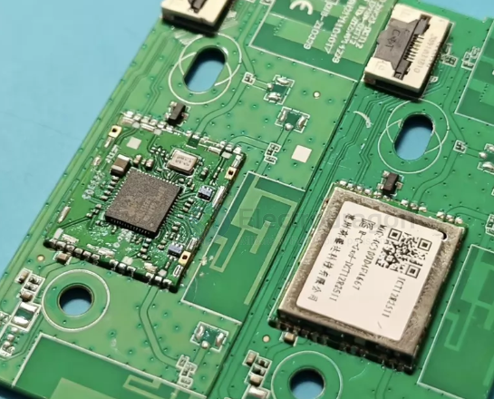

# openIPC-chip-dat

- [[openIPC-chip-dat]] - [[VTX-openIPC-dat]]

- [[Wifi-SDIO-dat]] - [[wifi-adapter-dat]] - [[openIPC-chip-dat]] - [[realtek-dat]] - [[ralink-dat]]

## openIPC-wifi-adapter-dat

https://github.com/OpenIPC/PixelPilot/blob/master/app/src/main/res/xml/usb_device_filter.xml

## USB device filter (supported WiFi adapters)

| Chipset               | Vendor ID | Product ID | Device / Comment                     |
| --------------------- | --------- | ---------- | ------------------------------------ |
| RTL8812AU             | 0x0BDA    | 0x8812     | RTL8812AU                            |
| RTL8812AU             | 0x0BDA    | 0x881A     | RTL8812AU-VS                         |
| RTL8812AU             | 0x0BDA    | 0x881B     | RTL8812AU-VL                         |
| RTL8812AU             | 0x2357    | 0x0101     | Archer T4U                           |
| RTL8812AU             | 0x2357    | 0x0103     | Archer T4UH                          |
| RTL8812AU             | 0x2357    | 0x010D     | Archer T4U V2                        |
| RTL8812AU             | 0x2357    | 0x010E     | Archer T4UH V2                       |
| RTL8812AU             | 0x0B05    | 0x17D2     | Asus AC56                            |
| RTL8812AU             | 0x2604    | 0x0012     | Tenda U12                            |
| RTL8812AU             | 0x0409    | 0x0408     | NEC AtermWL900U                      |
| RTL8812AU             | 0x0586    | 0x3426     | ZyXel 6605                           |
| RTL8811AU / RTL8821AU | 0x0BDA    | 0x0811     |                                      |
| RTL8811AU / RTL8821AU | 0x0BDA    | 0xA811     |                                      |
| RTL8811AU / RTL8821AU | 0x0BDA    | 0xB811     |                                      |
| RTL8811AU / RTL8821AU | 0x0BDA    | 0x0820     |                                      |
| RTL8811AU / RTL8821AU | 0x0BDA    | 0x0821     |                                      |
| RTL8811AU / RTL8821AU | 0x0BDA    | 0x0823     |                                      |
| RTL8811AU / RTL8821AU | 0x0BDA    | 0x8822     |                                      |
| RTL8811AU / RTL8821AU | 0x0411    | 0x0242     |                                      |
| RTL8811AU / RTL8821AU | 0x0411    | 0x029B     |                                      |
| RTL8811AU / RTL8821AU | 0x04BB    | 0x0953     |                                      |
| RTL8811AU / RTL8821AU | 0x056E    | 0x4007     |                                      |
| RTL8811AU / RTL8821AU | 0x056E    | 0x400E     |                                      |
| RTL8811AU / RTL8821AU | 0x056E    | 0x400F     |                                      |
| RTL8811AU / RTL8821AU | 0x0846    | 0x9052     |                                      |
| RTL8811AU / RTL8821AU | 0x0E66    | 0x0023     |                                      |
| RTL8811AU / RTL8821AU | 0x2001    | 0x3314     |                                      |
| RTL8811AU / RTL8821AU | 0x2001    | 0x3318     |                                      |
| RTL8811AU / RTL8821AU | 0x2019    | 0xAB32     |                                      |
| RTL8811AU / RTL8821AU | 0x20F4    | 0x804B     |                                      |
| RTL8811AU / RTL8821AU | 0x2357    | 0x011E     |                                      |
| RTL8811AU / RTL8821AU | 0x2357    | 0x0120     |                                      |
| RTL8811AU / RTL8821AU | 0x2357    | 0x0122     |                                      |
| RTL8811AU / RTL8821AU | 0x3823    | 0x6249     |                                      |
| RTL8811AU / RTL8821AU | 0x7392    | 0xA811     |                                      |
| RTL8811AU / RTL8821AU | 0x7392    | 0xA812     |                                      |
| RTL8811AU / RTL8821AU | 0x7392    | 0xA813     |                                      |
| RTL8811AU / RTL8821AU | 0x7392    | 0xB611     |                                      |
| RTL8812EU             | 0x0BDA    | 0xA81A     | RTL8812EU (e.g. LB-LINK BL-M8812EU2) |
| RTL8822EU             | 0x0BDA    | 0xA82A     | RTL8822EU                            |
| RTL8822EU             | 0x0BDA    | 0xE822     | RTL8822EU (multi-function)           |

## RTL8822CU 

## Chip solutions confirmed

The TP-Link Archer T4U has used different chips depending on the hardware revision — historically Realtek parts such as the **RTL8812AU**.

WFB-NG video links place special demands on the NIC: the **ground-side** adapter must be able to enter Monitor mode (promiscuous / listen mode) and support packet injection, otherwise it cannot correctly unpack the WFB-NG RF stream coming from the aircraft.

**Alternative and recommended options**

- [[antenna-MIMO-dat]] - [[RTL8814AU-dat]] - [[RTL8812AU-dat]] - [[RTL8822-dat]] - [[openIPC-dat]] - [[AR9271-dat]] - [[RT3070-dat]] - [[ralink-dat]] - [[RT3072-dat]]

If you are planning the airborne or ground-station NIC for OpenIPC, it is best to pick chips that are **highly mature in the community and fully covered by drivers**:

| Chip | Antenna config | Recommended use | Community support | Notes |
|---|---|---|---|---|
| **RTL8812AU** | 2x2 MIMO | airborne / ground station | ⭐⭐⭐⭐⭐ (top pick) | the current mainstream standard chip for OpenIPC / WFB-NG; richest tutorials and drivers |
| **RTL8812EU** | 2x2 MIMO | airborne (onboard / NIC) | ⭐⭐⭐⭐⭐ | newer chip, lower power than the 8812AU, common on dedicated OpenIPC airborne all-in-one boards |
| **RTL8822BU** | 2x2 MIMO | airborne / ground station | ⭐⭐⭐⭐ | well-controlled power draw, decent compatibility |
| **AR9271 / RT3070** | 1x1 (2.4G single band) | ground station / backup for speed | ⭐⭐⭐ | 2.4 GHz band only, lower performance |

## error

### RTL8814AU — root cause analysis

Put simply: **the RTL8814AU cannot be used directly — or is very strongly discouraged — in an OpenIPC digital video (WFB-NG) system.**

Although it belongs to the same chip family as the **RTL8812AU** that OpenIPC widely uses, under OpenIPC / WFB-NG the RTL8814AU has several fatal technical bottlenecks:

**① Missing driver and kernel-compatibility problems**

OpenIPC — especially the WFB-NG firmware used for HD digital video — relies heavily on the wireless driver's **Monitor mode** and **packet injection** support inside the embedded Linux kernel.

Very little porting and optimisation of the RTL8814AU's open-source / third-party Linux driver has been done on embedded SoCs (HiSilicon, SigmaStar, Rockchip and other IPC chips), so it cannot simply be compiled into OpenIPC's limited flash space.

**② WFB-NG (the video protocol) has not been adapted for it**

The WFB-NG stack underneath OpenIPC makes specific modifications to the NIC driver (to support a particular frame-injection rate, power control and low-latency transfer). All of the community's optimisation and testing is concentrated on **RTL8812AU / RTL8822BU / RTL8812EU** and similar chips — the RTL8814AU is not on the supported list.

**③ Much higher power draw and heat**

The RTL8814AU is a 4x4 MIMO (4-antenna) adapter, so its power draw and heat are far beyond a 2x2 MIMO RTL8812AU. The GPIO and 5 V/3.3 V supply rails of an IPC camera mainboard (the airborne side) usually cannot withstand the current the RTL8814AU pulls under load, which very easily causes the IPC board to reboot or the adapter to drop offline.

## ref 