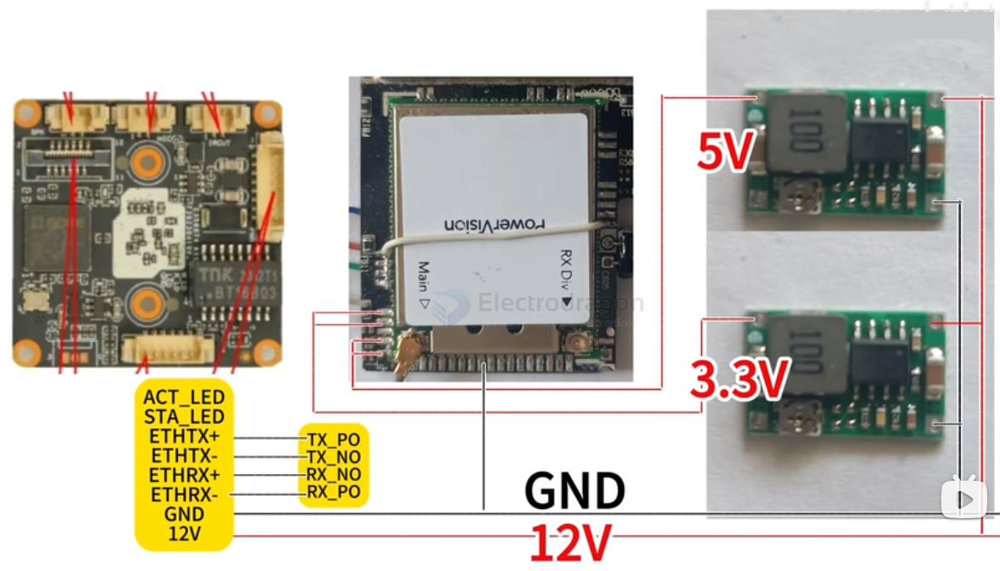
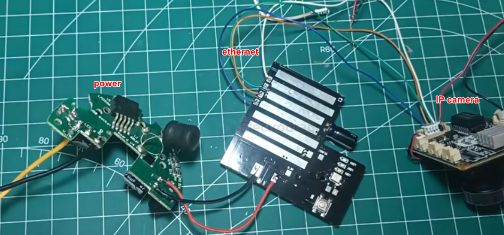
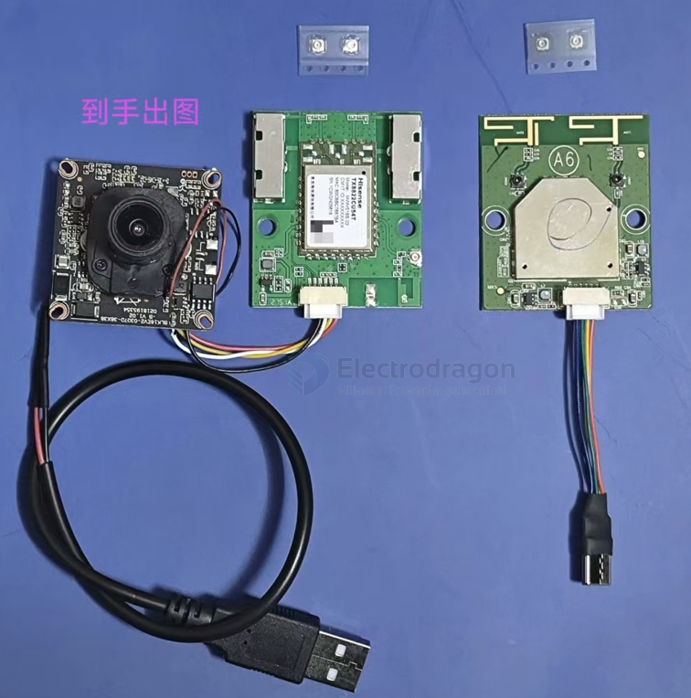
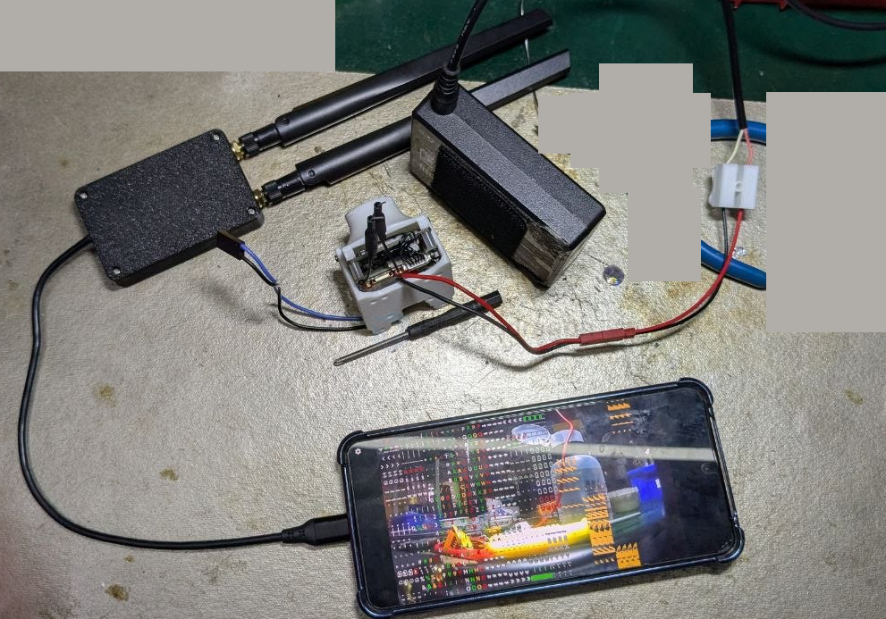

# openIPC-dat

- [[openIPC-dat]] - [[VTX-openIPC-dat]] - [[VRX-openIPC-dat]]

== [[VRX-dat]] + [[VTX-dat]]

- [[openIPC-dat]] - [[camera-IP-dat]]

- [[opensource-dat]] - [[openIPC-dat]] ?? - [[IMX307-dat]] - [[VTX-dat]]

- [[camera-digital-dat]] - [[Sigmastar-dat]] - [[openHD-dat]] - [[opensource-dat]] - [[openIPC-dat]] - [[rubyFPV-dat]] - [[video-digital-dat]]

https://github.com/OpenIPC/firmware

- [[camera-IP-dat]] - [[sensor-camera-dat]]

## best support 

- [[openIPC-dat]] - [[HiSilicon-dat]] - [[SigmaStar-dat]] - [[Goke-dat]] - [[Ingenic-dat]]

- [[hi3516-dat]] - [[HiSilicon-dat]] - [[HI3518-dat]]

- [[goke-dat]] - [[GK7205V210-dat]] - [[camera-IP-dat]] - [[openIPC-dat]]

- [[Sigmastar-dat]] - [[SSC338-dat]] - [[openIPC-dat]]

test == 17db枫叶天线 == 50ms // 35km

## wifi

- [[wifi-adapter-dat]] - [[openIPC-wifi-adapter-dat]] 

- [[realtek-dat]] - [[WIFI-USB-dat]] 

rtl8731成品模块+PA放大器 - [[RTL8731-dat]]

- [[RTL8812-dat]]

- [[wifi-dat]] - [[wifi-WFB-NG-dat]]

## camera 

- [[sensor-camera-dat]] 

- [[sony-dat]] - [[imx415-dat]] - [[IMX307-dat]]

## SDK 

- [[uboot-dat]] - [[openIPC-dat]] == unlock 

## info 

https://github.com/OpenIPC/wiki/blob/master/en/installation.md

https://docs.openipc.org/getting-started/homepage/

flash tool - https://github.com/OpenIPC/companion/releases

## branches 

- [[APFPV-dat]] - [[openIPC-dat]]

## parts 

- [[MCU-dat]] - [[SBC-dat]] 

- [[camera-digital-dat]] - [[Sigmastar-dat]]

- [[RF-modules-dat]] - [[RF-dat]]

- [[EMax-dat]] - [[runcam-dat]] - [[openIPC-dat]] - [[camera-IP-dat]]

- [[Eachine-dat]] - [[Eachine-Sphere-Link-dat]]

## tech 

- [[wifi-dat]] - [[wifi-WFB-NG-dat]]

- [[VRX-dat]] - [[VRX-openIPC-dat]] - [[openIPC-dat]]

- [[VTX-dat]] - [[VTX-openIPC-dat]] - [[openIPC-dat]]

## 双卡 

- [[wifi-WFB-NG-dat]]

三、再说「双卡」是什么

双卡 = 地面站的接收设备上插【两张 WiFi 网卡】
       （通常是两张 RTL8812AU），同时接收同一路 OpenIPC/WFB-ng 信号

为什么双卡在 OpenIPC 里可行（这点和普通 WiFi 完全不同）
普通 WiFi：要"关联(associate)"、要 ACK、一对一 → 一张卡一个连接
WFB-ng：  ⭐ 单向【广播】（monitor 模式，无关联、无 ACK）
          → 发射端把数据当 UDP 包广播出去
          → 地面上有几张卡，就能同时收几份
          → 软件层做【去重 + 合并】，丢包互补

双卡的收益（不只是"多一张卡"）
配置                    等效增益    40log 区距离
单卡                     +0 dB       ×1.00
双卡分集                 +3 dB       ×1.19
⭐ 双卡 + 不同增益天线     +6 dB       ×1.41
   （例如：一张 20dBi 螺旋朝远方 + 一张 8dBi 平板兜近处） - [[antenna-dat]]
        ↓
⭐ 真正的价值是【覆盖互补】：飞机在远端用螺旋，回到近处用平板，
   边缘距离上"能看"而不是"卡死" —— 这比单纯的 +3dB 有意义得多

---

四、⚠️ 双卡的三个硬件坑

① ⭐ 必须是【真 RTL8812AU】
   8812AU ≠ 8812CU ≠ 8812EU —— 芯片不同，驱动/monitor 模式支持不同
   买错 = 装不上 wfb-ng
② 需要 USB 3.0 口 + 足够供电
   8812AU 吃电很凶，插 USB 2.0 或带载供电不足 → 掉卡/丢包
③ 两张卡要分开插（尽量落在不同 USB 控制器上）+ 天线隔开 ≥15cm
   否则两张卡互相干扰，反而比单卡差

---

📋 一句话总结

【机上偶极】
   飞机端把摄像头原厂的 PCB 小天线，换成一根正经的 λ/2 偶极
   → +3~5dB（5.8G 只要 26mm，2.4G 62.5mm，好装不贵）
   → 必须竖直、远离干扰源、别让轴线对着你

【双卡】
   地面站插两张 RTL8812AU，同时收同一路 WFB-ng 广播
   → +3~6dB，且不同天线可以覆盖互补
   → 前提：真 8812AU + USB3.0 供电 + 天线隔开

        ↓
⭐ 这两项加起来是 OpenIPC 里【性价比最高】的两个改造（¥100-300），
   比换高功率模组划算得多

## build 

### build air-unit // [[VTX-dat]]

via - [[ethernet-dat]] - [[powervision-dat]]

OpenIPC 摄像机方案（主流黄金组合）

采用支持 OpenIPC 的安防/机器视觉模组（如 GK7205、SSC338 等芯片的 IPC 摄像机），机载直接运行 WFB-NG 将编码后的 H.265/H.264 视频通过发射网卡推出去，省去了额外的树莓派机载电脑，成本低且效率极高。

传统树莓派机载方案（较老）

早期用树莓派 + CSI 摄像头 + 树莓派官方系统的方案，目前在 OpenIPC 普及后逐渐被更低延迟的 IPC 方案替代。

### build ground-unit // [[VRX-dat]]

- [[VRX-dat]] - [[openIPC-dat]] - [[VRX-openIPC-dat]] - [[VRX-openIPC-bonnet-dat]]

- [[pixelpilot-dat]] - [[openIPC-dat]]

- [[serial-dat]]

## 芯片方案确认：

TP-Link Archer T4U 根据硬件版本不同，历史上使用过 Realtek（如 RTL8812AU）等芯片。

WFB-NG 飞行图传对网卡有特殊要求：地面端网卡必须能够开启 Monitor 模式（混杂/监听模式） 并支持注入，才能正确解包无人机发出的 WFB-NG 射频流。

## build 

- [[VTX-openIPC-dat]] == build 1 

## ref 

https://github.com/OpenIPC/hardware

- [[video-digital]] - [[openIPC]] - [[video]]