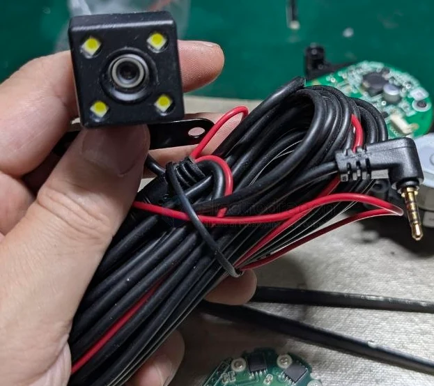
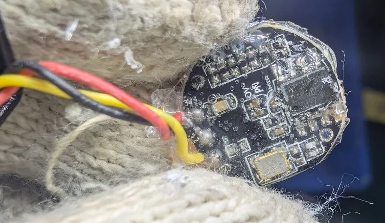
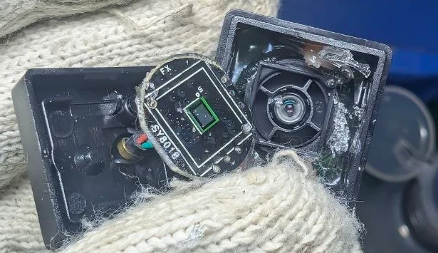
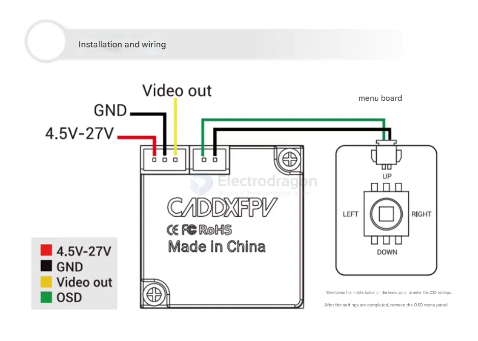
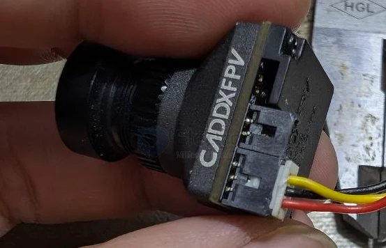

# camera-analog-dat

- [[MS-519-dat]]

- [[camera-FPV-dat]] - [[camera-analog-dat]] - [[camera-digital-dat]] - [[caddxFPV-ratelpro-dat]] - [[runCam-dat]] - [[VTX-dat]]

- [[camera-digital-dat]] - [[camera-analog-dat]]

- [[CONN-XLR-dat]] - [[analog-dat]] - [[CONN-USB-dat]] - [[video-dat]] - [[sensor-camera-dat]] - [[camera-analog-dat]]

- [[conn-audio-dat]]

- [[easycap-dat]]

## tech 

- [[camera-analog-swtich-dat]] - [[camera-analog-dat]]

## USB CAM 

`USB Video Capture Card (Easy & Cheap):`

If you have an analog camera, you can plug its yellow video signal wire and ground wire into an `external USB video capture dongle` (often called an "`EasyCap`" or cheap HDMI/AV USB capture card meant for security cameras or retro gaming).

Plug the USB capture card into your PC and open a webcam viewer or OBS Studio. Keep in mind this will only show the raw camera image; it won't include Betaflight OSD unless the camera is routed through an FC with an active analog OSD chip and an external monitor/receiver setup.

## analog camera quality 

在模拟系统里，什么才是真正提升画质的关键？

如果你觉得现在的模拟画面糊、想提升视觉体验，优先级从高到低排列如下：

1. 传感器尺寸（Sensor Size）⭐️⭐️⭐️：
   - 1/3 英寸 ➔ 1/1.8 英寸（比如你手上的 Caddx Ratel Pro）。
   - 大底进光量呈指数级提升，傍晚、夜间和阴天不仅噪点极少，宽动态范围拉满，这才是肉眼可见的质变！
2. 镜头光学素质（Lens Optics）：
   - 好镜头畸变小、边缘不发虚，比堆砌 CMOS 的 TVL 数字有用十倍。
3. 眼镜端接收机模块（Receiver Module）：
   - 从普通的入门眼镜切换到具备抗多径、防滚屏算法的高端分集接收机（如 RapidFIRE / SteadyView），雪花噪点大幅压制。

## common analog sensor for car / truck surveillance

use - [[conn-audio-dat]] == signal normally == video out (CVBS) + power + GND

- [[24C08-dat]] - [[eeprom-dat]] - [[camera-analog-dat]] - [[atmel-dat]] == ATMHK238 24C08

在摄像头模组（包括带 ISP 的模拟/CVBS 摄像头、HD 模拟高清摄像头或数字模组）中，CMOS 图像传感器（CIS）或 ISP 旁边放一颗 **EEPROM**，核心原因是**掉电保存配置与出厂校准参数**。

### 1. 为什么需要这颗 EEPROM？

* **上电自动加载寄存器参数**：很多模拟摄像头模组没有大容量板载闪存，或者需要独立于主控快速初始化。上电时，ISP 或主控通过 I2C 总线读取 EEPROM 中的初始化序列，配置曝光、白平衡、帧率、输出制式或画质参数。
* **保存镜头与模组专属校准数据**：每颗镜头和传感器装配后都会存在个体差异。模组在产线调焦或暗室标定后，会把 **镜头阴影矫正（LSC）网格表**、坏点坐标、自动白平衡（AWB）参考增益等数据写进 EEPROM，让图像中心到边缘亮度更均匀。
* **产线差异化配置无需改固件**：同一款硬件板卡，换不同焦距镜头或不同客户参数时，只需烧录不同的 EEPROM 内容即可，不用重新编译主固件。
* **记录模组序列号与版本信息**：便于售后溯源、产线批次管理和硬件版本识别。

### 2. 常见 EEPROM 型号与容量选择

模拟或模组级配置表通常很小，几百字节到十几 KB 就够用：

* **小容量配置/ID 存储（如 2Kbit / 256×8 bit）**：常用于存模组信息、基础配置表或小量参数。
* **中大容量校准表存储（如 128Kbit / 16K×8 bit）**：当镜头 shading 网格或标定数据较多时，会选更大容量的 I2C 串行 EEPROM。

## RC Specified Camera 

- [[camera-analog-dat]] - [[CaddxFPV-dat]] - [[runCam-dat]]

## common pin out Analog 

- MENU 

- Video 
- GND 
- 5-36V 

- [[runcam-dat]] - [[camera-FPV-dat]] - [[camera-analog-dat]]

## common camera cable 

- [[cable-dat]]

- 3P 1.0 mm - ANT - [[X12-dat]] - [[SH1.0-dat]]
- 3P 1.25 mm - [[caddxFPV-dat]] - ratel-pro

## apps 

- [[camera-FPV-dat]] - [[camera-analog-dat]]

## ref 

- [[sensor-Camera-dat]]