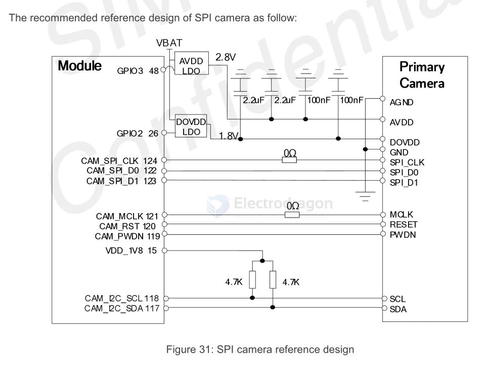
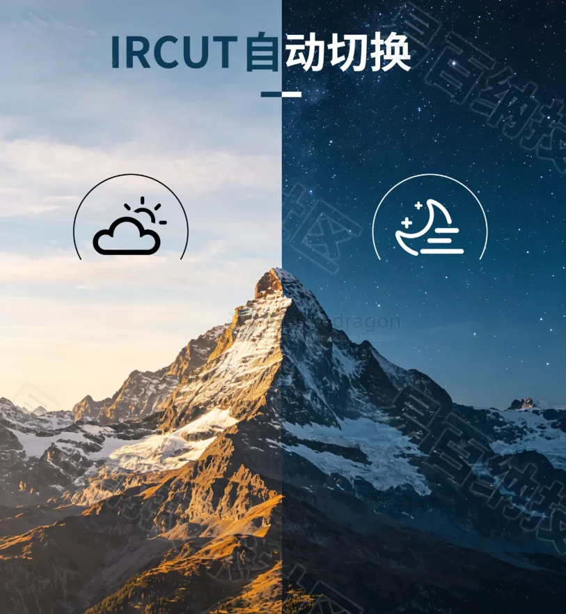

# sensor-camera-dat 

- [[H.265-dat]] - [[RTSP-dat]] - [[ONVIF-dat]] - [[video-dat]] - [[video-streaming-dat]] - [[sensor-camera-dat]]

- [[sensor-camera-dat]] - [[sensor-camera-chip-dat]] 

- [[sensor-camera-CSI-dat]] - [[sensor-camera-dat]] - [[camera-CSI-dat]]

- [[sensor-camera-dat]] - [[video-dat]] - [[image-dat]] - [[vision-dat]] - [[video-digital-codec-dat]] - [[H.265-dat]] - [[H.265-AI-dat]]

- [[camera-interface-dat]] - [[camera]] - [[video-transmission-dat]]

- [[detecting-camera-dat]]

- [[camera-analog-dat]] - [[camera-digital-dat]] - [[camera-action-dat]]

- [[camera-SDK-dat]] - [[camera-sys-dat]]

- [[lens-dat]] - [[optical-design-dat]]

- [[camera-depth-dat]]

- [[camera-installation-dat]] - [[sensor-camera-dat]] - [[camera-wireless-dat]]

- [[camera-wireless-dat]] - [[camera-FPV-dat]]

- [[gopro-dat]] - [[insta360-dat]] - [[DJI-dat]] - [[camera-mount-dat]] - [[sensor-camera-dat]]

- [[camera-vision-dat]]

- [[sensor-camera-chip-dat]]

## tech 

- [[renesas-dat]] - [[buffer-FIFO-dat]] - [[IDT720x-dat]] - [[app-dat]] == [[sensor-camera-dat]]

- [[sensor-camera-SOC-dat]] - [[sensor-camera-chip-dat]] - [[lens-dat]] - [[lens-mount-dat]]

## camera

- [[OV3660-dat]] - [[OV2640-dat]] - [[OV5640-dat]] - [[OmniVision-dat]] - [[OV9760-dat]]

## boards 

- [[ESP1000-dat]]

- [[SCM1030-dat]] - [[SCM1027-dat]]

- [[MPC1080-dat]]

- [[SCM1000-dat]] - [[SCM1002-dat]] - [[SCM1012-dat]] - [[SCM1013-dat]] - [[SCMS015-dat]]

- [[ESP32-S3-APP-dat]]

- [[NWI1249-dat]]

## DVP vs. MIPI-CSI Camera Interfaces

- [[camera-interface-dat]] - [[camera-DVP-dat]] - [[camera-CSI-dat]] 

| Feature         | **DVP (Parallel)**           | **MIPI-CSI (Serial)**           |
| :-------------- | :--------------------------- | :------------------------------ |
| **Data Flow**   | All bits (8-12) sent at once | Data sent in high-speed packets |
| **Wiring**      | High pin count (15+ wires)   | Low pin count (4-10 wires)      |
| **Signal Type** | Standard CMOS (Single-ended) | Differential Pairs (Low Noise)  |
| **Complexity**  | Simple; easy to debug        | High; requires dedicated PHY    |
| **Best For**    | **Rover V2**, ESP32, STM32   | Raspberry Pi, Jetson, 4K Video  |

---

### Key Takeaways for Your Project

* **DVP (What you are using):** Uses pins like **Y0-Y9**. You can leave **Y0/Y1 NC** to treat it as an 8-bit bus. It is perfect for microcontrollers but sensitive to motor noise (EMI) from your **DRV8701**.
* **CSI:** Used for high-definition AI tasks. It uses "Lanes" instead of individual data bits, making it much harder to wire manually but better for long cables.

- [[sensor-camera-chip-dat]]

## Camera Functionalities

- [[Camera-Functionalities-dat]]
- 
- [[auto-focus-dat]]

- [[3D-camera-dat]] - [[night-vision-dat]] - [[camera-pan-dat]] - [[camera-tilt-dat]] - [[camera-zoom-dat]]

- [[video-dat]]

## output format 

- [[MJPEG-dat]] - [[YUV-dat]] - [[RGB-dat]] - [[H264-dat]] 

output format is MJPEG 640X480. Only in this format and resolution can a high frame rate be achieved.

## use-guide 

- [[ESP32-cam-dat]] - [[RPI-camera-dat]]

## other camera types 

- GC0328

- GC0328 dual camera (horizontal screen) for MF1 only
- OS08A20 camera for M4Ndock

## SCH 

### SPI Camera Interface 

## apps 

- [[xiaomi-dat]] - [[Wireless-Video-Doorbell-dat]] - [[sensor-camera-dat]]

- [[cam-dash-dat]] - [[DDpai-dat]] - [[sensor-camera-dat]]

- [[sigmastar-dat]] 

- [[sensor-camera-dat]] - [[wifi-sdio-dat]] - [[TPLINK-camera-dat]] - [[DDPAI-dat]]

- [[opensource-dat]] - [[openHD-dat]] - [[openIPC-dat]] - [[rubyFPV-dat]]

- [[camera-FPV-dat]]

- [[sensor-camera-dat]] - [[camera-wifi-dat]] - [[camera-IP-dat]] - [[camera-surveillance-dat]] 

- [[thermal-dat]] - [[sensor-thermal-dat]] - [[sensor-dat]] - [[camera-dat]] - [[thermal-imaging-dat]] - [[camera-thermal-dat]]

- 人车检测模型
- 人脸人形车形模型
- 人脸人形车形远距低照模型
- 宠物模型
- 头肩模型
- 非机动车模型
- 非机动车梯控模型
- 包裹检测模型
- 人脸抓拍模型
- 车牌识别模型
- 人脸识别模型
- 旋转框检测
- 文字检测
- 多目标跟踪
- 手部关键点

## relevant tech 

### IR cut 

- [[IR-cut-dat]]

## shutter 

归一化对比（同快门条件）

机型	标称	归一 F1.2	归一到 1/50s
海康 DS-2CD3141G2（同 1/2.9" 4MP）	0.005 Lux@F1.6@1/3s	0.0028 Lux	⚠️ 0.047 Lux
⭐️ IVG-G4H	0.01 Lux@F1.2	0.01 Lux	⭐️ 0.01 Lux

慢快门可能只是固件阉割，不是硬件限制

IVG-G4H 规格：快门 1/50s ~ 1/10000s  ← 无慢快门
        ↓
⭐ 但同族芯片的官方模组做得更慢：
   CCD CAM IM50A01（GK7205V300 + IMX335）写的是
   「Shutter Speed 1/2 - 1/20,000s, 【Slow shutter support】」
        ↓
⭐⭐⭐ GK7205 平台【硬件上支持慢快门】
   1/50s 是雄迈原厂固件的功能阉割
        ↓
📌 刷 OpenIPC 后很可能能开回 1/25、1/12
   → 低照度再提 2-4 倍
   → F0.95 @1/50s 的 0.0063 Lux → 【0.0016-0.003 Lux】
        ↓
⚠️ 这是推论，未验证。刷后看 majestic.yaml 的曝光范围

## ref 

- [[camera-dat]] - [[omni-vision-dat]]

- [[SCM1009]] - [[SCM1008]] - [[SCM1030]]

- [[camera]]

- [[oil-soaking-dat]]