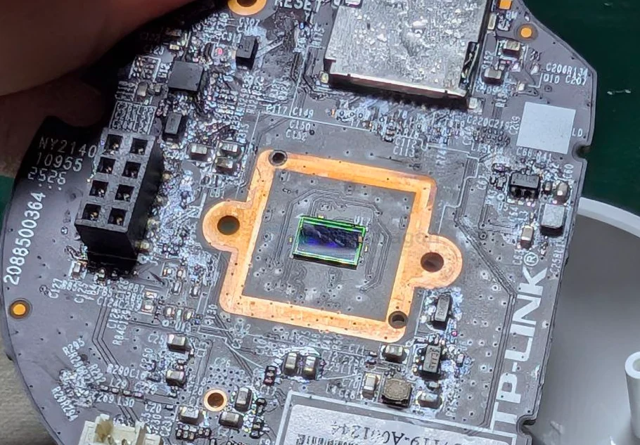

# sensor-camera-sensor-dat

- [[sensor-camera-sensor-dat]] - [[sensor-camera-dat]]  - [[sensor-camera-soc-dat]]
  
  
- [[ambarella-dat]] - [[H22N-A0-HR-dat]] - [[sensor-camera-sensor-dat]] 

- [[hisilicon-dat]] - [[sensor-camera-sensor-dat]] 

## sensor look like 

- [[TPLINK-dat]]

## sensor 

## camera

- [[OV3660-dat]] - [[OV2640-dat]] - [[OV5640-dat]] - [[OmniVision-dat]] - [[OV9760-dat]]

- [[SC101IOT-dat]] - [[sensor-camera-dat]] - 

- [[SC500AI-dat]] - [[SC4336P-dat]] - [[sensor-camera-dat]]

- [[onsemi-dat]] - [[AR0237-dat]] - [[sensor-camera-dat]]

[[OmniVision-dat]] == [[camera-DVP-dat]] - [[camera-CSI-dat]] 

- [[OV3660-dat]] - [[OV2640-dat]] - [[OV5640-dat]] 

- [[OV9281-dat]]

- [[OV2710-dat]]

- [[ov5659-dat]] - [[ov2659-dat]] 

- [[OV5647-dat]]

- [[OV7670-dat]] - [[OV7725-dat]]

- [[OV7740-dat]] - [[OV5642-dat]]

- [[OV5648-dat]]

OV series boards - [[SCM1008-dat]] - [[SCM1009-dat]] - [[SCM1017-dat]] - [[SCM1024-dat]] - [[SCM1020-dat]] - [[SCM1004-dat]] 

- [[SONY-dat]]

- [[SC2336-dat]]

- [[pixart-dat]] - [[PS5268-dat]]

- [[maxim-dat]] - [[serializer-dat]] - MAX96717F GMSL serializer

The `MAX96717F` GMSL™ serializer receives video on a MIPI CSI-2 interface and outputs it on a GMSL2 serial link transceiver. Simultaneously, it sends and receives bidirectional control channel data across the same GMSL2 link.

`MAX9296A` deserializer chip

Maxim GMSL2 serializer (`MAX96717`)

### more cameras 

| model          | max resolution | color type | output format                                                                      | Len Size |
| -------------- | -------------- | ---------- | ---------------------------------------------------------------------------------- | -------- |
| [[OV2640-dat]] | 1600 x 1200    | color      | YUV(422/420)/YCbCr422 / RGB565/555 / 8-bit compressed data / 8/10-bit Raw RGB data | 1/4"     |
| [[OV3660-dat]] | 2048 x 1536    | color      | raw RGB data / RGB565/555/444 / CCIR656 / YCbCr422 / compression                   | 1/5"     |
| [[OV5640-dat]] | 2592 x 1944    | color      | RAW RGB / RGB565/555/444 / CCIR656 / YUV422/420 / YCbCr422 / compression           | 1/4"     |
| [[OV7670-dat]] | 640 x 480      | color      | Raw Bayer RGB / Processed Bayer RGB / YUV/YCbCr422 / GRB422 / RGB565/555           | 1/6"     |
| [[OV7725-dat]] | 640 x 480      | color      | Raw RGB / GRB 422 / RGB565/555/444 / YCbCr 422                                     | 1/4"     |
| NT99141        | 1280 x 720     | color      | YCbCr 422 / RGB565/555/444 / Raw / CCIR656 / JPEG compression                      | 1/4"     |
| GC032A         | 640 x 480      | color      | YUV/YCbCr422 / RAW Bayer / RGB565                                                  | 1/10"    |
| GC0308         | 640 x 480      | color      | YUV/YCbCr422 / RAW Bayer / RGB565 /Grayscale                                       | 1/6.5"   |
| GC2145         | 1600 x 1200    | color      | YUV/YCbCr422 / RAW Bayer / RGB565                                                  | 1/5"     |
| BF3005         | 640 x 480      | color      | YUV/YCbCr422 / RAW Bayer / RGB565                                                  | 1/4"     |
| BF20A6         | 640 x 480      | color      | YUV/YCbCr422 / RAW Bayer / Only Y                                                  | 1/10"    |
| SC101IOT       | 1280 x 720     | color      | YUV/YCbCr422 / Raw RGB                                                             | 1/4.2"   |
| SC030IOT       | 640 x 480      | color      | YUV/YCbCr422 / RAW Bayer                                                           | 1/6.5"   |
| SC031GS        | 640 x 480      | monochrome | RAW MONO / Grayscale                                                               | 1/6"     |
| HM0360         | 656 x 496      | monochrome | RAW MONO / Grayscale                                                               | 1/6"     |
| HM1055         | 1280 x 720     | color      | 8/10-bit Raw / YUV/YCbCr422 / RGB565/555/444                                       | 1/6"     |

ArduCAM

- [[OV7660-dat]] 0.3MP
- [[OV7670-dat]] 0.3MP
- [[OV7675-dat]] 0.3MP
- [[OV7725-dat]] 0.3MP
- [[OV2640-dat]] 2MP JPEG
- [[OV3640-dat]] 3MP
- [[OV5642-dat]] 5MP JPEG
- [[OV5640-dat]] 5MP JPEG
- [[MT9V111-dat]] 0.3MP
- [[MT9M112-dat]] 1.3MP
- [[MT9M001-dat]] 1.3MP
- [[MT9D111-dat]] 2MP
- [[MT9T112-dat]] 3MP

## 逐个比对「1/2.9" 4MP」

候选	实际规格	对不对得上
sc4236	1/2.6"、3.5MP(2304×1536)、2.5µm，已停产	❌
imx307 / imx327	1/2.8"、2MP	❌ 像素不够
imx335 / os05a / sc500ai	5MP 级	❌
ov2718	1/2.9"、2MP	⚠️ 格式对、像素不够
SC4238 类（1/3"、4MP 2688×1520）	像素对	⚠️ 不在支持列表

### selection table 

## Camera Interface 

- [[USB-camera-dat]] - [[wireless-camera-dat]]

- [[camera-interface-dat]] - [[SCCB-dat]] - [[CSI-dat]] - [[UVC-dat]] - [[analog-video-dat]] - [[HDMI-dat]]

[[CSI-dat]]: - [[MPC1080-dat]]   

[[SCCB-dat]]: - [[SCM1008-dat]] - [[SCM1009-dat]] - [[SCM1017-dat]] - [[SCM1024-dat]] 

[[UVC-dat]]: - [[SCM1020-dat]] - [[SCM1002-dat]] - [[SCM1004-dat]]

[[analog-video-dat]]: - NA

- [[DVP-camera-dat]]

## ref 