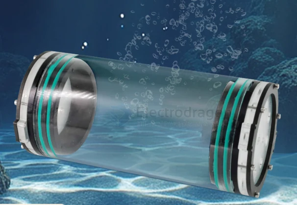
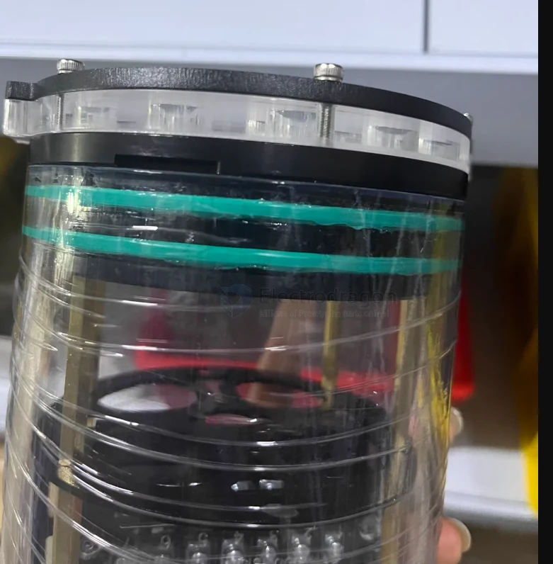
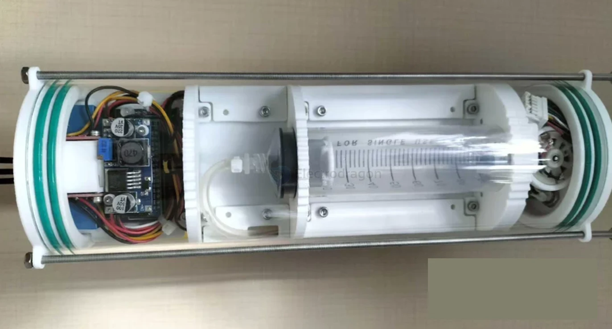
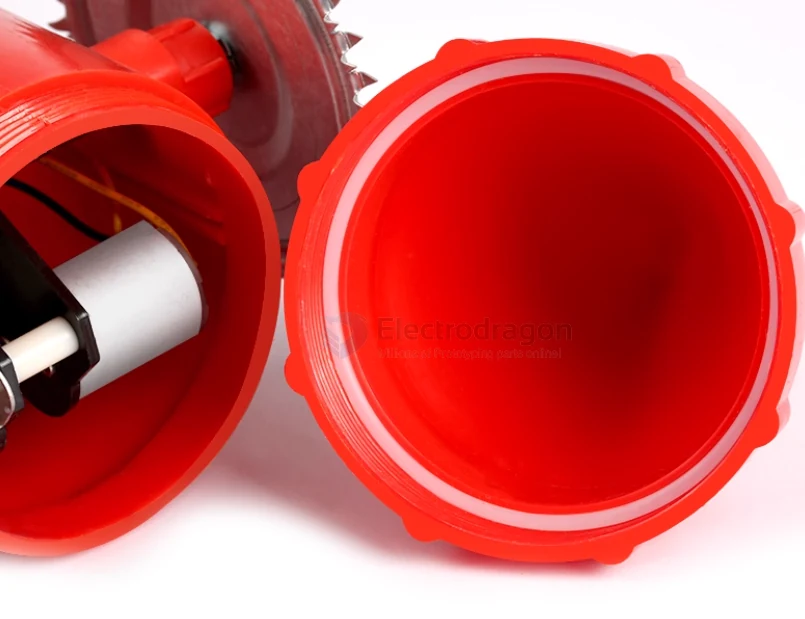
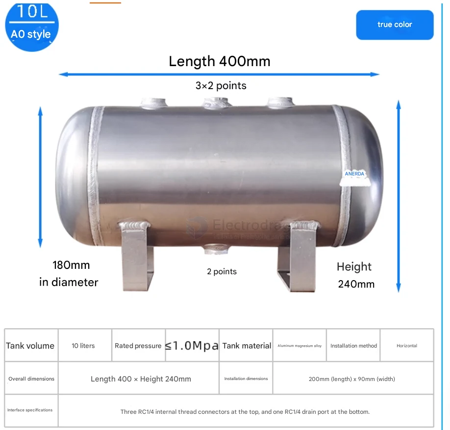
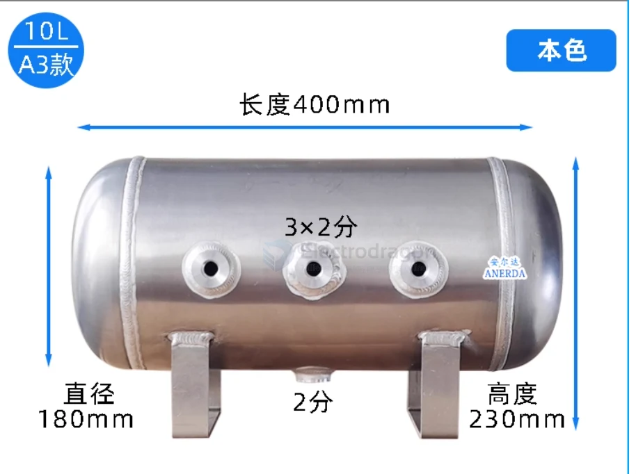

# waterproof-container-dat

- [[case-waterproof-dat]]

- PVC tube
- acrylic box

## PMMA tube 

- [[PMMA-dat]]

inside 

## tube seal by screw and o-ring

## aluminum canister

- Theoretical minimum: <1 mm for a tiny cylinder.  
- Practical safe design: 3–5 mm aluminum alloy (6061-T6) cylinder for 100 m depth.

## improvement 

| #    | 方法                              | 效果                                 | 代价                    | 推荐         |
| ---- | --------------------------------- | ------------------------------------ | ----------------------- | ------------ |
| ⭐️⭐️ 1 | 涂硅脂（Silicone Grease）         | 填微观缝隙、防 O-ring 扭转、减缓老化 | ¥10-20                  | ⭐️ 必做，先做 |
| ⭐️ 2  | 换更粗 O-ring（2.0 → 2.5mm）      | 压缩量 +0.15-0.25mm                  | ¥5-15                   | ⭐️ 先量槽深   |
| ⭐️ 3  | 外部加弹簧夹 / C 型夹（长边中段） | ⭐️⭐️ 直接补压紧力，不开孔              | ¥15-30                  | ⭐️⭐️ 首选加固  |
| 4    | 壳体上加压扣                      | 效果最好                             | ⚠️ 要打孔 → 多一个漏水点 | ⚠️ 不推荐     |
| 5    | 压扣下加薄垫片                    | 让压扣更紧一点                       | ¥0                      | ⚠️ 临时       |
| 6    | 换压扣布局更好的壳体              | 彻底                                 | ¥100-200                | ⚠️ 兜底       |

## ref 

- [[waterproof]] - [[waterproof-container]]

- [[waterproof-dat]]