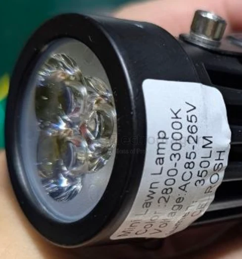
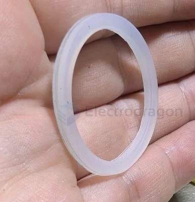
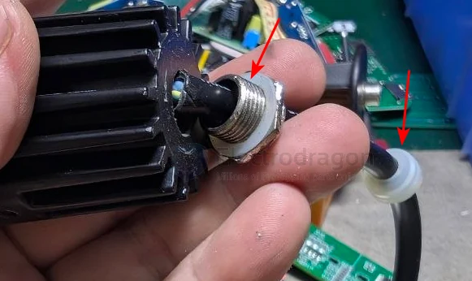
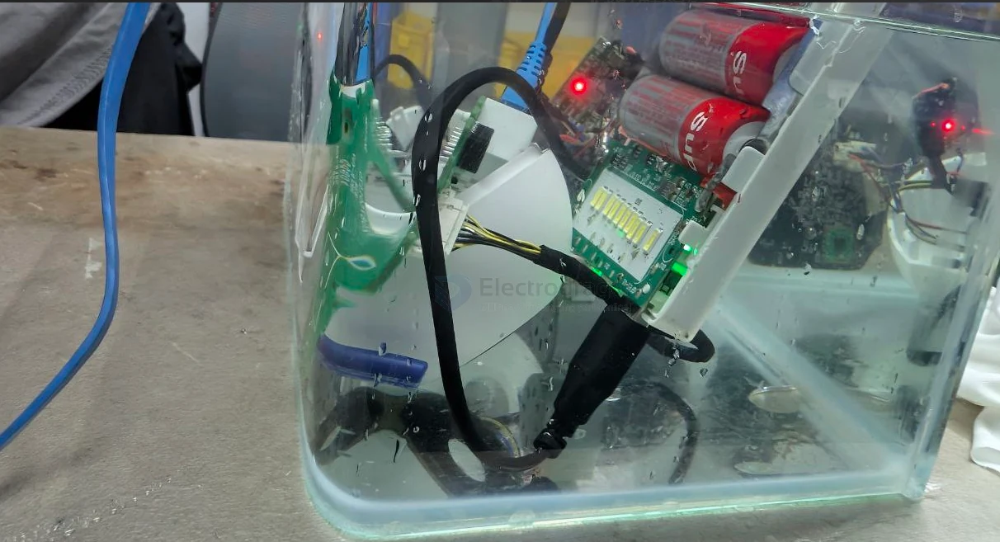
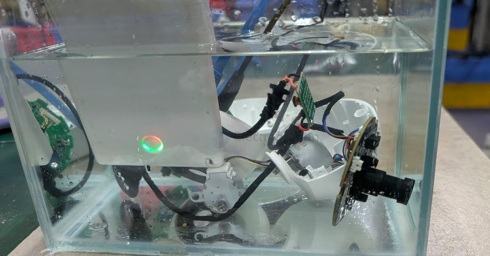
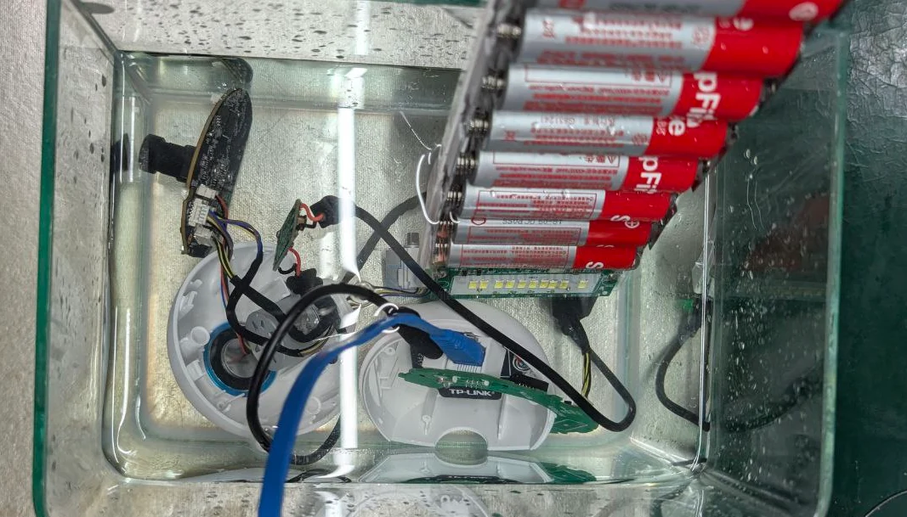
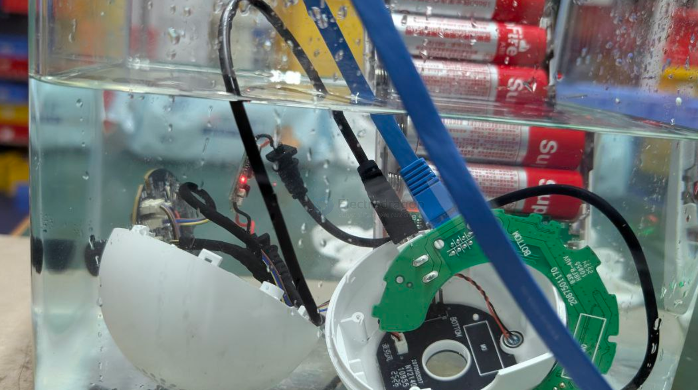

# waterproof-dat

- [[waterproof-dat]] - [[underwater-dat]] - [[nature-dat]]

- [[CONN-waterproof-dat]]

- [[motor-waterproof-dat]] - [[motor-dat]] - [[servo-waterproof-dat]]

- [[shaft-dat]] - [[shaft-waterproof-dat]] - [[waterproof-dat]]

- [[waterproof-container-dat]] - [[case-waterproof-dat]] - [[case-dat]]

- [[waterproof-sealant-dat]]

- [[glue-waterproof-dat]] - [[waterproof-tape-dat]] == 布基胶带 

- [[Conformal-Coating-dat]] - [[protection-dat]]

- [[vision-dat]] - [[sensor-camera-dat]] 

- [[mechanical-parts-dat]] - [[o-ring-dat]] - [[waterproof-dat]]

## design reference 

- [[waterproof-design-dat]] - [[waterproof-container-dat]]

## boards 

- [[SMO1085-dat]]

- [[led-strip-dat]] - [[ILSS014-dat]]

## waterproof level 

- IP69 

- [[IP68-dat]] 

- PA66 - [[plastic-dat]]

- IPX68 

## tech 

- [[pressure-dat]]

- [[CONN-waterproof-dat]] - [[CONN-dat]]

- [[silicon-grease-dat]]

## waterproof light 

- [[led-strip-dat]] - [[led-strip-silicone-dat]] 

## waterproof glue 

- [[glue-dat]]  - [[adhesive-marine-dat]] 

## apps 

- [[submarine-dat]] - [[submersible-dat]]

## water pressure 

深度	水压 (bar)
0.1 m	0.010
0.3 m	0.029
0.5 m	0.049
1.0 m	0.098（≈1.4 psi）
2.0 m	0.196
5.0 m	0.491

## container calculation

- [[waterproof-container-dat]] 

F15-T：230 × 150 × 85mm，长边 230mm
        ↓
⚠️ 压扣若只在【两端】，中间约 150mm 完全无支撑
        ↓
⭐ 简化模型：接合面像两端固定的梁，均布压力下中段挠度 ∝ L⁴
   无支撑 100mm → 相对挠度 1.0×
   无支撑 150mm → 【5.1×】
   无支撑 200mm → 16.0×
        ↓
⚠️⚠️ 150mm 无支撑 = 100mm 时的 5.1 倍挠度
   → 中段 O-ring 被水压顶开 → 正是你描述的现象

- [[O-ring-dat]]

## build 

## demo 

underwater case test - https://t.me/electrodragon3/467

- [[sensor-camera-dat]] - [[power-dat]] - [[network-dat]] - [[ethernet-dat]] - [[TPLINK-dat]]

## ref 

- [[waterproof]]

- [[onshape-dat]]

- [[waterproof-dat]] - [[silicon-grease-dat]]