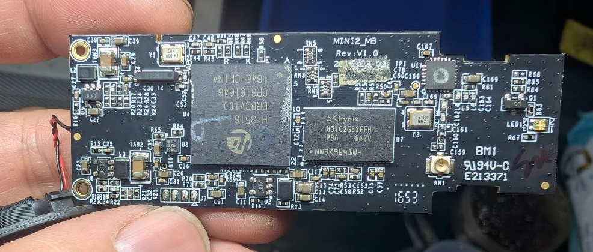
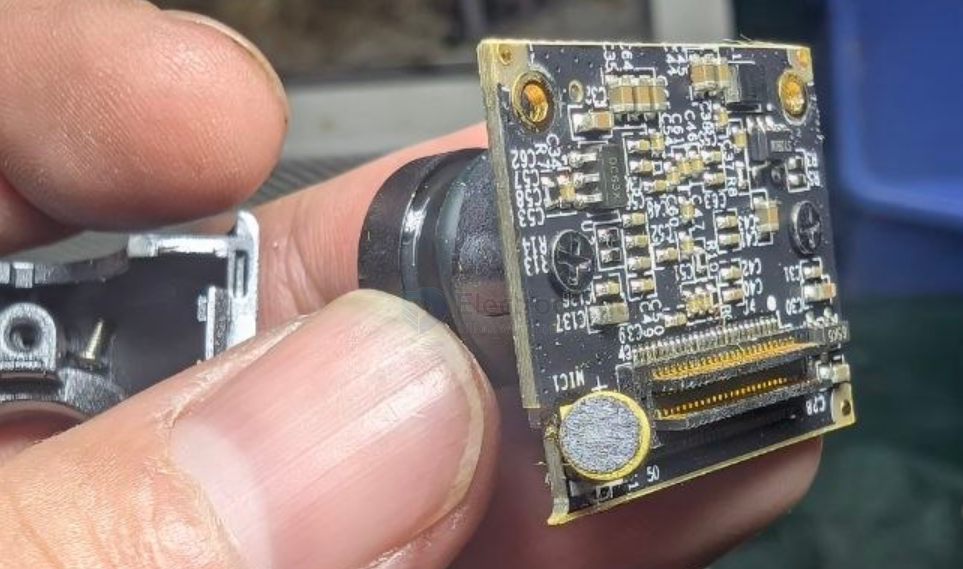
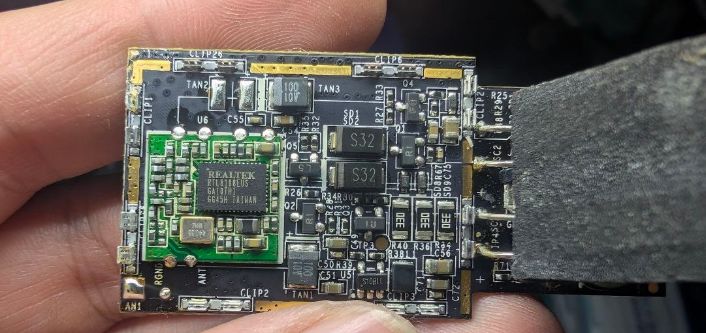
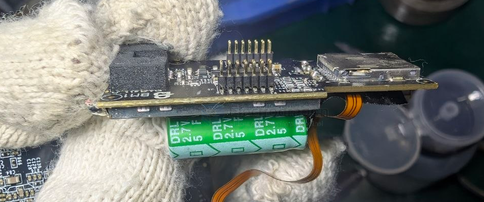
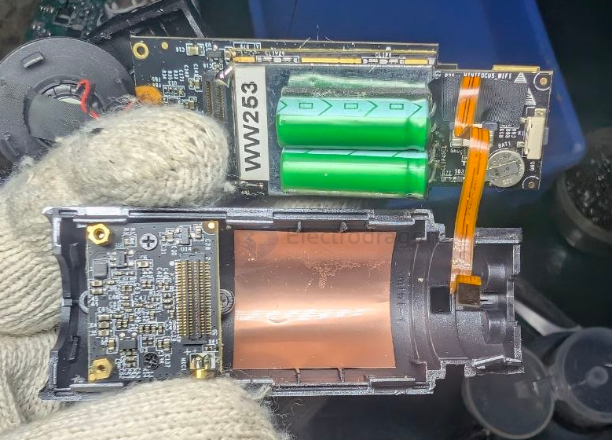
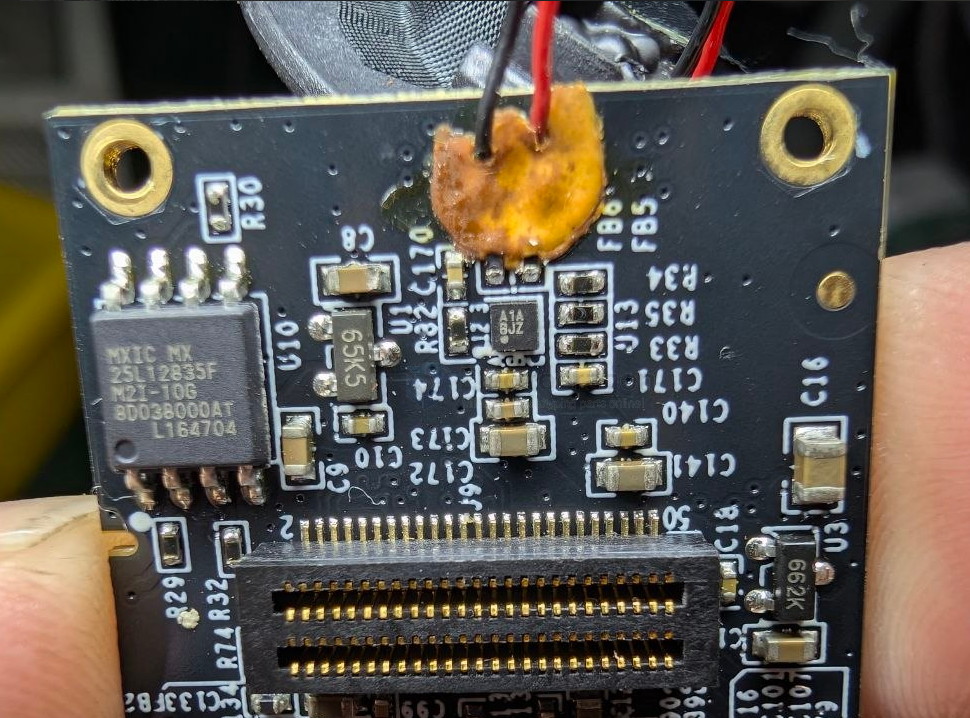
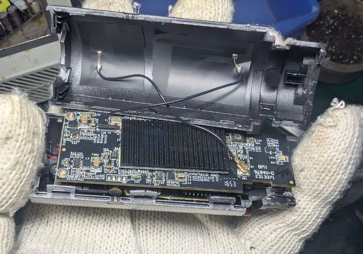
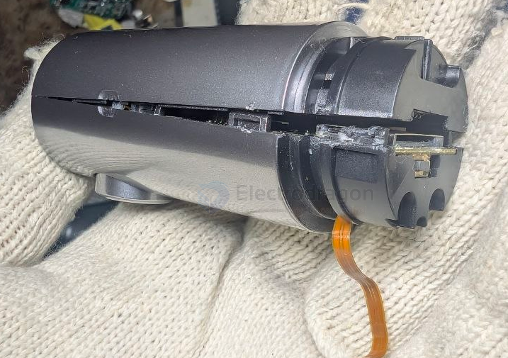
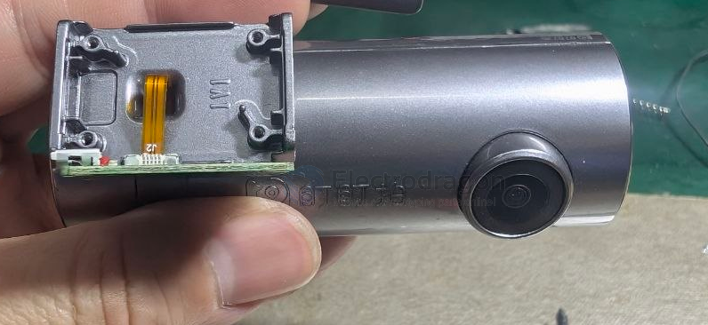
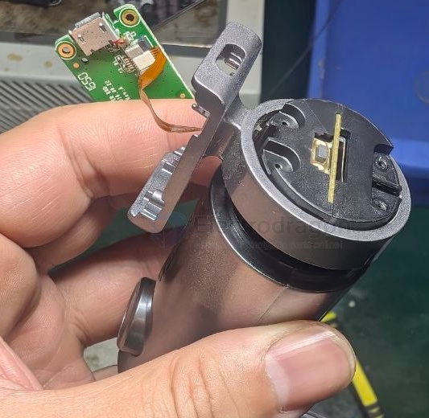

# DDPAI-dat

- [[cam-dash-dat]] - [[DDpai-dat]] - [[sensor-camera-dat]]

## build 

- [[HI3516-dat]] - [[hisilicon-dat]] 

- [[SKhynix-dat]] - [[H5TC2G63FFR-dat]] - [[SDRAM-dat]]

0816Y SOT23-5 - [[dcdc-down-dat]]

MIN12_MB
Rev:V1.0

- [[beken-dat]] - [[BK2433-dat]] - [[cam-dash-dat]] - [[DDpai-dat]] - [[sensor-camera-dat]]

DC63X 

S10BIM

65K5 

- [[realtek-dat]] - [[RTL8188US-dat]] - [[RTL8188-dat]] - [[ddpai-dat]]

- [[conn-dat]] - [[capacitor-super-dat]]

WW253 

A1A BJZ 

65K5 

- [[flash-nor-dat]] - [[mxic-dat]] - [[25x128-dat]]

- [[case-plastic-dat]] 

- [[USB-SDK-dat]] - [[ddpai-dat]] 

## ref 