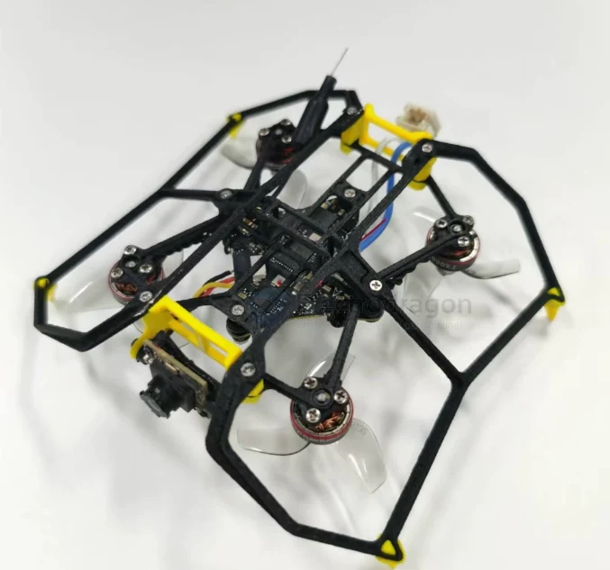
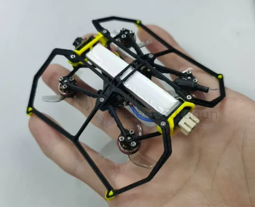
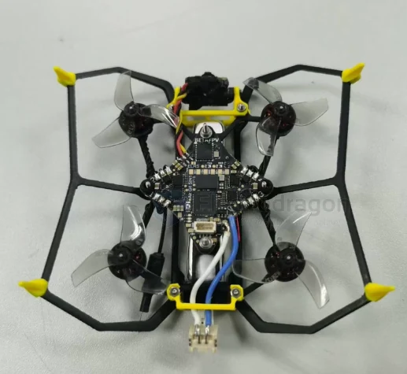

# FPV-frame-dat

- [[FPV-build-dat]] - [[FPV-frame-dat]] - [[flight-controller-dat]] - [[motor-FPV-dat]] - [[propeller-FPV-dat]] - [[camera-FPV-dat]]

- [[FPV-frame-MARK-dat]]

- [[FPV-frame-pusher-dat]] - [[FPV-frame-dat]] 

## up-side-down frame 

## motor and propeller mount 

## ref 

