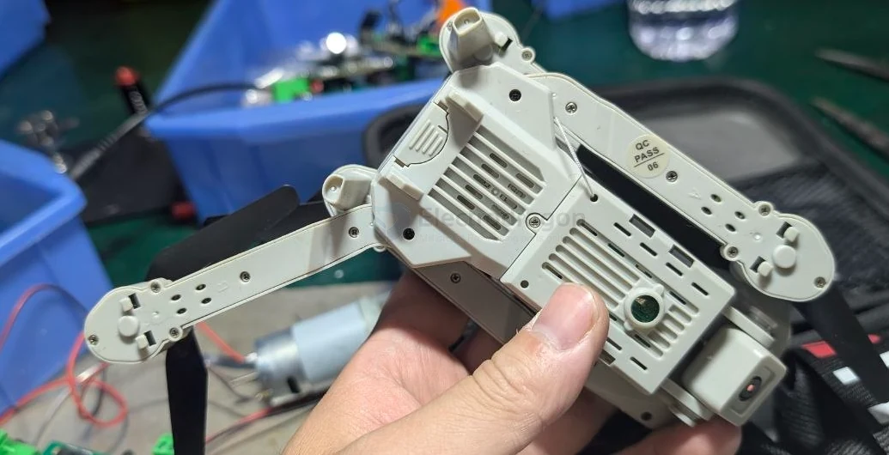
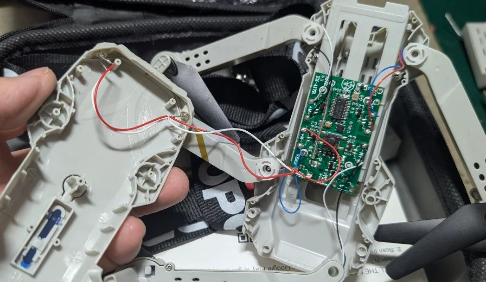
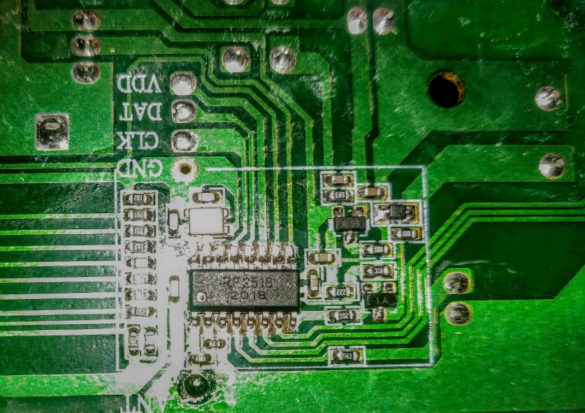
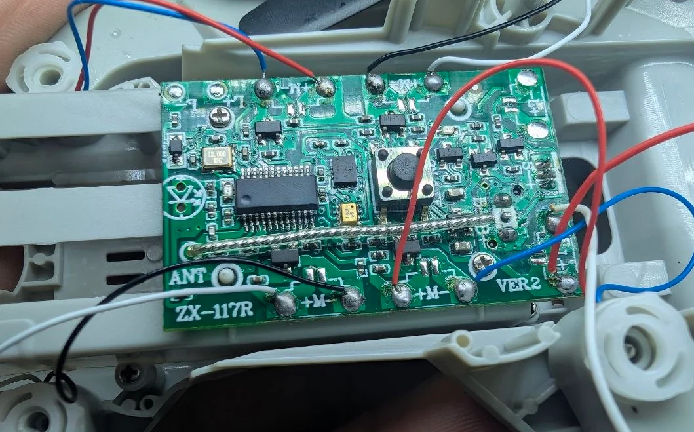
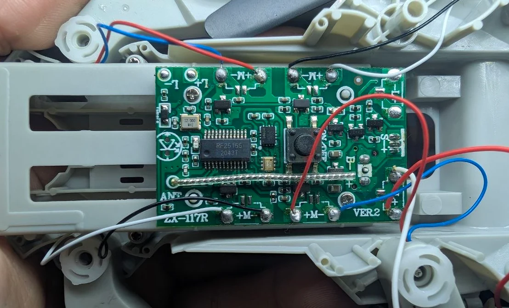
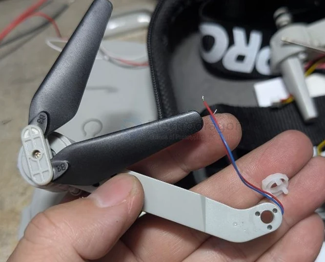
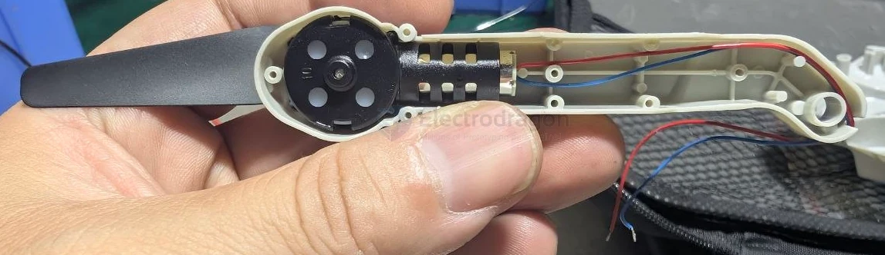
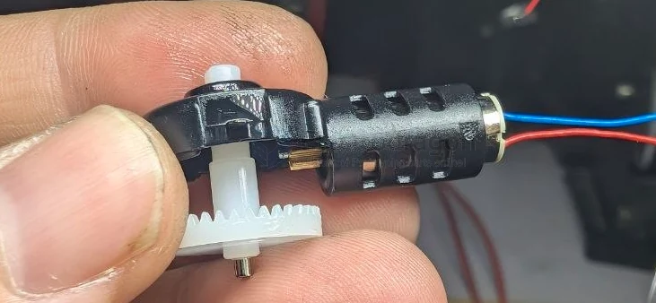
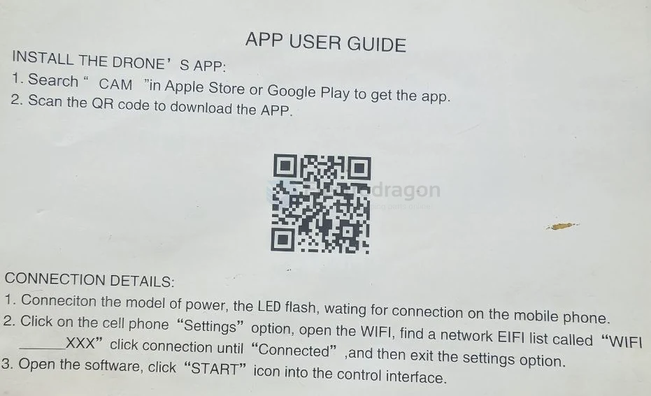

# FPV-toy-dat

- [[FPV-dat]] - [[FPV-toy-dat]]

## tech 

- [[motor-brushed-coreless-dat]] 

- [[camera-digital-dat]] - [[BK7231-dat]] - [[beken-dat]]

- [[rc-protocols-dat]] - [[rc-dat]]

## build 

build 1 

- Transmitter site:
- Chip: RF2518
- Board name: LN1953T2

- Receiver site (2 in 1 Receiver and ESC):
- Chip: RF25155
- Board name: LN1953R2-T

- [[RU307-dat]] - [[ruichips-dat]] - [[mosfet-dat]]

- [[test-point-dat]]

- [[invensense-dat]] - [[FPV-toy-dat]] - [[ICM-14605-dat]] - [[ICM-14604-dat]] - [[IMU-dat]]

ARM 

- [[motor-brushed-coreless-dat]] 

- [[propeller-FPV-dat]]

- [[battery-dat]] - [[battery-li-pouch-dat]]

- [[camera-digital-dat]] - [[BK7231-dat]] - [[beken-dat]]

## ref 

